# MVP-2.7.1 · ChatGPT 风格 Web Chat — 端到端验证报告

2026-11-07/08 · 本机，分支 `MVP-2.7.1`（`cd4f0d2` → `8a57088`），`aiops service`，真实模型（Main = Opus 5.5，Bedrock） · Playwright（Chromium）· 设计：`docs/superpowers/specs/2026-11-07-chatgpt-style-chat-design.md` · 计划：`docs/superpowers/plans/2026-11-07-chatgpt-style-chat.md`

测试账户 `e2e-chat`；评审修复的浏览器复验用了 `e2e-chat2`。两个都是 writer，非管理员，用完即停用。测试会话都开在这两个账户下，临时造的会话用完即删。

## 结论

规定的场景全部通过，另有一项没测，见文末「没验证的」：
- **桌面端 10 项**：富内容渲染、工作过程、刷新后内容一致、脱敏、拖入附件、按键、回到底部、重新生成、深色模式。
- **移动端 7 项**。
- **性能 3 项**。
- **纯文本渠道 1 项**。

E2E 过程中发现 6 个问题，都已修复，每个都先写了失败的测试或实测数据，再修复，见「E2E 中发现并修复的问题」。

## 闸门

| 闸门 | 结果 |
|---|---|
| 后端全量 `pytest tests/`（临时库） | 7360 passed · 99 skipped · 4 failed。4 个失败都与本改动无关：<br>• 2 个 `test_claude5_bedrock_models::TestClaude5SettingsSync`：本机未提交的 `config/settings.yaml`（主人自己的模型选择）；<br>• 1 个 `test_prompt_budget::test_no_cjk_in_base_prompts`：本机未提交的 `reporter_agent.py` 中文提示行；<br>• 1 个 `test_web_tools::test_invalid_headers_json`：本机 DNS 的已知误报。<br>前 3 个在干净的 HEAD 检出上重跑：127 passed |
| 前端 `vitest --run` | 70 个文件，769 个测试全部通过 |
| `tsc --noEmit` | 0 |
| `/tmp` 空目录 `npm ci && npm run build && vitest` | 全部 exit 0；产物里有独立的 `mermaid.core-*.js` |

## 桌面端（1440×900）

| # | 场景 | 结果 | 证据 |
|---|---|---|---|
| 1 | **统计问题出图**：「各严重级别的未关闭健康问题各有多少个，并画成图」 | PASS | 柱状图按真实数据渲染，两个系列，有图例，图例文字用正文颜色，没有 ASCII 图；表格正常；有操作栏和「下一步」建议<br>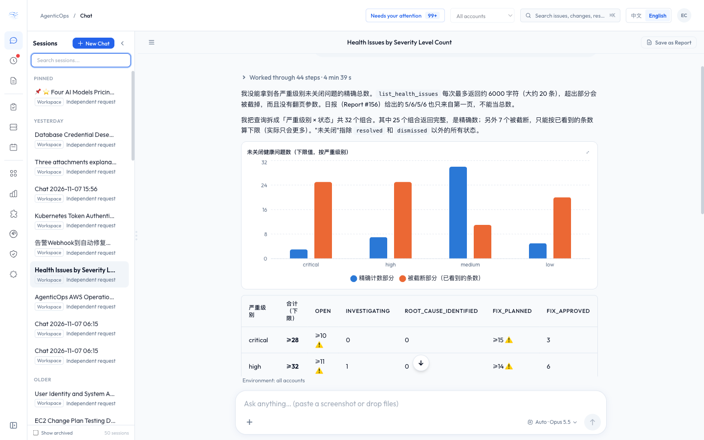 |
| 1b | **工作过程实时显示** | PASS | 运行中逐步出现，每步带摘要（如 `severity=high status=open`）和耗时；完成后收成一行<br>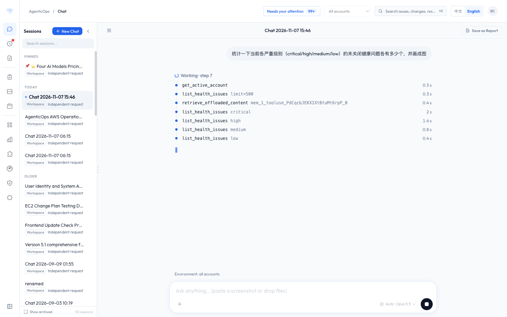 |
| 2 | **流程图**：「一条告警从 webhook 进来到自动修复完成的流程」 | PASS | mermaid SVG 渲染，`.aiops-mermaid svg` = 1，没有 ASCII；点开后可以缩放到 125%，ESC 关闭<br>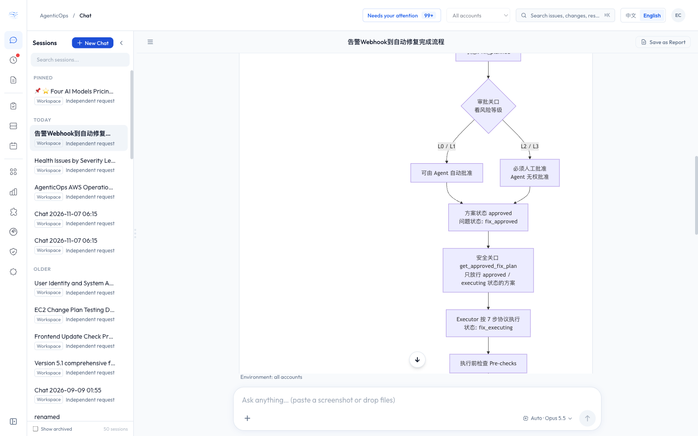 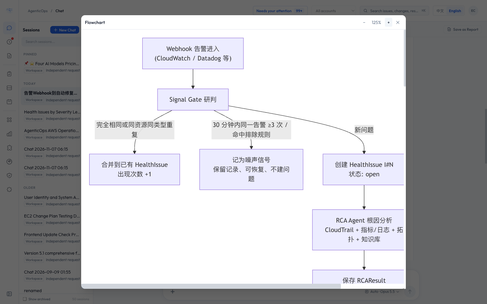 |
| 3 | **markdown 表格** | PASS | 见 1 |
| 4 | **刷新后内容一致** | PASS | 重新载入会话后点开工作过程，前几步（`get_active_account` 0.3 秒、`list_health_issues limit=500` 0.3 秒……）与实时显示一致，数据来自库里的 `tool_calls` |
| 5 | **脱敏** | PASS | 让 agent 调 `search_agent_memory`，传入 `postgresql://admin:S3cretPass42@db:5432/app`：<br>• 工作过程摘要显示为 `postgresql://admin:[REDACTED-SECRET]@db:5432/app`；<br>• 库里 `chat_messages.tool_calls` 中找不到 `S3cretPass42`；<br>• 单元测试覆盖四种写法（`--password` 的值、`aws_secret_access_key <值>`、`Bearer` token、URL 的 `user:pass@`）以及 ARN 不被误盖 |
| 6 | **拖入对话区任意位置**（PNG / PDF / XLSX / EXE） | PASS | 拖到消息区中央就出现淡色提示。放下后：<br>• 附件进到输入框里：图片缩略图带圆形进度，PDF 是红色卡片、XLSX 是绿色卡片，处理完显示「1 page · 1 KB」「5 KB」；<br>• EXE 显示为红色卡片并写明原因；<br>• 计数「3/20 · 6 KB / 200 MB」；<br>• 处理完成前发送键为灰色（`sendDisabledEarly: true`），完成后可用<br>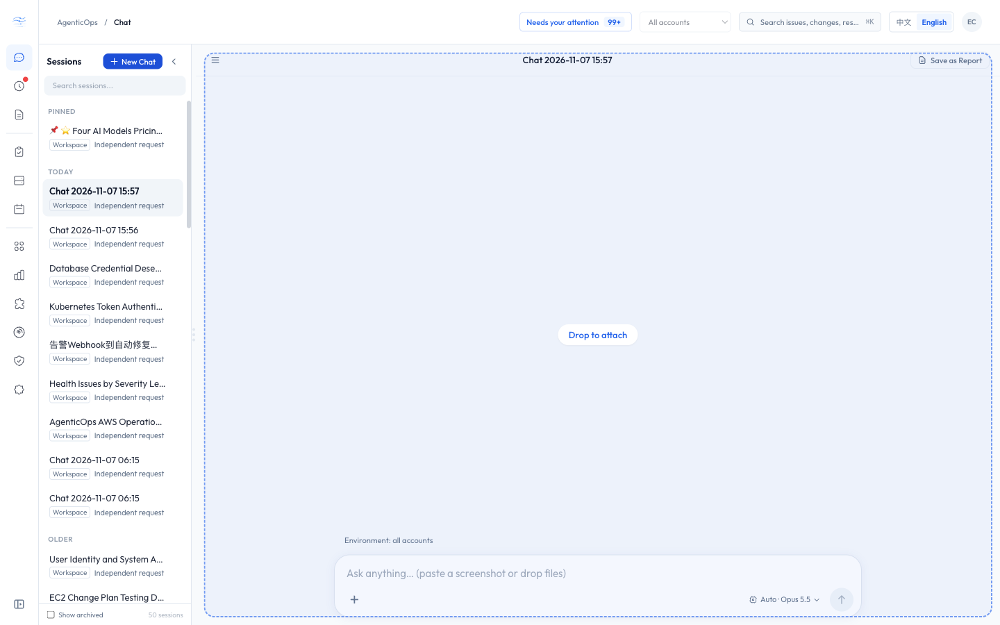 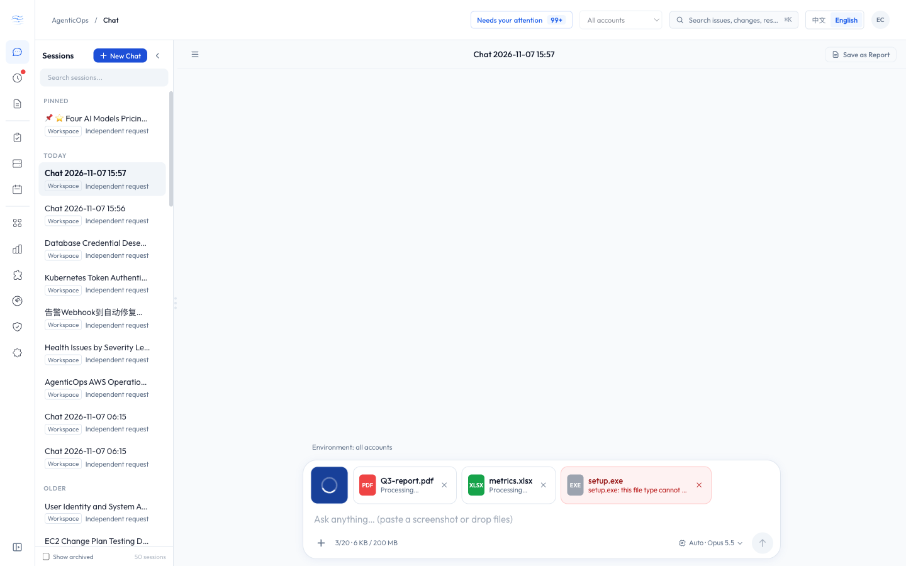 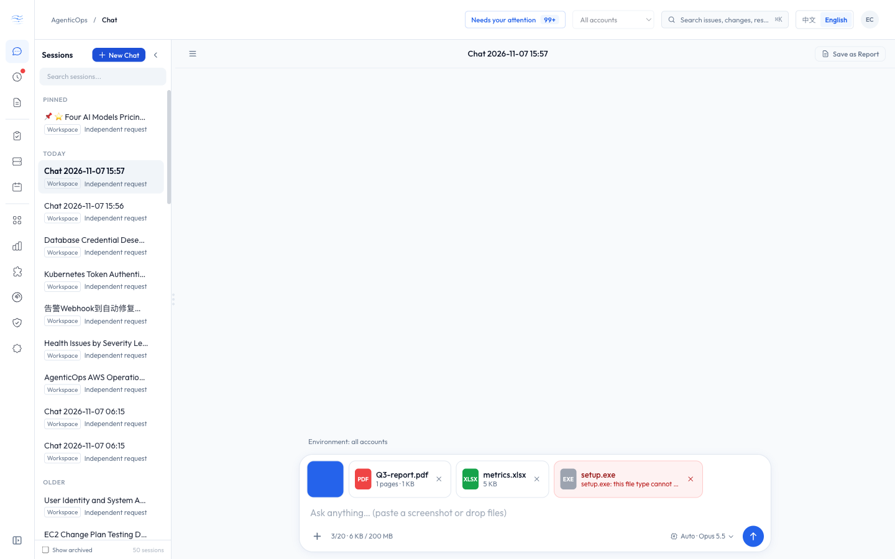 |
| 6b | **带附件发送** | PASS | 模型读了三个附件，并把 XLSX 的数据画成了柱状图<br>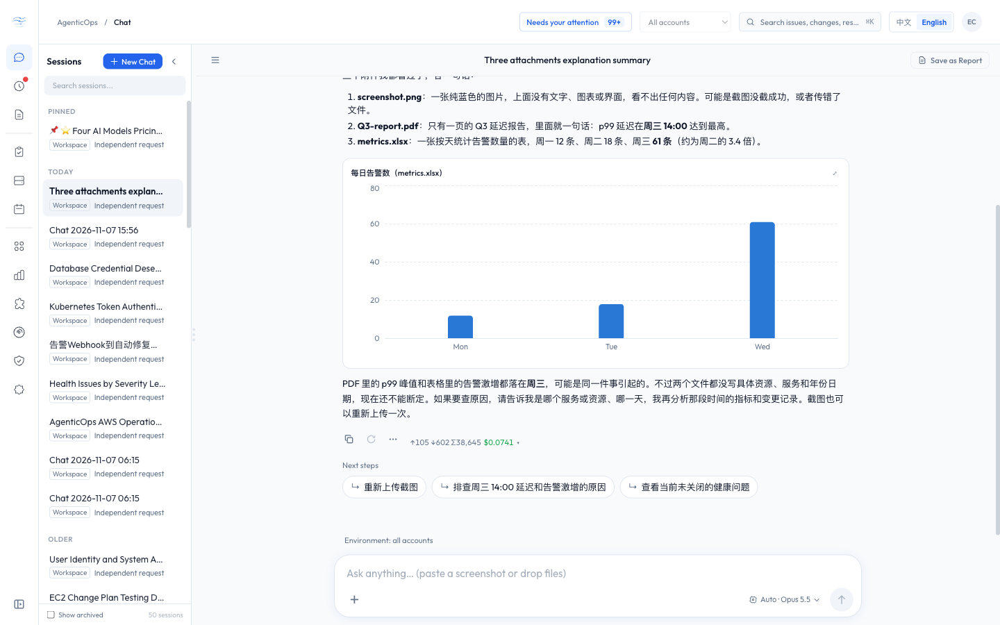 |
| 7 | **按键** | PASS | Shift+Enter 换行；发一个 `isComposing: true` 的 Enter，不会发送；Enter 发送 |
| 8 | **回到底部** | PASS | 向上翻后出现「↓」按钮，点击后回到底部，按钮消失 |
| 9 | **重新生成** | PASS | 最后一条回答可用：点击后再发一次原问题，出现新的用户消息和新回答，重新生成按钮仍只在最后一条回答上。原问题带附件时按钮置灰，提示「The attachments went with the original message — attach them again and send.」 |
| 10 | **深色模式** | PASS | 图表和流程图（mermaid dark 主题）都清晰可读<br>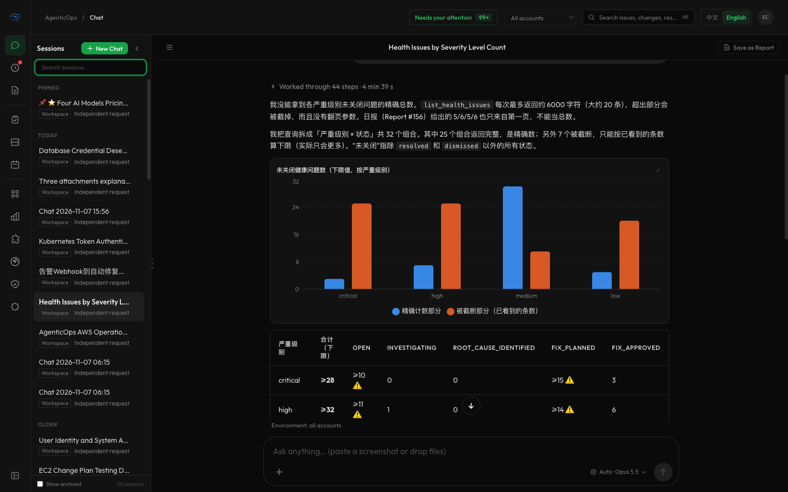 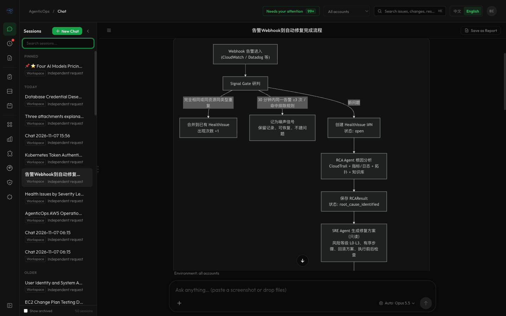 |
| — | **骨架** | PASS | 全局导航收成图标栏；对话列表默认展开；空对话时输入框居中<br>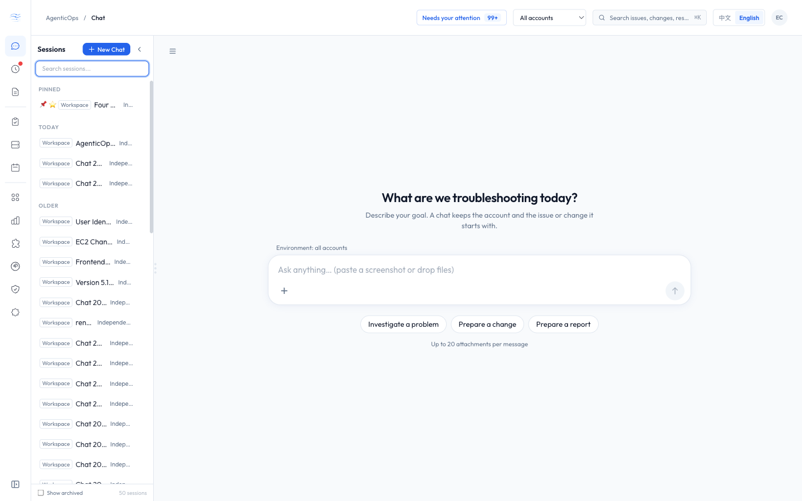 |

## 移动端（390×844）

| 场景 | 结果 | 证据 |
|---|---|---|
| 对话列表抽屉 | PASS | 从左上角按钮打开；选中一个对话后抽屉关闭并跳转<br>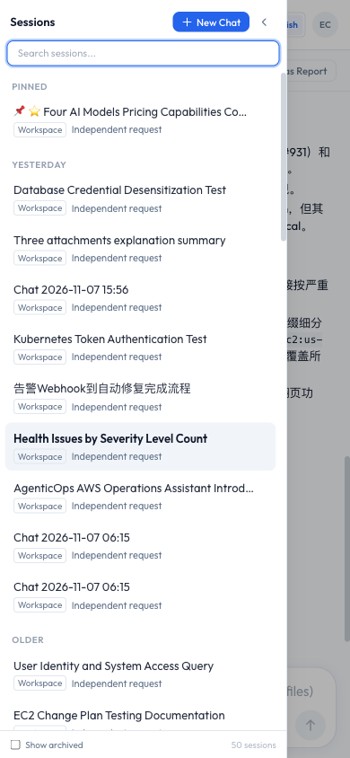 |
| 输入框贴底 | PASS | 输入框在 y≈753，在视口底部<br>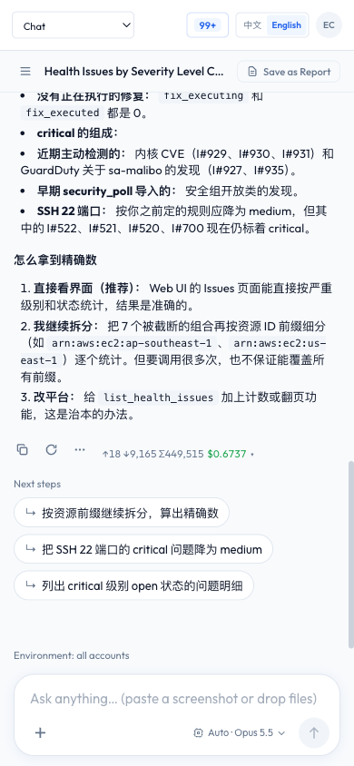 |
| 输入框里的附件横向滚动 | PASS | 附件行 `flex-wrap: nowrap` + `overflow-x: auto` |
| 「＋」菜单 | PASS | 有「Upload files」「Upload images」。「拍照」只在触屏（`pointer: coarse`）下出现，见「没验证的」 |
| 图表 / 流程图适配宽度 | PASS | 图表 100% 宽；流程图缩到 352 px 宽显示，点开可全屏缩放 |
| 大图预览左右滑动 | PASS | 合成 touchstart/touchend 后，`a.png 1/2` 切换为 `b.png 2/2`；同时验证了点输入框里的缩略图能打开预览<br>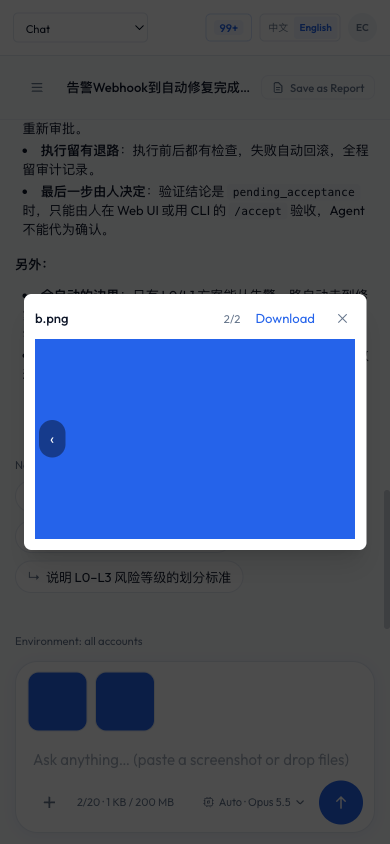 |
| 主要按钮的点击区域 | PASS（修复后） | Send、＋、复制、重新生成、⋯、对话列表都是 44×44 px |

## 性能与按需加载

| 场景 | 结果 | 证据 |
|---|---|---|
| 没有流程图的对话不下载 mermaid | PASS | 新开页面打开统计对话，没有任何 mermaid / flowDiagram / dagre 请求；打开流程图对话时才加载 `mermaid.core`、`flowDiagram`、`dagre` |
| 200 条消息的长对话（临时造数：表格，每 10 条一张图） | PASS（修复后） | 打开时停在底部（距底 1 px）；用鼠标滚轮翻到最顶，200 条全部加载到「问题 0」；滚动过程中行重叠 0 次；回到底部后保持吸底。测试会话已删除（DELETE 204） |

## 纯文本渠道

| 场景 | 结果 | 证据 |
|---|---|---|
| CLI 不出现富块 | PASS | `aiops chat "按严重级别统计…并画出告警到自动修复的处理流程"`：输出里 ```` ```chart ```` 0 处，```` ```mermaid ```` 0 处，CLI 照旧输出纯文本。IM 和定时任务走同一个默认构建（`create_main_agent()` 不带 `rich_output`），`tests/test_main_agent_rich_output.py` 已锁定 |

## E2E 中发现并修复的问题

1. **步骤耗时虚高**（`4256b86`）。
   - 现象：一次并行的 44 个调用，单步耗时显示为 14 秒、13 秒……0.6 秒，总计「4 分 39 秒」，而这一轮实际只用了约 2 分钟。
   - 原因：从模型开始写这次调用时就开始计时；总计又是各步耗时相加。
   - 修复：输入写完、开始执行时才计时，每步记录 `started_ms`；总计改为实际时间跨度。旧消息没有 `started_ms`，仍然相加。
   - 测试：`test_a_step_is_timed_from_when_it_runs_not_from_when_the_model_began_writing_it`，`workTotals` 跨度用例。
2. **对话列表太挤**（`4256b86`）。
   - 现象：220 px 宽时，标签和上下文挤在一行，标题只剩「Chat 2…」。
   - 修复：标题单独一行；可见性标签和上下文放在第二行，用浅色小字；默认宽度改为 260 px。
3. **图例文字用了系列颜色**（`4256b86`）。按 dataviz 规范改为正文颜色。
4. **被拒附件的卡片重复文件名，以及「1 pages」**（`6b4100b`）。测试：`attachments.test.ts`「composer card copy」。
5. **手机上点击区域不够**（`84d3beb`）。
   - 现象：实测 26–38 px，根字号是 15 px，rem 尺寸会缩小。
   - 修复：改成固定的 44 px。
6. **长对话打开时停在半截**（`40ad813`）。
   - 现象：200 条消息的对话打开后，距底部还有 2104 px。
   - 原因：行的实际高度比估计的高（有表格、图表），虚拟列表调整滚动位置时触发的 scroll 事件被当成「用户上翻」。
   - 修复：只有用户手势（滚轮、触摸、按键、指针）才会取消吸底。
   - 测试：`stickToBottom.test.ts`。

## 全分支评审后的修复（`ac1779f`）

由一位全新的评审者看完整个分支，结论：没有 Critical，5 个 Important，10 个 Minor。5 个 Important 都已修复，每个都先写了失败的测试再修复，其中两个另做了浏览器复验：

| 问题 | 修复 | 证据 |
|---|---|---|
| 服务端按 Python 码点计偏移，浏览器按 UTF-16 切分，回答里带 emoji（🔍 🔴）时，过程话和正文的分界会错位 | 服务端改为按 UTF-16 计数 | `test_offsets_count_utf16_units_like_the_browser` |
| 只有一个文本字段且字段名是密钥（`{"password": …}`）时，摘要直接显示原值并写入库 | 先用 `redact_obj` 按字段名盖值，再选摘要 | `test_a_secret_passed_as_the_only_text_field_is_never_the_summary` |
| 显示层脱敏正则在 `a.a.a.…` 这类输入上是平方级耗时：40 KB 摘要要 27 秒，卡住整个单进程 | 给标签匹配加长度上限；摘要先截到 4000 字再跑正则 | `test_the_display_patterns_cost_stays_linear_on_hostile_input` |
| mermaid 的 HTML 标签和 `img:` 形状会加载外站图片，违反「外站图片不自动加载」 | 标签改用 SVG 文本（`htmlLabels: false`）；绘制前去掉 ``（含转义形式）和 `img:` 形状 | 单元测试 + 浏览器复验：恶意源 0 个外站请求、0 个 `foreignObject`，绘制失败后按代码显示；真实的中文多行流程图照常渲染 |
| 回复生成中把文件拖进对话区，浏览器会打开这个文件、离开页面，正在进行的回答被打断 | 文件拖拽一律拦下，只在可用时才添加附件；页面其它位置也拦下 | `fileDragAction` 单元测试 + 浏览器复验：生成中在对话区和侧栏放下文件，事件都被取消，没有添加附件，页面不变 |

修复后的闸门：
- 后端全量：7363 passed · 99 skipped，失败的仍是同样 4 个环境相关用例。
- 前端：vitest 70 个文件 / 773 个测试；`tsc` 0；构建通过。

10 个 Minor 记录在案，没有在这一轮修复，见计划工作区的 ledger：
- 显示层脱敏还漏几种写法；
- mermaid 绘制失败时可能在页面底部留下错误图；
- 「复制为纯文本」会带上按钮文字；
- ⋯ 菜单里的「存为报告」保存的是整段对话；
- `enhanced_task` 的标签固定写着 Claude Code；
- 虚拟行重新挂载后，工作过程的展开状态会丢；
- 过程话不渲染 markdown；
- 缓存不回收；
- 没有去掉 front-matter 配置；
- 附件的 ✕ 只有 20 px。

## 追加：模型流读超时与思考摘要（2026-11-08，`743a434..de9b86f`）

修复的是一个会话一连三轮「回复失败」：它分析 HTML 时用的是 Fable 5.1 + effort max。根因与实测数据见 `MVP-2.7.1-RELEASE.md`「模型流读超时与思考摘要」。验证时先重启了本地服务，用一次性的管理员账户 `e2e-admin3`，用完已停用。

| 场景 | 结果 | 证据 |
|---|---|---|
| 「模型连接」卡片 | PASS | Settings → 通用 里把等待上限从 600 改为 900 并保存：<br>• 卡片显示「已改」标记，以及修改人和时间；<br>• `audit_logs` 记一行 `update`（600 → 900）；<br>• 「恢复默认」后再记一行 `reset`，值回到 600。<br>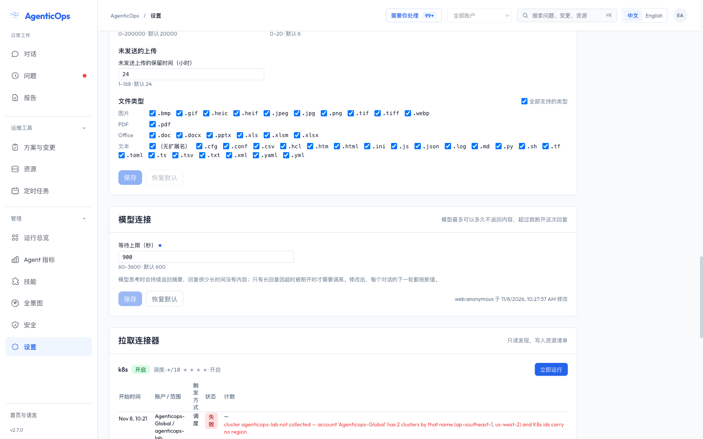 |
| 思考摘要不断流 | PASS | 用 `curl` 抓同一轮的原始 SSE（Fable 5.1、effort max、Max tokens 16384，请模型列出八皇后的全部 92 个解）：<br>• 共 695 个 `thinking` 帧，第一个在 33.7 s（主要是约 28 s 的 agent 构建）；<br>• 之后帧与帧之间**最大间隔 5.9 s**；<br>• 读超时从未触发 |
| 用完输出上限 | PASS | 同一轮在 208.7 s 结束，收到 `error {code: "max_tokens"}`。存库的失败消息显示：「模型在思考时用完了输出上限（Max tokens）……可以在 Settings → 通用 → Agent 模型 调高 Main 的 Max tokens，或降低 effort。」<br>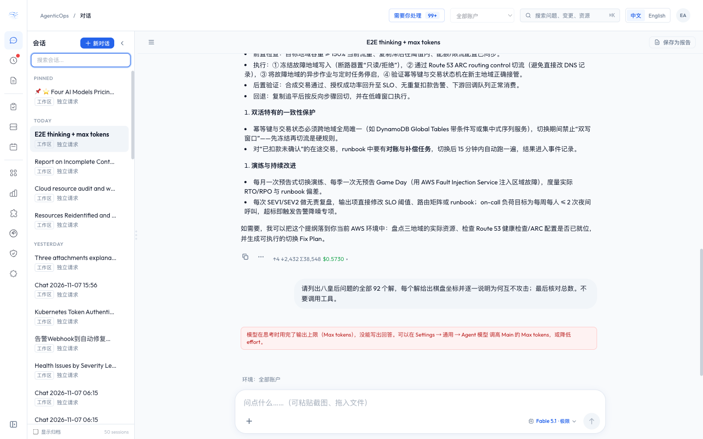 |
| 调高 Max tokens 后完整回答 | PASS | Main 的 Max tokens 调到 64000 后，发了一个同样需要长时间推敲的请求（季度故障切换演练计划，Fable 5.1 max）：<br>• 139 s 完成，输出 6528 token；<br>• 生成过程中显示实时的「思考中… …Application Recovery Controller, and Well-Architected reliability pillar guidance…」，过长时从左边截断。<br>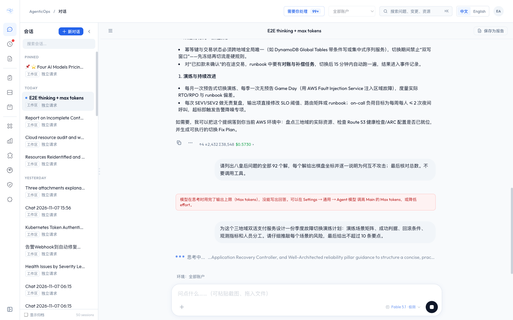 |
| 历史重建 | PASS | 造了一个会话，旧回复的 `tool_calls` 里有 `Read File`、`Load skill`、`Terminal`，然后发「hi」：<br>• 日志里是 `Restored 3 messages`，`invalid tool name pattern` 为 0 条；<br>• 测试会话已删除 |
| 收尾 | — | • Main 的 Max tokens 恢复默认（0 = 16384）；<br>• 本机 `config/settings.yaml` 按备份逐字节还原（sha1 `7872e30…` 一致）；<br>• 「模型连接」已恢复默认 |

本轮闸门：
- 后端全量：7390 passed · 99 skipped · 5 failed。其中 4 个是已知的环境问题；另 1 个是 `test_change_intake[from-the-future]`，单独跑 30/30 通过，与本次改动无关，属于全量运行时的偶发失败。
- 前端：vitest 71 个文件 / 780 个测试，`tsc` 0，构建通过。
- 真实模型花费：诊断（两次重放 + 三组探测）约 3.3 美元，E2E 约 2.5 美元。

本轮发现的测试问题，已修复（`dcc4aae`），修复后全量 7395 passed，只剩 4 个已知环境用例失败；真实 `logs/backend.log` 没有一行测试输出，也没有再轮转：
- **测试覆盖服务日志。** 服务日志改为写到 `settings.log_dir`（默认 `<项目>/logs`，可用 `AIOPS_LOG_DIR` 覆盖），同一文件的处理器只挂一次；`tests/conftest.py` 把它指到临时目录。以前全量测试会把正在运行的服务的 `logs/backend.log` 轮转掉，11-08 早上那段服务日志就是这样丢的。
- **测试相互污染。** `test_session_history` 在任何 mock 之前先 import `chat_dispatch`。原来它在 mock 期间被首次 import，留下了假的 `get_db_session`，导致之后的聊天测试失败。
- **测试写进环境数据库。** `test_multi_cloud_api` 的账户接口原来写进 `AIOPS_DATABASE_URL` 指定的库，同一个库跑第二次就 409；现在用测试自己的临时库。

## 追加：OpenAI 模型的推理参数、被拒请求的原因、SQLite 锁（2026-11-08）

修复的是：GPT-6 Astra 加任意一个 effort，每一轮都「回复失败」；以及开发机 14:31 一轮对话以 `database is locked` 失败。根因与实测见 `MVP-2.7.1-RELEASE.md`「OpenAI 模型的推理参数、被拒请求的原因、SQLite 锁」。

验证在本机服务上做，用一次性的管理员账户 `e2e-admin4`，用完已停用。顺序是：先只上「被拒原因」和 SQLite 两项，用旧的推理参数复现失败；再上推理参数的修正。

| 场景 | 结果 | 证据 |
|---|---|---|
| 被拒的请求显示原因（生成时） | PASS | GPT-6 Astra + 极限，用旧的推理参数：失败消息和输入框上方的横幅都显示「模型拒绝了这次请求。原因：Unknown parameter: 'reasoning_effort'.」<br>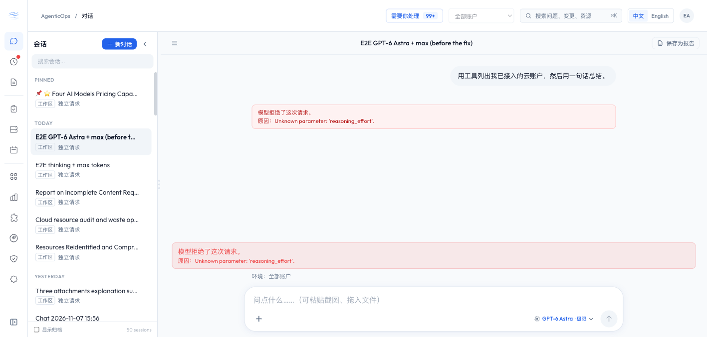 |
| 被拒的请求显示原因（重新打开） | PASS | 刷新后，存下的失败消息仍显示原因（`token_usage.error_code = request_rejected`，`error_detail` 就是上面那句）<br>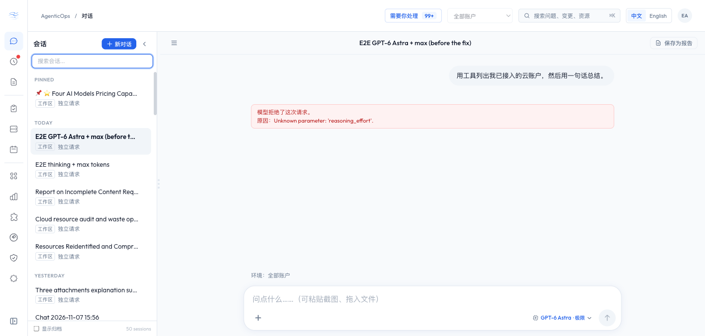 |
| GPT-6 Astra + 极限，修正后 | PASS | 同一会话重发：完成，调了 `get_active_account`、`list_cloud_accounts`，回答是账户表格。基于上一轮历史的追问 5 秒完成。<br>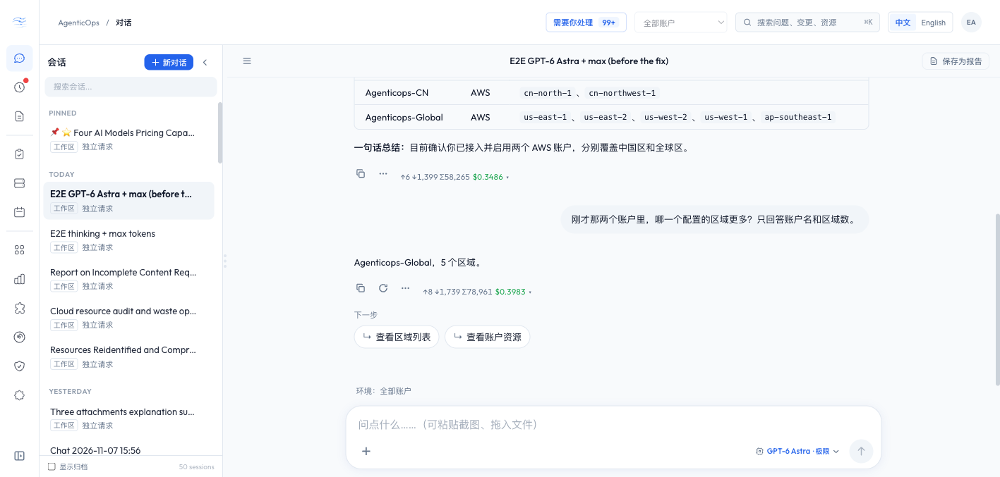 |
| GPT-6 Astra + 浅度 | PASS（请求） | 在界面里把 effort 改为「浅度」后，这一轮完成。但模型调了 10 次 `list_health_issues` 仍没数清，回答「无法确定（工具结果被截断）」。这就是下文已记录的「`list_health_issues` 无法统计总数」，不是这次的问题 |
| gpt-oss-120b + 极限 | 先 FAIL，修正后 PASS | 第一次按「所有家族都到 max」发出 `reasoning_effort: max`，被拒：「'reasoning_effort' value 'max' is not supported by this model」。新的原因提示让问题一眼可见。逐档实测后，gpt-oss 截到 high，重跑完成（31 s，含 agent 构建） |
| GPT-5.6 Terra + 深度 | PASS | 完成，3 s |
| GPT 5.5 + 极限 | PASS | 实际发的是 xhigh（5.5 不支持 max），完成，6 s |
| 全部 OpenAI 型号 × 四个档位 | PASS | 选择器里的 14 个 OpenAI 型号，乘以浅度 / 深度 / 超深 / 极限四档，都经真实的 `resolve_thinking_budget` → `thinking_fields_for_budget` → `bedrock_model_kwargs` 生成请求，直接调 Bedrock：56 / 56 成功 |
| SQLite WAL | 本机无法验证切换 | 本机库原本就已是 WAL：设置存在库文件里，不清楚之前是谁设的，所以在本机看不到切换。开发机现在是回滚日志模式，部署后在那里验证 |

## 没验证的

- **移动端「拍照」菜单项。** 它只在 `pointer: coarse`（触屏）下出现，Playwright 调整窗口大小模拟不出触屏，需要在真机上看一下。
- **IM / 定时任务的真实回答。** 这两条路径的提示词与 CLI 是同一个默认构建，已由单元测试锁定，没有真的发一条飞书消息或跑一次定时任务。

## 顺带观察到的（不在本次范围，供主人决定）

- **`list_health_issues` 无法统计总数。** 结果超过约 6000 字符会被截断，而且不能翻页。为了统计总数，模型把查询拆成了 32 个组合，这一轮跑了约 2 分钟、44 步。模型自己的建议是给这个工具加计数和分页。
- **模型对「带凭证样子的命令」会返回空回答。** 让 agent 执行 `kubectl get ns --token=FAKE-…` 时，模型输出 0 token，库里存了一条空的已完成回答，界面上什么也不显示。这是 S5 起就有的行为：空回答没有提示。
- **嵌套列表。** 自研 markdown 渲染器不支持嵌套列表，子项会被拉平。
- **CLI 输出末尾。** headless 模式下回答末尾会原样带上 `<<SUGGEST>>[…]` 那一行。这是现有行为。
