# MVP-2.8.0 E2E 报告

每个阶段跑完都在这里追加一节。只追加，不改写前面的内容。

## S1（2026-11-09）

### 环境

- 代码：worktree `.worktrees/mvp-2.8.0`，分支 `MVP-2.8.0`。前端用 worktree 自己 `npm run build` 出来的 dist。
- 实例：一个独立的 uvicorn 进程，地址 `127.0.0.1:8001`，`--workers 1`，环境变量设为：
  - `AIOPS_DATA_DIR=/tmp/aiops-280-e2e/data`
  - `AIOPS_DATABASE_URL=sqlite:////tmp/aiops-280-e2e/agenticops.db`
  - `AIOPS_LOG_DIR=/tmp/aiops-280-e2e/logs`
  - `AIOPS_API_AUTH_ENABLED=true`
- 数据库：本地 `data/agenticops.db` 的副本。
  - 用 sqlite 的在线备份 API 从只读打开的源库复制：源库是 WAL 模式，直接 `cp` 可能漏掉还在 `-wal` 里的提交。
  - 副本里的 17 个定时任务全部停用，所以这个实例的调度器什么都不会跑。
  - 主人正在运行的 :8000 服务、真实数据库和主检出都没有碰。
- 账户：`e2e-admin`（管理员）、`e2e-viewer`（只读）、`e2e-editor`（只读，能只读打开 Settings）。都是用 `aiops users create` 在副本库里建的。
- 浏览器：Playwright，时区 `Asia/Shanghai`，界面语言中文。宽度 1440 / 390 / 320 px。

### 结果

| # | 检查 | 结果 | 证据 |
|---|---|---|---|
| 1 | 安全页正常加载 | PASS | 六个模块都有内容；趋势显示「最近 30 天没有评分记录」，是请求成功后的空状态 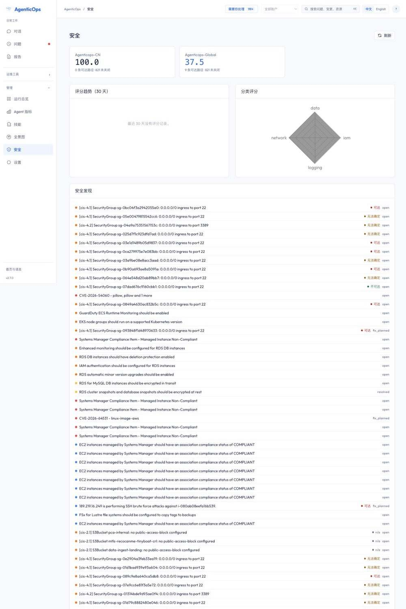 |
| 2 | 拦截 `/api/security/findings` 返回 503 | PASS | 只有发现模块显示「加载失败 · Service Unavailable」+「重试」，其他模块照常显示 |
| 3 | 拦截 `/api/security/recommendations` 返回 `[]` | PASS | 显示「没有待处理的建议。」，是空状态，不是错误 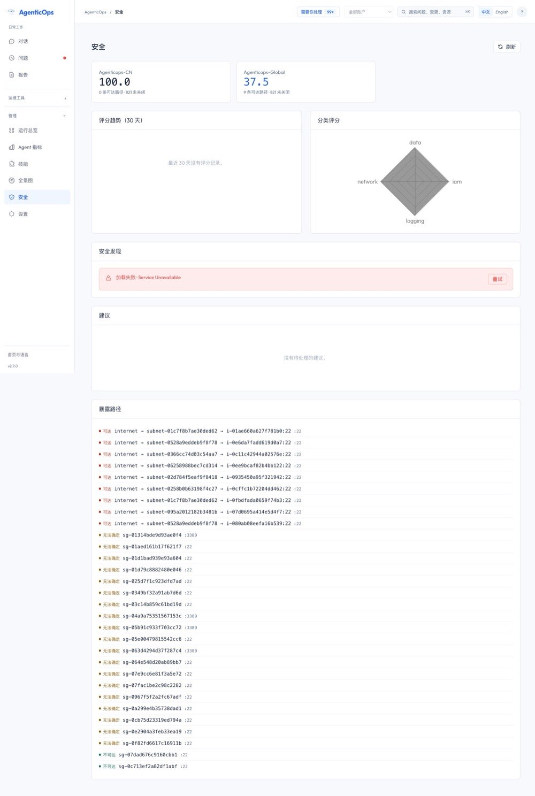 |
| 4 | 先加载成功，再让刷新失败 | PASS | 继续显示旧的发现，上方是「刷新失败，正在显示上次成功获取的数据 · 数据截至 23:48 UTC」+「重新获取」 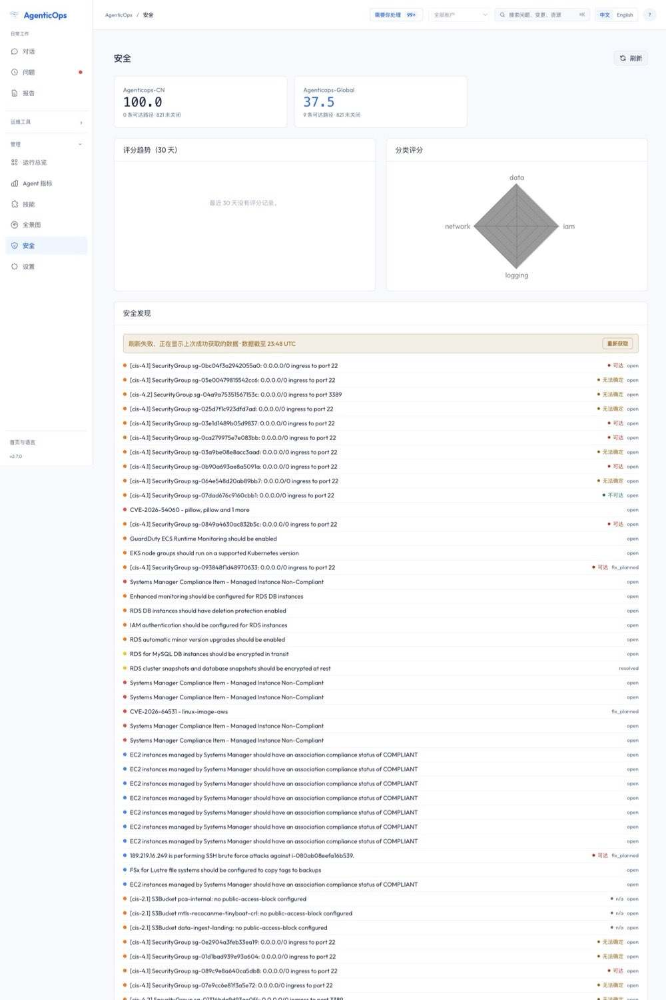 |
| 5 | 慢网络：发现接口延迟 4 秒 | PASS | 发现模块显示「加载中...」，别的模块已经显示内容 |
| 6 | 长标识符标题：I#374（标题是一整串 ARN）和计划 #148 | PASS | 390 / 320 px 下 `scrollWidth == clientWidth` 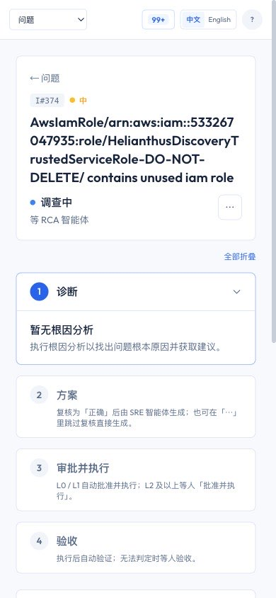 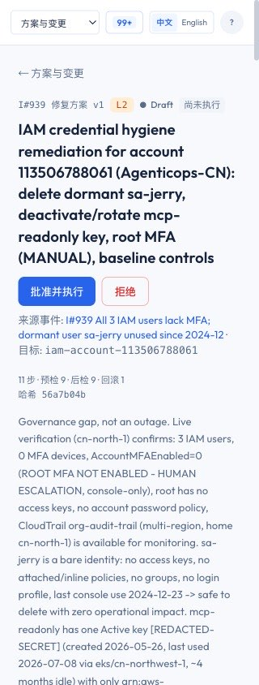 |
| 7 | 改到的 8 个页面在 390 / 320 px 下都没有整页横向溢出 | 修复后 PASS | 页面：问题、计划、安全、定时任务、任务详情、设置、报告、对话。第一轮实测有 4 个页面溢出：计划里的长命令文本（多出 10–54 px）、Schedules 页头（多出 16–86 px）、Settings 的 Galaxy 模型行和连接器表（多出 61 px）、Reports 页头（多出 17 px）。修复在 `c54abba`，复测全部为 `scrollWidth == clientWidth` |
| 8 | 聊天输入区（R04） | PASS | 390 px 下文本框宽 336 px（≥ 300），320 px 下 266 px（≥ 250）；输入长中文加一段多行代码后，页面没有横向滚动 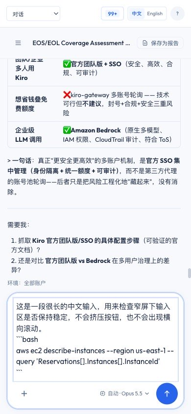 |
| 9 | 设置开关，管理员 | PASS | 13 个 `role=switch`，每个都有名称（Auto RCA、Auto Fix Pipeline、Executor……）。聚焦后按 Space 切换为 false，再按一次回到 true。焦点环可见 |
| 10 | 设置开关，`e2e-editor` | PASS | 13 个开关都是 `:disabled`（外层是 `fieldset disabled`），按 Space 不改变状态 |
| 11 | 全局搜索：键盘全流程 | 修复后 PASS | Enter 打开后，焦点在 combobox 上。输入「security」后，播报「20 条结果」。按 ↓↓，`aria-activedescendant` 指向 `role=option`、`aria-selected=true` 的那一行。Tab / Shift+Tab 都留在弹层内。按 Esc 关闭。 第一轮实测：关闭后焦点落在 `<body>`。原因是 Radix 把焦点还给 `Dialog.Trigger`，而这个弹层没有 Trigger。修复在 `eeeacdf`（打开时记下来源元素），复测焦点回到搜索按钮。输入「374」再按 Enter，跳到第一条结果 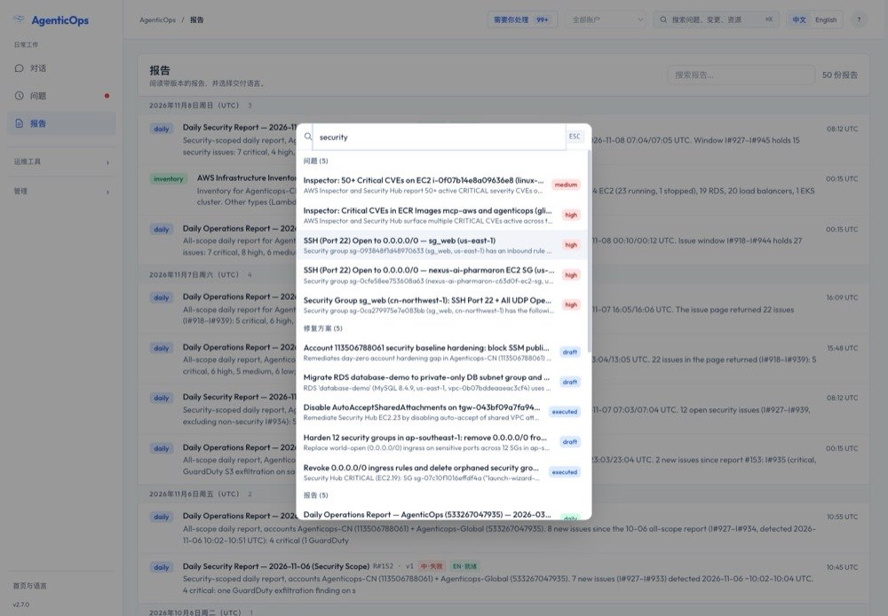 |
| 12 | 全局搜索：拦截 `/api/search` 返回 503 | PASS | 显示「搜索失败」+「重试」，读屏播报「搜索失败」，不显示「没有找到」 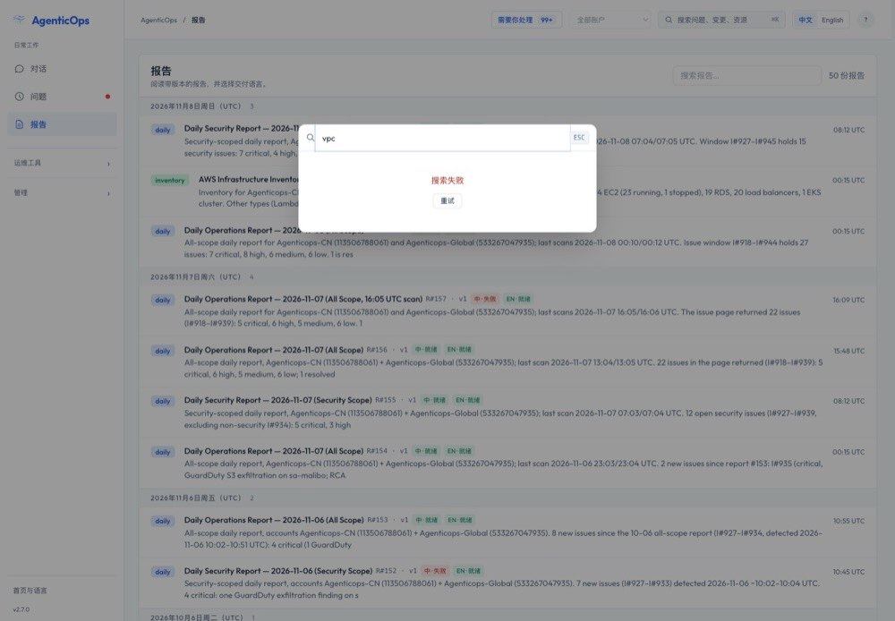 |
| 13 | 定时任务列表 | PASS | 新建一个停用、从没跑过的任务：「已停用 · 尚未运行 · 还没有执行记录」，运行时间为「—」。 `k8s-discovery`：「失败」+ kubectl 的错误摘要。 一次性任务：「一次性」，不再显示「Running / Completed」。 `security-incremental-poll` 显示「结束于 Sep 3」：这是数据库里真实的最新一条，这个任务在本地 9 月 3 日之后没再跑过，84 条记录里最新的就是这条 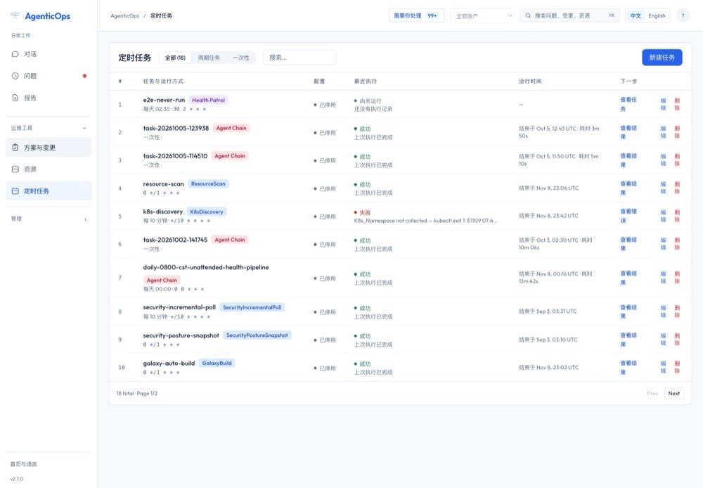 |
| 14 | 任务详情的「立即运行」 | PASS | `k8s-discovery`：点了之后先显示「已提交，等待执行记录」，随后出现 `#2285 运行中`（页面自动刷新出来的），跑完后是「失败」，带错误；列表里同一行也是「失败」 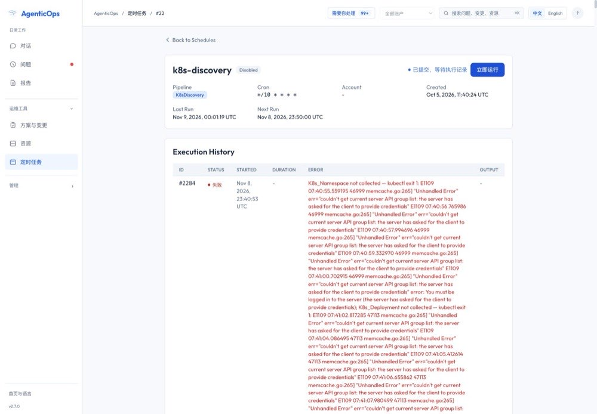  |
| 15 | 没有 outcome 的历史工具步骤 | PASS | 会话「EOS/EOL Coverage Assessment Needed」里有 11 条旧的工具调用。展开工作过程后，那一步是灰点 +「结果未知」，以前是成功色的蓝点 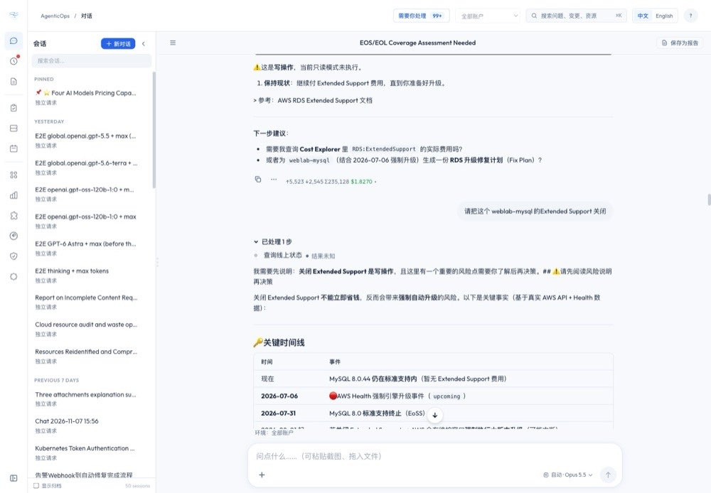 |
| 16 | 报告列表按 UTC 日分组 | PASS | 浏览器时区是 `Asia/Shanghai`，分组标题却是「2026年11月8日周日（UTC）」这样的 UTC 日。R#157 创建于 UTC 11-07 16:09（上海已是 11-08 00:09），它在「2026年11月7日周六（UTC）」组里，时间显示「16:09 UTC」 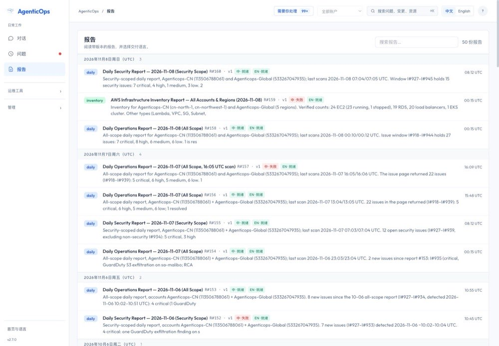 |

### 跑 E2E 时发现并修复的问题

1. **长文本把页面撑宽**：计划里的长命令、两个页头、Settings 的两处在 320 / 390 px 下撑宽页面。修复在 `c54abba`，复测见第 7 项。
2. **全局搜索关闭后焦点丢失**：落到 `<body>`。修复在 `eeeacdf`，复测见第 11 项。
3. **一次性任务的说明后面多了一个分隔符**：显示成「一次性 ·」。修复在 `bbfa0cb`。

### 整个分支评审之后的修复（2026-11-09）

修复前先复现，修复后用同一个 E2E 复测。纯函数的问题先补单元测试（先失败、再通过）。

| 评审项 | 修复前 | 修复后 |
|---|---|---|
| 某一轮回复失败或中断后，存下的步骤还是「运行中」 | 一直转圈 | 写「结果未知」（`workSteps.test` 先失败、再通过） |
| 每周的 cron 说错了星期几 | 「每周一」：调度器把 cron 的星期几按 Python 的 `weekday()`（周一为 0）比对，所以 `0 9 * * 1` 实际在周二运行 | 不再给出星期几的说法，只显示表达式（`scheduleRows.test` 先失败、再通过）。调度器本身没改，等主人决定 |
| 任务详情的执行记录请求失败 | 「No executions yet.」 | 「加载失败 · down」+「重试」 |
| 消息设置里的发送记录请求失败 | 「No delivery logs yet.」 | 「加载失败 · down」+「重试」 |
| 定时任务列表刷新失败（删除一个任务后，重新取列表返回 503） | 整张表被错误页替换 | 10 行照常显示，上方提示「刷新失败，正在显示上次成功获取的数据 · 数据截至 …」 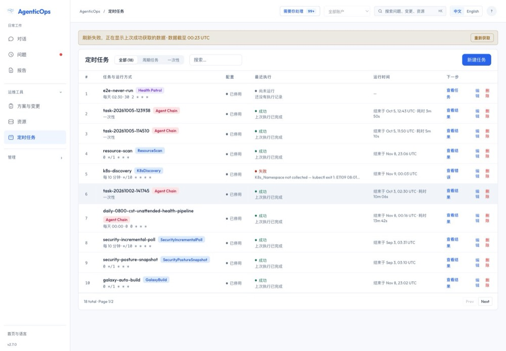 |
| 报告列表刷新失败 | 同上，整页被错误替换 | 同上，保留旧数据并提示 |
| 任务表单里「启用」开关的名称 | 「On」 | 「Enabled」，On / Off 只作视觉文字 |
| 320 px 下问题页的主按钮 | 和状态文字挤在同一行，状态文字只剩 184 px 宽 | 按钮单独换到下一行，状态文字宽 230 px，没有溢出 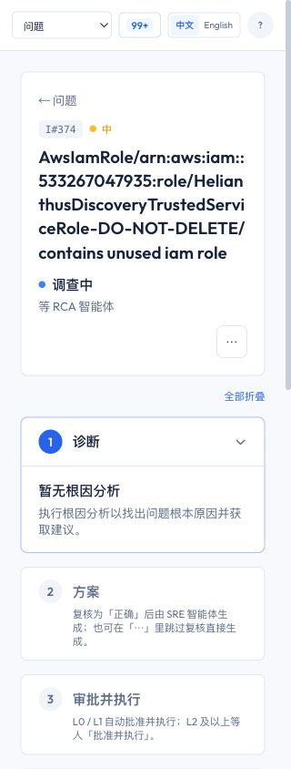 |
| 任务表单里的「下次运行」预览 | 按浏览器时区显示，没有标注 | 「Nov 9, 09:00 UTC」 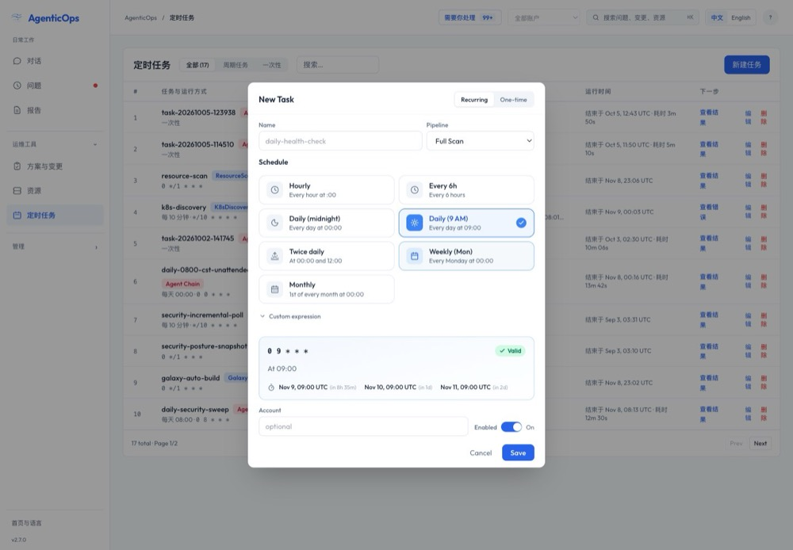 |
| `GET /api/schedules/{id}/executions` | `async def`，而任务详情页每 3 秒轮询一次 | 改为普通 `def`（新加的测试先失败、再通过） |
| 输入法选词时按 Enter | 会直接打开搜索结果的第一条 | 被忽略（`isComposingKey`，和输入框共用，单元测试先失败、再通过） |

修复后，8 个页面在 390 / 320 px 下都没有整页横向溢出。

### 看到了，但不属于 S1（留给后面的阶段）

- 账号卡片：
  - `Agenticops-CN` 显示 100.0 分：采集失败时的假满分，S3 修；
  - 两个账号都显示「821 未关闭」：这是全局数，S3 修。
- 雷达没有标明属于哪个账号；有的暴露路径可达性是原始值 `n/a`：S3。
- 设置项名称是英文：S8。

## S2（2026-11-09）

### 环境

和 S1 相同：
- 同一个 :8001 实例；
- 同一份数据库副本，定时任务全停，开启认证；
- 同样的三个账户；
- 前端用 worktree 自己构建的 dist，每次修复后都重新构建再复测。

**造数据的地方（只在副本库里）**：副本里只有一条在等验收的执行：I#934 的执行 #37（计划 #145，6 个检查里 pc-5 报了警告、pc-6 没有结果）。第一轮验收把它用掉以后，为了再测焦点和「已处理」，在副本库里把它改回等待验收，改了两次：
- `fix_executions.verification_status = 'pending_acceptance'`，清空 `accepted_*`；
- `health_issues.status = 'fix_executed'`。

### 结果

| # | 检查 | 结果 | 证据 |
|---|---|---|---|
| 1 | 工作台标签的数量 | PASS | 全部 134 = 待批准 111 + 待验收 1 + 执行失败 13 + 待确认 9，和 `GET /api/ui/attention` 的 `counts` 一致；每个标签下的行数等于它的数量 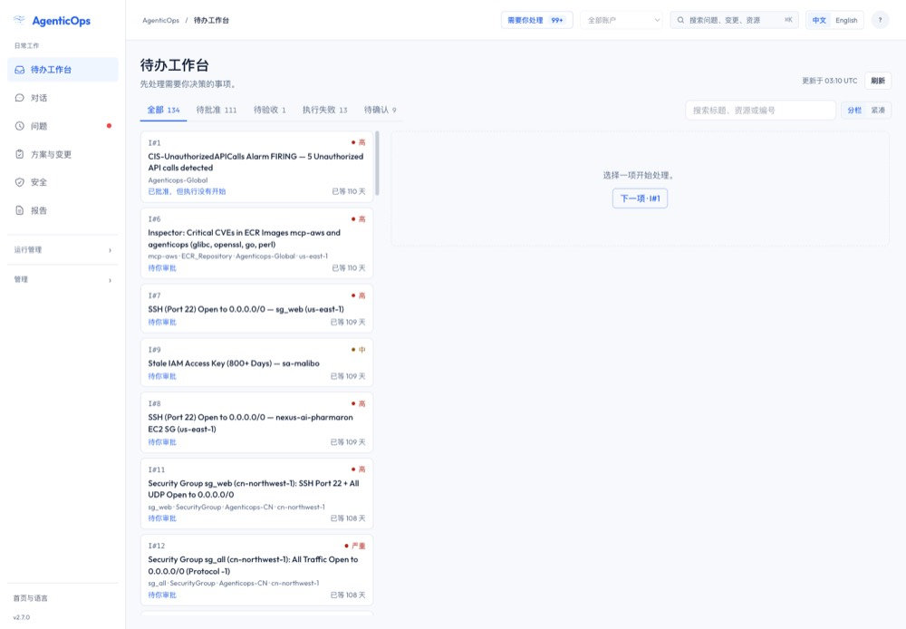 |
| 2 | 顶栏「需要你处理」 | PASS | 是一个指向 `/app/inbox` 的链接，页面上不再有原来的弹层 |
| 3 | 侧栏 | PASS | 日常工作 6 项：待办工作台、对话、问题、方案与变更、安全、报告。往 `aiops-nav-order-v2` 写一份 S2 之前的顺序（日常工作：报告、对话、问题；运维工具：定时任务、方案与变更、资源），刷新后日常工作是：待办工作台、报告、对话、问题、方案与变更、安全。待办工作台排第一，用户原来的先后保留，挪了组的条目进了新组 |
| 4 | 搜索和标签写进 URL | PASS | 搜「I#877」→ `?q=I%23877`，只剩 1 行，标签变成「全部 1 · 待确认 1」，其余为 0。点「待确认」→ `?decision=confirm&q=I%23877`；浏览器后退 → 回到 `?q=I%23877` |
| 5 | 刷新后选中项还在 | PASS | `?decision=acceptance&item=I934` 刷新后 URL 不变，右侧仍是 I#934（能直接点它的「接受结果」） |
| 6 | 1440 px 分栏、等验收的事项首屏 | 修复后 PASS | 右侧不用滚动就能看到：状态行和「接受结果」、步骤条、当前责任 / 等待时长 / 计划版本、「10 / 10 步完成」、「Plan #145 · v1 · hash ba312f1d · 与批准内容一致」、6 个检查（待核对和警告在最前）、「展开检查记录与计划依据」。第一轮实测这 6 个检查的长文本把「待核对」挤到了首屏以下，修复见下 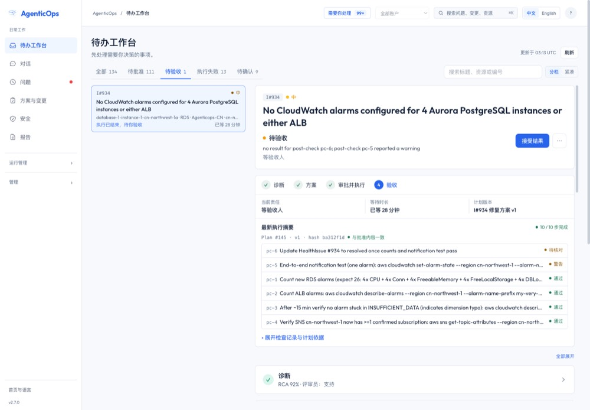 |
| 7 | 验收对话框 | PASS | 「验收本次执行」，「Plan #145 · v1」和「与批准内容一致」；勾选框是 pc-5（警告）、pc-6（没有结果）和最后一项总的确认。三项全勾上之前「确认验收」不能点。确认后，审计里的 `execution.accepted` 记着 `confirmed_checks: ["pc-5","pc-6"]`，两次验收都是 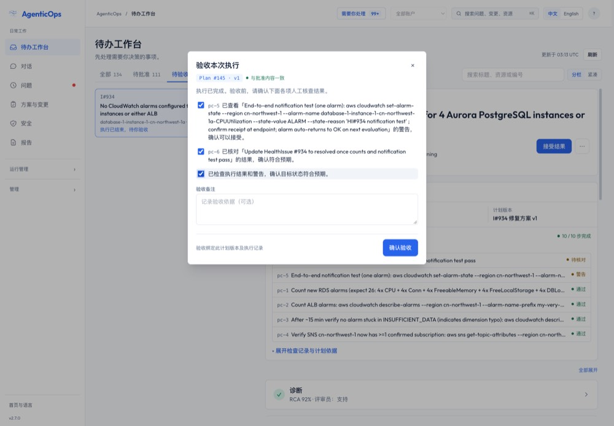 |
| 8 | 验收对话框的焦点 | 修复后 PASS | 打开后焦点在弹层内；连按 12 次 Tab 仍在弹层内；按 Esc 或点 × 关闭后，焦点回到「接受结果」（问题页和工作台都测了）。第一轮实测焦点落在 `<body>`，修复见下 |
| 9 | 选中的事项刚被处理完 | PASS | 在工作台里验收 I#934 之后，右侧写「这项已经处理，或已不再等你。」；待验收标签变成 0，没有下一项，所以不显示「下一项」 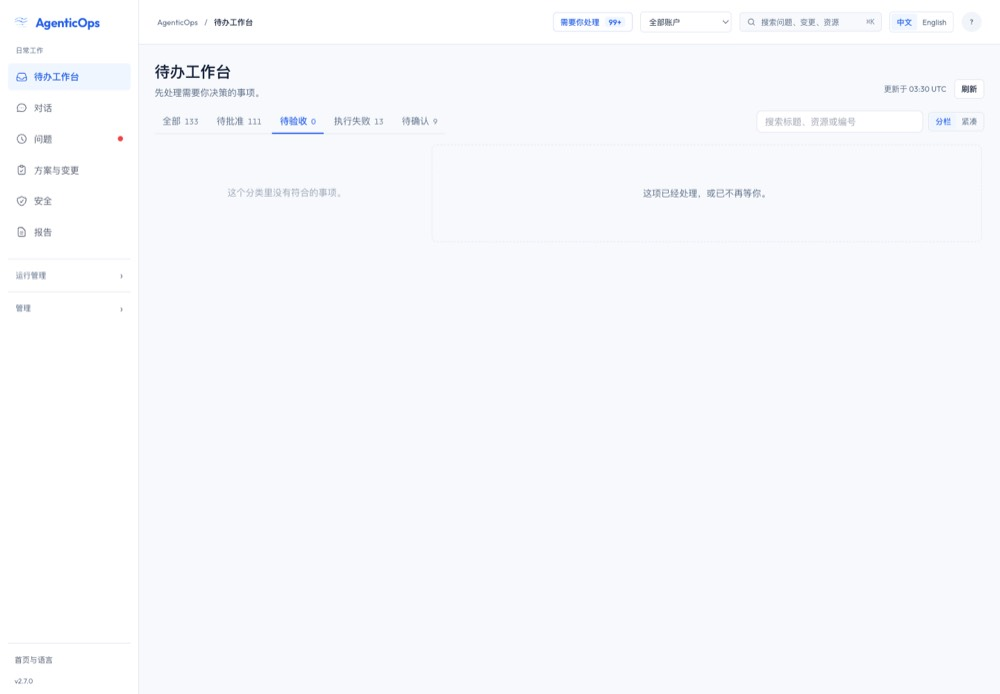 |
| 10 | 390 px：列表和详情轮流占满屏幕 | 修复后 PASS | 点一行，详情占满屏幕，顶部是「← 返回待办列表」。第一轮实测这里写的是「← 问题」，修复见下。返回后回到同一个标签，滚动位置 y = 600 不变 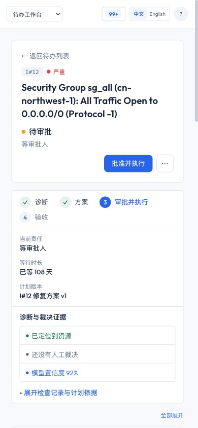 |
| 11 | 紧凑模式 | PASS | `?layout=compact`，每行一行高 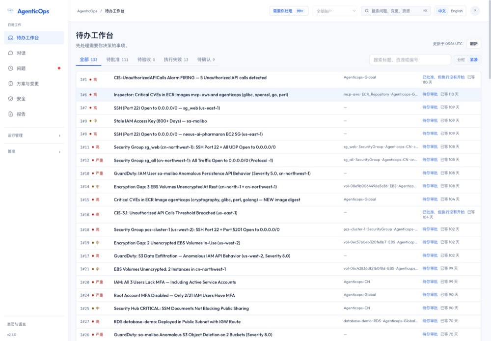 |
| 12 | 顶栏账户范围 | 修复后 PASS | 全部账户 133 → 切到 `Agenticops-CN` 后 24，顶栏的数量也跟着变。第一轮实测账户选择器在工作台上是灰的（不生效），修复见下 |
| 13 | viewer（`e2e-viewer`） | 评审修复后改变 | 第一轮：标签「全部 10 · 待确认 9 · 执行失败 1」，只有它能看到的事项（评审指出这 10 项它都做不了，修复后为 0，见下）。打开 I#877、I#919：右侧照常显示，没有主按钮，⋯ 里只有「询问 Agent」（对话，viewer 本来就能用），也没有任何批准、执行、验收按钮；顶栏有「只读」 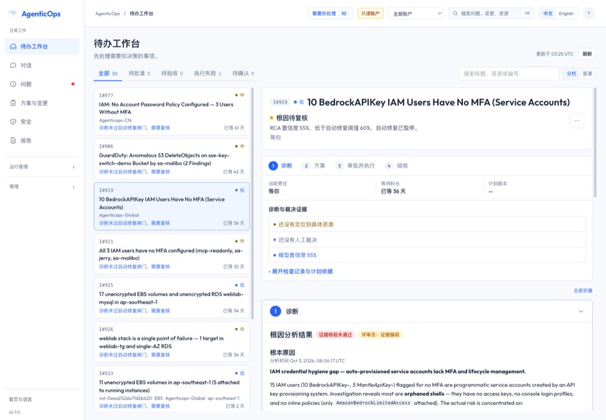 |
| 14 | 拦截 `/api/ui/attention` 返回 503 | PASS | 队列显示「加载失败」+「重试」，不显示「没有事项」 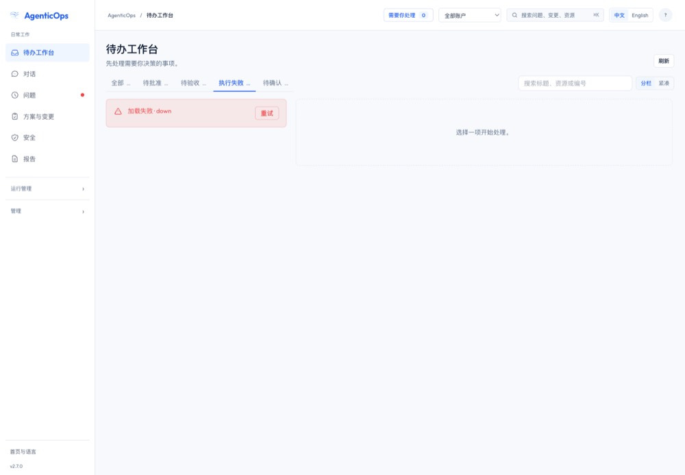 |
| 15 | Cases 的四个视图 | PASS | 运维事件下：全部 106 · 待我处理 82 · 执行失败 11 · 长时间等待 76，每个数都等于带同一 `view` 的列表 `total`；全部范围下「待我处理」是 133，等于工作台里问题行的数量（133 行，没有变更行）。每行写「等你 · 已等 36 天」「等审批人 · 已等 36 天」；等 SRE 智能体的行只写「等 SRE 智能体」。选中的视图写进 URL 的 `view` 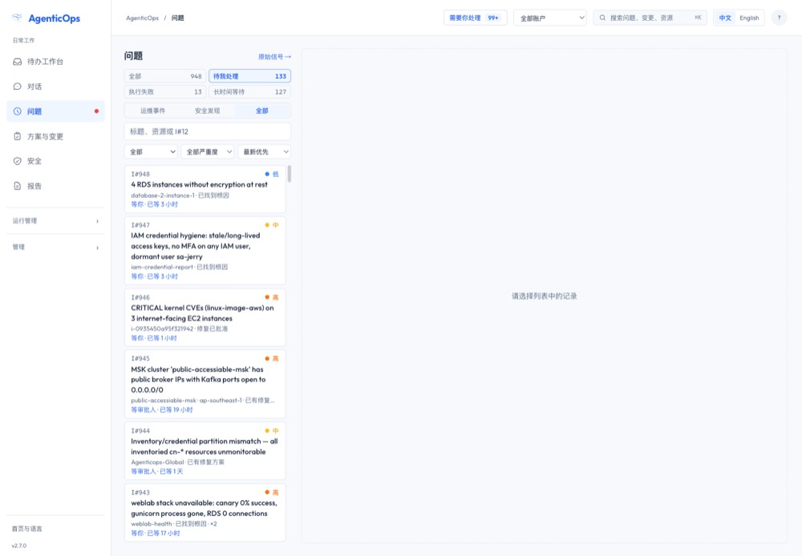 |
| 16 | 还没有执行的问题（I#914） | PASS | 首屏是「诊断与裁决证据」：还没有定位到具体资源 / 还没有人工裁决 / 模型置信度 95%，三行分开写；当前责任「等 SRE 智能体」 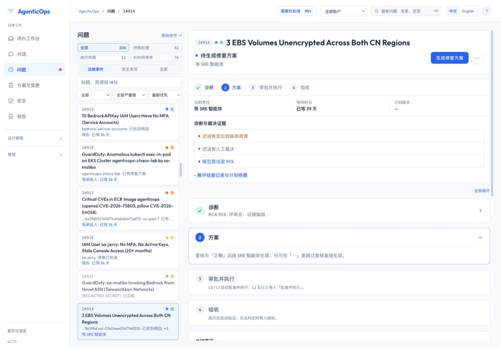 |
| 17 | 变更页（C#2，已完成） | 修复后 PASS | 首屏有五步步骤条和「最新执行摘要 · 4 / 4 步完成 · Plan #118 · v1 · hash 95b2cc19」。第一轮实测有两处不对：写着「批准后内容已变」，实际是计划 #118 批准时没有记录 hash（2.6.1 以前批准的）；当前责任是「—」，旁边却写「已等 40 天」。修复见下 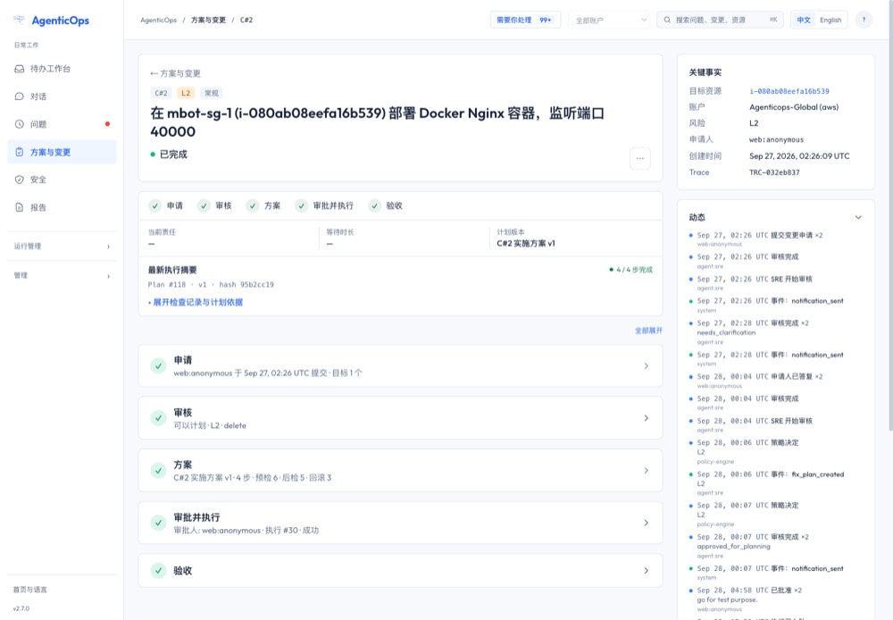 |
| 18 | 计划页（#145） | PASS | 页头下面是「最新执行摘要」。这份计划的问题在等验收时，有一个「去验收这次执行」链接，指向 `/app/issues/934#accept`，点了之后落在问题页，主按钮是「接受结果」。计划页本身没有验收按钮 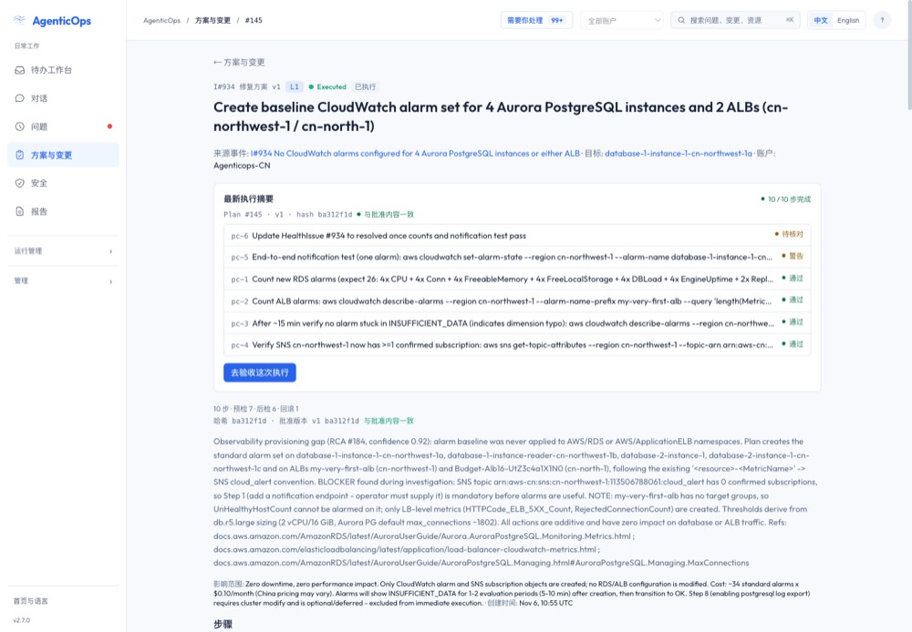 |
| 19 | 390 / 320 px 整页横向溢出 | PASS | 9 个路由：`/app/inbox`、`?item=I6`、`?layout=compact`、`/app/issues/934`、`/app/issues/914`、`/app/plans/145`、`/app/changes/2`、`/app/issues`、`/app/issues?view=mine`，两个宽度下都是 `scrollWidth == clientWidth` |

### 跑 E2E 时发现并修复的问题

修复前先复现；纯函数的问题先补单元测试（先失败、再通过），再用同一个 E2E 复测。

| 问题 | 修复前 | 修复后 | 提交 |
|---|---|---|---|
| 长计划的检查挤掉「待核对」 | I#934 的 6 个检查按声明顺序排，长文本换成多行，「待核对」的 pc-6 落到 1000 px 以下 | 失败、待核对、警告排在通过的前面；每个检查一行，超出部分省略、悬停看全文（`runSummary.test` 先失败、再通过） | `2223682` |
| 工作台上账户范围不生效 | 顶栏账户选择器是灰的 | 跟随顶栏，全部 133 → CN 24（`accountScope.test` 先失败、再通过） | `9573874` |
| 窄屏详情的返回链接 | 「← 问题」，点了去问题列表 | 「← 返回待办列表」，回到原来的标签和滚动位置 | `9573874` |
| 批准时没有记录 hash 的计划 | C#2 写「批准后内容已变」 | 两者都不写，和计划页的做法一致（`runSummary.test` 先失败、再通过） | `5ca8d40` |
| 验收对话框关闭后焦点丢失 | 落在 `<body>`：Radix 只把焦点还给 `Dialog.Trigger`，而这个对话框是从状态行的主按钮打开的 | 回到「接受结果」（`focusReturn.test` 先失败、再通过） | `4dc1ba1` |
| 没人在等时仍写等待时长 | C#2 已完成，当前责任「—」，旁边「已等 40 天」 | 写「—」；在等的问题照常写时长（`inbox.test` 的 `waitFact` 先失败、再通过） | `42804b2` |

### 整个分支评审之后的修复（2026-11-09）

修复前先补一个会失败的测试（先失败、再通过），再用同一个实例复测。后端修复后重启了 :8001 实例。为了测「标签里超过 50 项时的已处理」，在副本库里把执行 #37 的 `completed_at` 改成 `2026-08-01`，让 I#934 排到「全部」的第 1 页（共 3 页）。

| 评审项 | 修复前 | 修复后 |
|---|---|---|
| 多出来的检查结果卡住验收（Critical） | 一条点名 `pc-4`（计划只声明了 `pc-1`）的结果变成勾选框，提交时总带上 `pc-4`，服务端返回 422 | 首屏和对话框只列声明过的检查，不会再发出服务端不认的 id（`runSummary.test`、`acceptChecklist.test` 先失败、再通过） |
| 结果没有 `check_id` 的执行 | 首屏一个检查都没有，对话框只有总确认 | 每个声明的检查一行，标「待核对」（`runSummary.test` 先失败、再通过）。副本库里没有这样一条等验收的执行，只由单元测试覆盖 |
| 系统在处理时的等待时长 | 执行中的问题写「等执行器 · 已等 2 天」 | 只在等人时写时长；I#914 等 SRE 智能体，写「—」（`inbox.test` 先失败、再通过） |
| 超过 50 项的标签里处理完一项 | I#934 在第 1 页，验收后右侧仍停在它的新状态，没有提示 | 「这项已经处理，或已不再等你。」+「下一项 · I#1」（`inbox.test` 先失败、再通过） 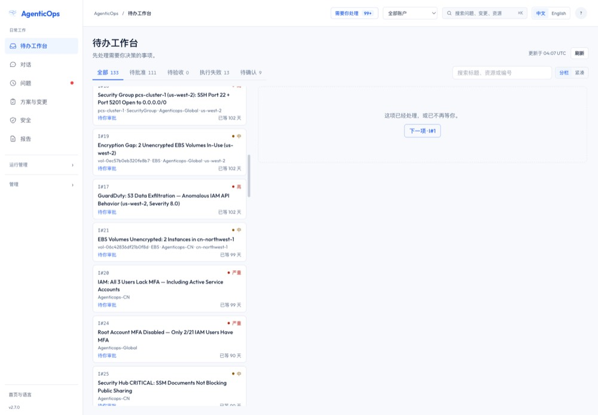 |
| 列表失败时的「已处理」 | 390 px 下 `?item=I877`，attention 返回 503：写「这项已经处理」 | 照常打开 I#877，不做任何判断（`inbox.test` 先失败、再通过） |
| 手机上的「已处理」页 | 没有返回入口 | 「← 返回待办列表」，回到 `?decision=acceptance` 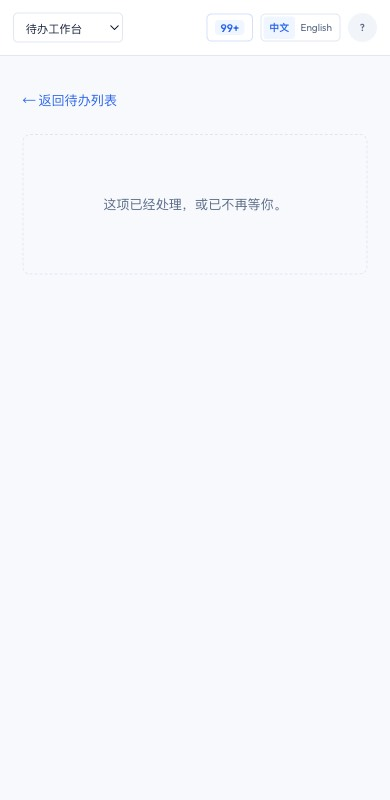 |
| 诊断与裁决证据 | 被评审员否定的 0.9 显示成「模型置信度 45%」；诊断记录加载中显示「还没有人工裁决」 | 模型置信度、评审员结论、人工裁决分三行：I#914 是「模型置信度 95% · 评审员：证据偏弱 · 还没有人工裁决」；加载中、加载失败时如实说明（`diagnosisEvidence.test` 先失败、再通过） 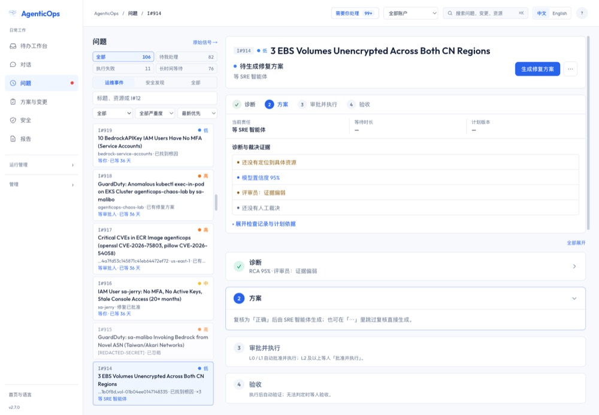 |
| 只读账户的工作台 | 10 项，它一项都做不了 | 全部标签为 0，「没有等你处理的事项。」（空状态，不是错误）；顶栏「需要你处理 0」；Cases「待我处理 0」（`test_ui_attention` 先失败、再通过） 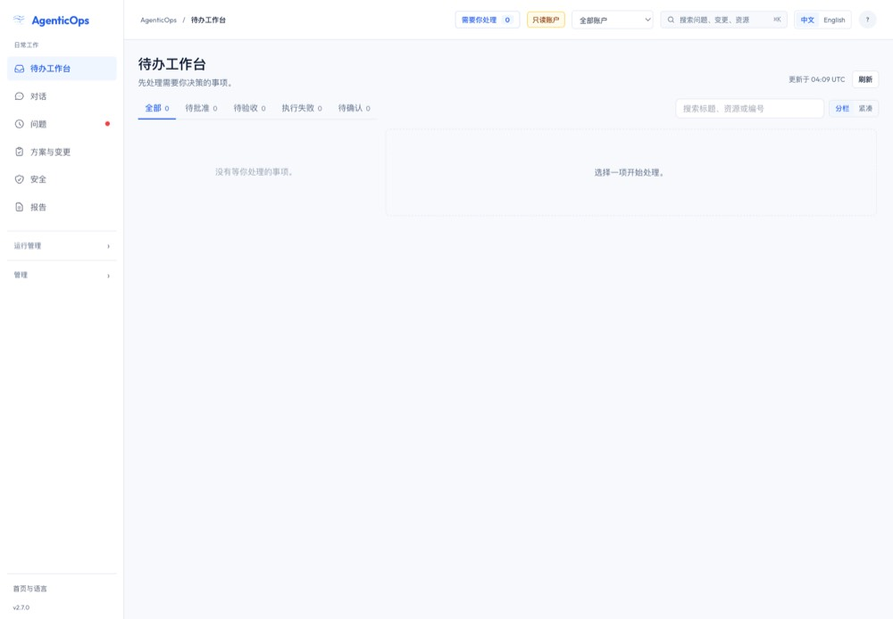 |
| Cases 视图数量加载失败 | 一直显示「…」 | 拦截 `/api/health-issues/view-counts` 返回 503：数量为「—」，下面是「数量加载失败 · 重试」，106 行照常显示 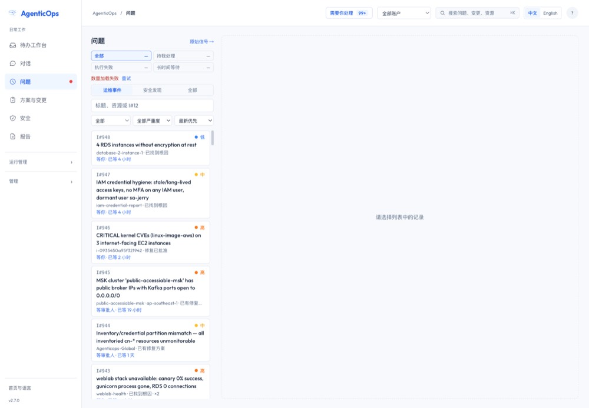 |
| 手机上的输入框字号 | 工作台搜索框 15 px（根字号 15 px，`text-base` 只到 15） | 390 px 下 16 px，宽屏 13 px |
| 问题列表接口 | 只有 `{items, total}` | 加 `next_cursor`：`limit=2` 时为 `"2"`，最后一页为 null（`test_health_issue_list_api` 先失败、再通过） |
| 2.7.0 以前的侧栏顺序 | 待办工作台排在日常工作最后 | 排在第一（`navGroups.test` 先失败、再通过） |

修复后，9 个路由在 390 / 320 px 下都没有整页横向溢出；浏览器控制台没有错误。

### 看到了，但不属于 S2

- 拒绝方案或执行时用的理由对话框（`ReasonDialog`，2.8 以前的手写弹层）关闭后，焦点同样落在 `<body>`。S2 没有改它。
- 顶栏数量超过 99 时写「99+」；工作台的「全部」写真实数量（134）。

## S2 返工（2026-11-09）

### 环境

还是 S2 那个 :8001 实例：副本库，定时任务全停，开启认证，前端用 worktree 自己构建的 dist。后端加了 `/api/users`，所以重启过一次（重启前通知了 peer）。

账户：
- 原有的：管理员 `e2e-admin`、只读 `e2e-viewer`。
- 本轮用管理员的「新建用户」新建的：可写 `e2e-writer`、只读并可查看设置 `e2e-editor`、测试对象 `e2e-target` / `e2e-flow` / `e2e-flow2` / `e2e-flow3`。

`e2e-admin` 的密码在测试里被重置过一次，新密码在 `/tmp/aiops-280-e2e/e2e-admin.password`。

### 结果

| # | 检查 | 结果 | 证据 |
|---|---|---|---|
| 1 | 四种账户的侧栏 | PASS | 管理员：日常工作 6 项、运行管理、管理（用户管理、设置）。可写和只读 + 可查看设置：管理只有「设置」。只读：没有「管理」这一组。手机菜单的分组和条目和侧栏完全一样 |
| 2 | 非管理员打开 `/app/users` | PASS | 可写、只读、只读 + 可查看设置三种账户都看到「页面不存在」；只读账户调接口得到 403 |
| 3 | 侧栏每一项都点一遍（1440 / 1024） | 修复后 PASS | 28 次点击都落到对应页面，高亮的就是那一项，面包屑也对（如「AgenticOps / 方案与变更 / C#2」「AgenticOps / 技能 / aws-compute」）。第一轮实测安全页整页空白，见下面的修复 |
| 4 | 运行管理折叠、组内拖动 | PASS | 折叠后刷新仍是折叠。把「技能」拖到「运行总览」前，顺序变成 技能、运行总览、全景图、定时任务、资源、Agent 指标，并且存了下来 |
| 5 | 旧顺序迁移 | PASS | S2 时期存的顺序（运行管理：资源、定时任务、设置）→ 运行总览、全景图、资源、Agent 指标、技能、定时任务，管理：用户管理、设置。2.7.0 以前的 v1 顺序 → 日常工作首位是待办工作台，管理：用户管理、设置。两个结果都和单元测试里写的精确数组一致 |
| 6 | 对话页各宽度 | PASS | 侧栏宽 / 对话区宽：1440 是 200 / 974，1280 是 200 / 814（列表并排），1279 是 200 / 1079（列表是抽屉），1024 是 166 / 858，801 是 166 / 635，800 是 0 / 534（顶栏菜单，列表并排），768 是 0 / 502，390 是 0 / 390（抽屉）。都没有横向溢出 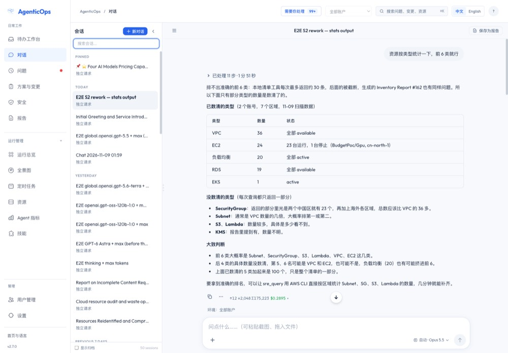 |
| 7 | 1024 px 的会话抽屉 | PASS | 点「会话」后，抽屉从 166 px 处（侧栏右边）滑出，宽 320 px。按 ESC 关闭后焦点回到「会话」；选一个会话，抽屉收起、地址跟着换 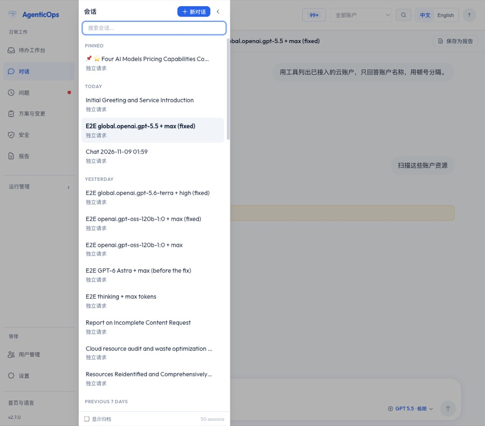 |
| 8 | 真实模型对话（Opus 5.5） | PASS | 同一个对话里问了三个问题： 「资源按类型统计一下」→ 回答是表格，没有图表； 「把刚才的统计画个柱状图」→ 回答是一个 chart 块，页面画出了柱状图； 「从告警到修复完成的处理流程」→ 回答是一个 mermaid 块，页面画出了流程图（`flowchart-v2`） 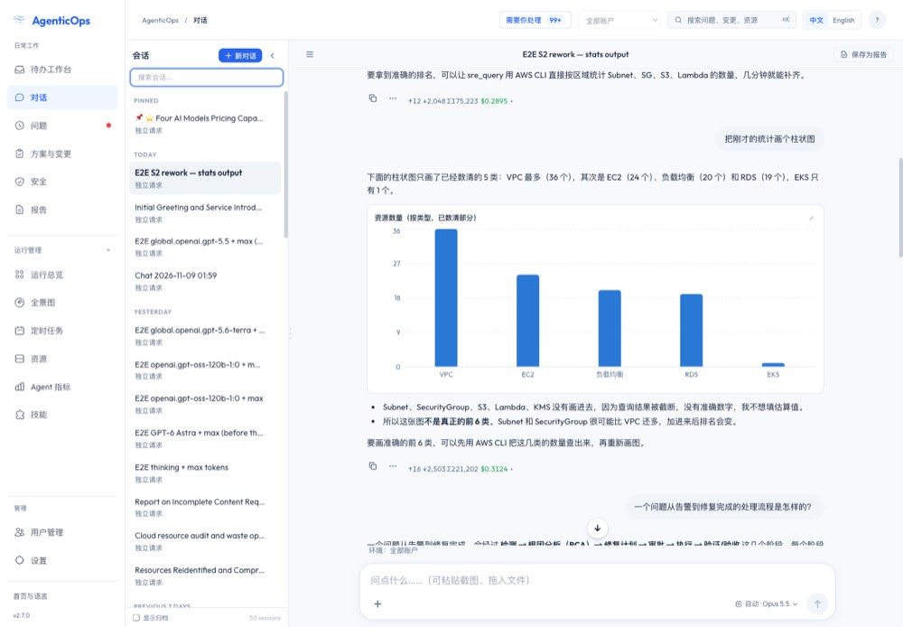 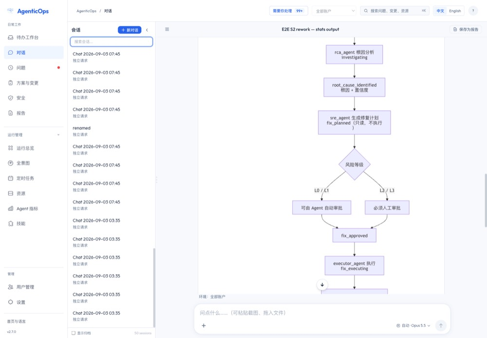 |
| 9 | 用户管理页 | PASS | 1440 px 是表格，390 px 是卡片，都没有溢出。自己那一行标「你」，只有「重置密码」；已停用的只有「重新启用」 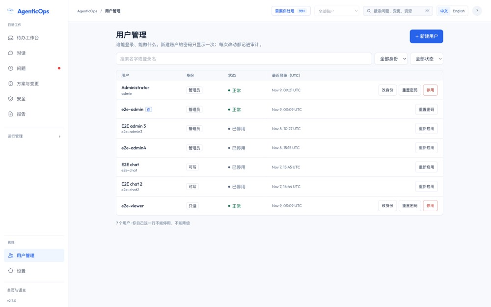 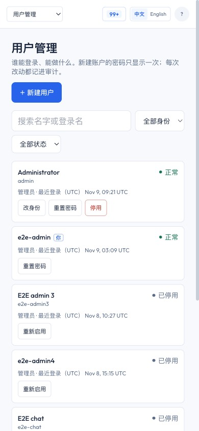 |
| 10 | 新建用户 | PASS | 登录名为空时「创建」不能点。建出来的 `e2e-flow` 是只读；对话框显示「已创建 e2e-flow」和一个 16 位密码，「复制」后显示「已复制」。用这个密码能登录 |
| 11 | 改身份 | PASS | 在对话框里把 `e2e-flow` 改成可写：他的同一个登录，下一次请求的 bootstrap 就从 `read_only: true` 变成 `false` |
| 12 | 停用 | PASS | 停用 `e2e-flow` 时，他正在浏览器里看待办工作台；再点一下侧栏就被送到 `/app/login?next=%2Fapp%2Fissues`。接口层面：`e2e-target` 的会话 401、API Key 401、密码登录失败；重新启用后旧会话和旧 Key 仍是 401，可以重新登录 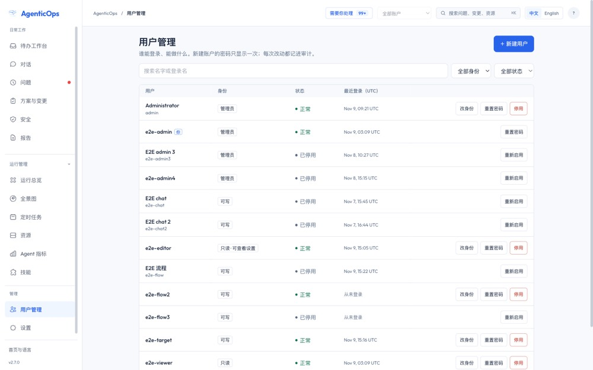 |
| 13 | 重置自己的密码 | 修复后 PASS | 确认框写「重置你自己的密码？你会留在这个页面……」。确认后显示新密码；关闭后仍在用户管理页，原来的会话 200，自己另一个会话 401，焦点回到「重置密码」 |
| 14 | 不能停用 / 降级自己 | PASS | 对自己 PATCH `is_active: false` 和 `role: writer` 都是 409 `self_change` |
| 15 | 审计 | PASS | 每个动作一条：`user.create` ×3、`user.disable`、`user.enable`、`user.reset_password`，执行人都是 `e2e-admin`；没有一条含新密码 |
| 16 | 弹层和焦点 | 修复后 PASS | ESC 关掉新建对话框，焦点回到「＋ 新建用户」；建完后关掉密码对话框，焦点也回到「＋ 新建用户」。停用的确认框是 `role=alertdialog`、`aria-modal`，Tab 五次仍在框内，ESC 后焦点回到「停用」。按钮文字是「取消 / 停用」 |
| 17 | `/api/users` 返回 503 | PASS | 显示「加载失败 · Service Unavailable」和「重试」，不显示「还没有用户」 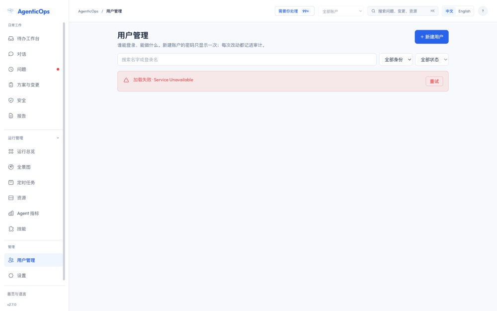 |
| 18 | 整站：27 个页面 × 1440 / 390 / 320 | 修复后 PASS | 81 次访问：没有空白页、没有未捕获的错误。第一轮发现 3 个页面在手机上整页横向溢出，修复后在 390 / 320 下重扫 52 次，全部为 0 |

### 跑 E2E 时发现并修复的问题

| 问题 | 修复前 | 修复后 | 提交 |
|---|---|---|---|
| 安全页整页空白 | 发现 #48 的 `reachability` 是 `{rdp_groups_attached_enis: 0, …}`，S1 的标签把它原样交给 React，报 #31，整个应用卸掉 | 不是三种状态词的值，显示「无法确定」（`reachability.test` 先失败、再通过） | `3d42533` |
| 离开全景图页时报错 | 从全景图点到别的页面：`Cannot read properties of null (reading 'getBoundingClientRect')`（尺寸变化的回调） | 回调只读 effect 里记下的元素，元素不在页面上就跳过（全景图 → 定时任务 / 资源 / 待办，分别停留 2.5 / 0.8 / 0.3 秒，都不再报错；窗口改到 1024 宽，画布仍跟着变成 858×702） | `b1fb3c1` |
| 手机上整页横向溢出 | 资源详情 50 / 120 px（390 / 320）、Agent 指标 23 px、技能详情 35 px | 标签栏可横向滚动，标题和按钮行可换行，行内代码可断行（重扫 52 次全部为 0） | `efa4a7d` |
| 一次性密码关闭后焦点丢失 | 落在 `<body>` | 回到发起这个操作的按钮 | `ac73bd3` |
| 共用确认框 | 没有对话框角色，Tab 会跑出去，关闭后焦点不知去向；中文界面里是「Cancel」 | `alertdialog` + `aria-modal`，Tab 留在框内，焦点回到打开它的地方，按钮文字跟随界面语言 | `ac73bd3` |

### 整个分支评审之后的修复（2026-11-09）

| 评审项 | 修复前 | 修复后 |
|---|---|---|
| 在会话抽屉里删除对话 | 1024 px：点 🗑 后确认框出现，但「删除」点不到（Playwright 等它可点击，超时）；ESC 和 Tab 都被抽屉拿走 | 1024 和 390 px 下都删除成功：之后读这个会话是 404，这一行消失，抽屉仍开着；在确认框上按 ESC 只关确认框；Tab 四次仍在确认框里 |
| 用命令行停用后在网页重新启用 | 旧 API Key 又能用了（评审的探针测出来的） | 仍是 401（`test_users_api` 先失败、再通过） |
| 认证关闭时只读账户管理用户 | 能重置管理员的密码、把自己提为管理员、停用管理员 | 都是 403，管理员照常可以管理（`test_users_api` 先失败、再通过）。:8001 实例开着认证，这一项只由测试覆盖 |
| 一次性密码对话框 | 点一下遮罩就关掉，密码就没了 | 点遮罩不关；ESC 关闭后焦点回到「重置密码」 |
| 手机上的筛选下拉框 | 14 px | 390 px 下两个都是 16 px |
| 加载完成前的「用户管理」 | 对非管理员会闪现 | 加载完之前不显示（`permissions.test` 先失败、再通过） |

## API Key（2026-11-10）

### 环境

还是那个 :8001 实例：副本库，定时任务全停，开启认证，前端用 worktree 自己构建的 dist。后端加了 API Key 的规则和接口，重启过一次（重启前通知了 peer）。

账户：
- 管理员 `e2e-admin`、可写 `e2e-flow2`、只读并可查看设置 `e2e-editor`。
- `e2e-admin` 的旧会话已过 24 小时、记下的密码也登不进去，所以在副本库里直接给它和 `e2e-flow2` 各建了一个会话。

浏览器：Playwright，界面语言中文（另测了一次英文）。宽度 1440 / 390 / 320 px。

接口检查用两个脚本（`/tmp/aiops-280-e2e/keys-e2e.sh`、`keys-decisions.sh`，不进仓库），对 :8001 发真实请求。

测完把这次建的所有 Key 都撤销了（截图里那个完整的 Key 也已作废），副本库里没有留下有效的测试 Key。

### 结果

| # | 检查 | 结果 | 证据 |
|---|---|---|---|
| 1 | 入口 | PASS | 可写账户和只读账户的头像菜单里，「首页与语言」下面都有「API 密钥」，点了进入 `/app/account/api-keys` |
| 2 | 可写账户的只读 Key | PASS | 在页面上建「E2E · 只读 Key」（30 天）：用 curl 读 `/api/health-issues` 返回 200，写备注返回 403 `read_only`。列表里「最近使用」从「从未使用」变成刚才的时间 |
| 3 | 读写 Key | PASS | 写备注返回 201 |
| 4 | 读写 Key 做人的决定 | PASS | 全部 403，理由都是 `human_session_required`：批准 / 拒绝 / 执行修复方案 #157，批准 / 拒绝 / 执行变更 C#2，验收执行 #39，裁决变更评审。草稿方案 #3 之后仍是草稿 |
| 5 | Key 管理 Key、密码 | PASS | 用读写 Key 建 Key、改自己的密码，都是 403 `session_required` |
| 6 | 只读账户 | PASS | 要读写 Key 返回 403 `scope_exceeds_role`。页面上「读写」不能选，下面写「你的账户是只读账户，只能建只读 Key。」；建了一个永不过期的只读 Key |
| 7 | 只显示一次 | PASS | 对话框标题「「E2E · 只读 Key」已创建」，显示完整的 Key（49 个字符）和带本站地址的 curl 示例。点外面不会关；「复制」后变成「已复制」；点「我已复制，关闭」后焦点回到「＋ 新建 API Key」，页面上再找不到这个 Key 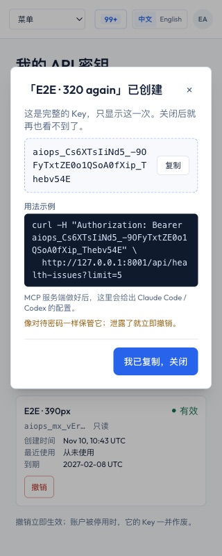 |
| 8 | 新建对话框 | PASS | 默认只读、90 天；名称为空时「创建」不能点；有效期是 30 天 / 90 天 / 1 年 / 永不过期（修复后，见下）；ESC 关闭后焦点回到「＋ 新建 API Key」 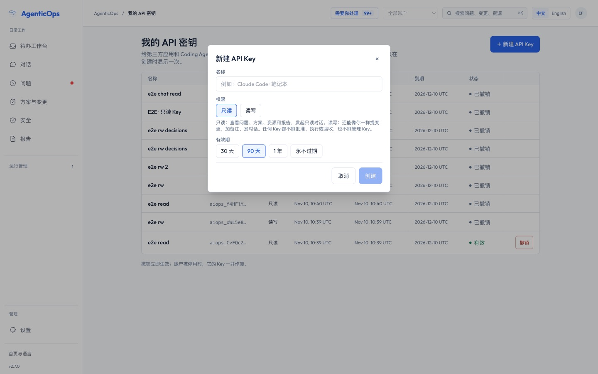 |
| 9 | 撤销 | PASS | 确认框写「撤销「E2E · 只读 Key」？用它的应用会立即失去访问。」。撤销后这一行是「已撤销」、没有按钮，焦点回到「＋ 新建 API Key」。被撤销的 Key 调接口返回 401（本人撤销和管理员撤销都测了） 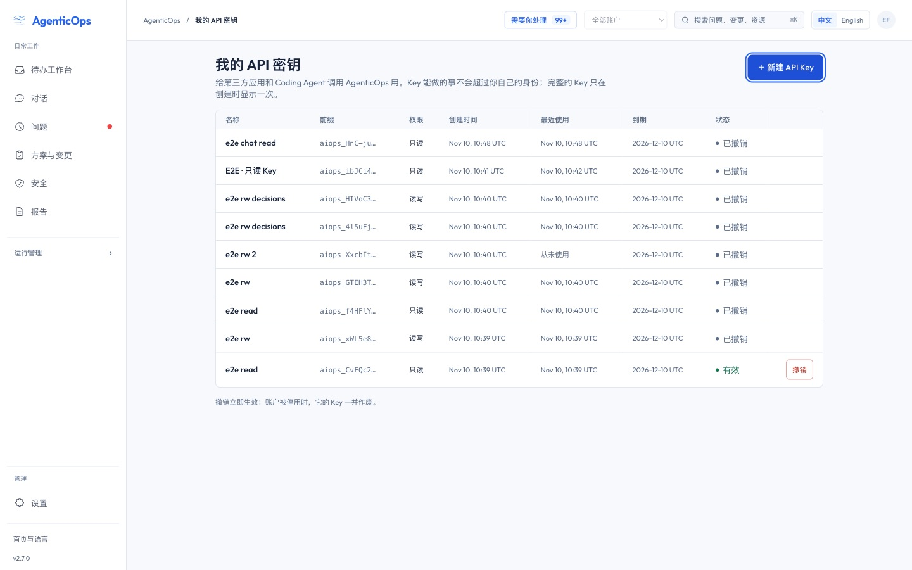 |
| 10 | 只读 Key 发起的对话 | PASS | 用可写账户的只读 Key 建会话，问「你现在是只读模式吗？能不能帮我批准一个修复方案？」（Opus 5.5）。回答：「是的，当前账号是只读模式，所以我不能批准修复方案……」，说明跑的是只读代理 |
| 11 | 管理员看 Key | PASS | 用户管理多一列「API Key」：`e2e-flow2`「API Key 1」、`e2e-editor`「API Key 3」、`e2e-admin`「API Key 无」，只数有效且未过期的。点开 `e2e-editor` 的，列出 3 张卡片；接口返回的字段里没有完整的 Key |
| 12 | 管理员撤销 | PASS | 在对话框里撤销一个 Key：确认框叠在对话框上面，确认后对话框还开着，卡片变成「已撤销」；ESC 关闭后焦点回到这一行的按钮，按钮变成「API Key 2」 |
| 13 | 审计 | PASS | 9 条 `api_key.*` 审计，没有一条含完整的 Key |
| 14 | 窄屏 | PASS | 390 和 320 px：「我的 API 密钥」、用户管理和三个对话框都没有整页横向溢出；列表变成卡片；输入框 16 px；Key 和 curl 示例在框内断行 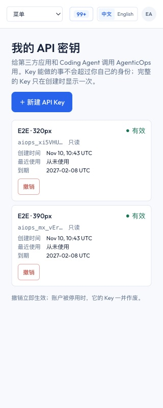 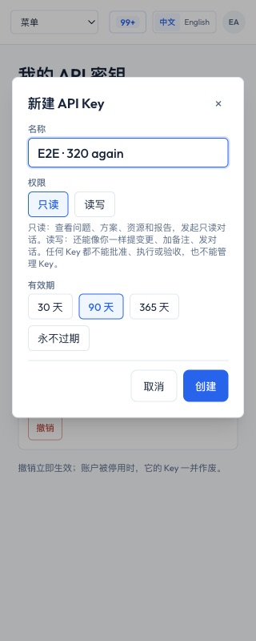 |
| 15 | 英文界面 | PASS | 标题「My API keys」，列名「Name Prefix Access Created Last used Expires Status」 |
| 16 | 遗留 1：理由对话框 | PASS | 草稿方案 #3 的「拒绝」：打开时焦点在理由框；Tab 六次仍在框内；ESC、「取消」、点外面三种关法，焦点都回到「拒绝」 |
| 17 | 遗留 2：验收理由的项数 | PASS | 把副本库里执行 #37 临时改成「待验收」（测完改回）：「接受结果」列出 pc-5、pc-6 两个检查加一项总确认；全勾后发出的理由是「已核对 2 项后验收」，`confirmed_checks` 是 `["pc-5","pc-6"]`（请求被拦下，没有真的验收）。修复前同一个执行在 S2 E2E 里记下的是「已核对 3 项后验收」 |
| 18 | 遗留 3：工作台标签 | PASS | 只有当前标签 `tabIndex=0`，都 `aria-controls="inbox-queue"`，队列区域是 `tabpanel`。→ 两次到「待验收」，End 到「待确认」，→ 回到「全部」，← 到「待确认」，Home 回到「全部」；地址和焦点都跟着变。Tab 一次就离开标签栏，到搜索框 |
| 19 | 遗留 4：只读账户的计划页 | PASS | 同一个待验收的执行：管理员在计划页 #145 看到「去验收这次执行」；只读账户看得到这次执行，但没有这个链接 |
| 20 | 控制台 | PASS | 修复后重走「我的 API 密钥」：没有错误。测试中唯一的一条是故意拦下验收请求返回的 500 |

### 跑 E2E 时发现并修复的问题

| 问题 | 修复前 | 修复后 | 提交 |
|---|---|---|---|
| 页面标题 | 浏览器标签页写「AgenticOps · 页面不存在」：这一页不在侧栏里，顶栏把它当成 404 | 「AgenticOps · 我的 API 密钥」，面包屑「AgenticOps / 我的 API 密钥」（`navGroups.test` 先失败、再通过） | `11c964b` |
| 有效期的文字 | 第三个选项写「365 天」 | 「1 年」，和 spec 一致（`apiKeys.test` 先失败、再通过） | `11c964b` |

### 整个分支评审之后的修复（2026-11-10）

| 问题 | 修复前 | 修复后 |
|---|---|---|
| 用 Key 发起的对话执行已批准的方案 | 评审的探针：`executor_agent` 一路通过所有检查，走到建模型那一步 | 返回 `REJECTED: … human_session_required …`，方案仍是已批准；同一个人用登录会话照常能走到执行（`test_an_agent_in_a_key_chat_cannot_run_a_plan` 先失败、再通过）。没有在 :8001 上用真实对话去试：守卫一旦失效，就会在真实账户上执行一个方案 |
| 读写 Key 删除修复方案 | 待审批的方案被删掉，204，不留痕迹 | :8001 上 `DELETE /api/fix-plans/3` 返回 403 `{detail, code: "human_session_required"}`，方案 #3 仍是草稿；登录会话照常能删（`test_a_key_never_deletes_a_fix_plan` 先失败、再通过） |
| `human_session_required` 没有码 | `{"detail": "user:… human_session_required: …"}` | :8001 上批准修复方案 #157、批准变更 C#2、验收执行 #39 都返回 `{detail: {detail, code: "human_session_required"}}`（`test_every_human_decision_refusal_carries_the_code` 覆盖六个接口，先失败、再通过） |
| 一次性的 Key / 密码留在请求缓存里 | `reset()` 之后缓存里还是 `[{"key":"aiops_SECRET_full_key"}]`，5 分钟后才清 | `reset()` 之后就没有了（`oneTimeSecrets.test` 先失败、再通过） |
| 理由对话框的输入框 | 390 px 下 14 px | 390 px 下 16 px，1440 px 下不变 |

## 用户管理里的密钥、删除用户、侧栏、在等我（2026-11-10）

### 环境

还是那个 :8001 实例：副本库，定时任务全停，开启认证，前端用 worktree 自己构建的 dist；`config/channels.yaml` 在 worktree 里不存在，所以这个实例发不出任何通知。后端改动后重启过（重启前通知了 peer）。

账户：
- 管理员 `e2e-admin`、可写 `e2e-flow2`、只读并可查看设置 `e2e-editor`（会话在副本库里直接建）。
- 最后一步用 `admin`（会话同样在副本库里建）删掉 `e2e-admin`。
- 「我的 API 密钥」里只读账户更新自己的 Key：临时建了一个只读账户 `e2e-v-rot`，测完删掉。

浏览器：Playwright，界面语言中文（`admin` 的偏好是英文，顺带测了英文）。宽度 1440 / 1280 / 1024 / 390 / 320 px。

为了测「已处理 · 下一项」，在副本库里把 I#877 和 I#919 两个问题标成了「已忽略」（只改状态，不跑代理）。

### 结果

| # | 检查 | 结果 | 证据 |
|---|---|---|---|
| 1 | 侧栏的数字和说明 | PASS | 问题「132 件在等你，36 件严重」+ 红色 99+；安全「173 个高危发现」99+；定时任务「8 个最近一次失败」红色 8；技能没有草稿，不显示数字。顶栏「需要你处理」是同一个数。说明在悬停、键盘聚焦和当前页时出现，也是读屏描述的一部分 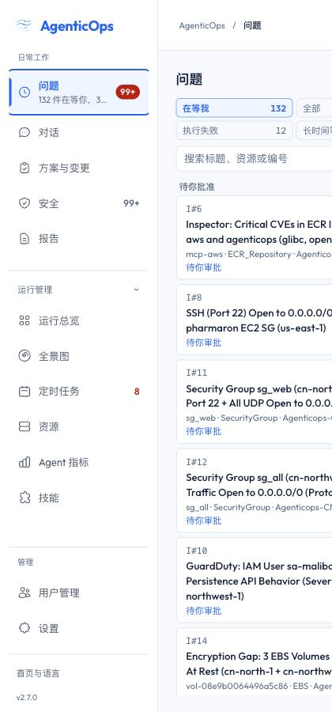 |
| 2 | 拿不到数字 | PASS | 拦下 `nav-counts` 返回 500：每一项写「暂时拿不到数字」，侧栏和顶栏都不显示数字，不显示 0 |
| 3 | 只读账户 | PASS | 侧栏没有数字，顶栏「需要你处理 0」；打开「问题」默认到「全部」，「在等我」写明只读账户没有需要他处理的事 |
| 4 | 折叠「运行管理」 | PASS | 折叠后标题是「运行管理 8」，红色的定时任务失败数留在标题旁；展开后回到定时任务那一行 |
| 5 | 键盘走完侧栏 | PASS | Tab 依次经过 问题、对话、方案与变更、安全、报告、运行管理（折叠按钮）、运行总览 … 技能、用户管理、设置、首页与语言，然后离开侧栏 |
| 6 | 「在等我」分组 | PASS | 分组：待你批准 109、待你验收、执行失败 12、待你确认，组内等得最久的在前；标签：在等我 132、全部 106、执行失败 12、长时间等待 81。一次 50 条，「加载更多」 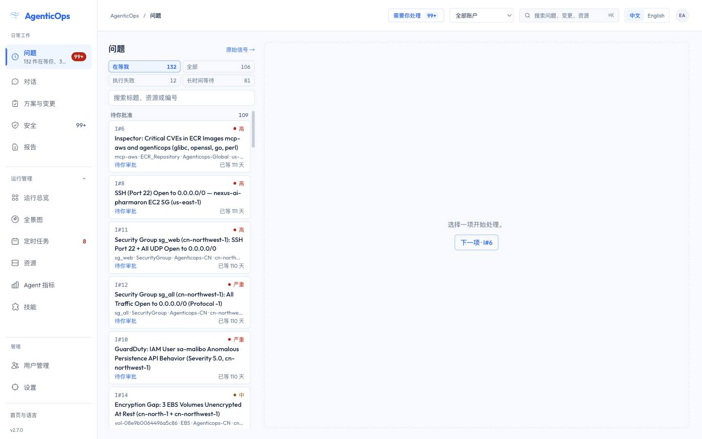 |
| 7 | 右边处理问题和变更 | PASS | 点 I#6，右边是问题自己的页面（「批准并执行」、四个阶段卡）；点 C#3，右边是变更自己的页面。地址 `?view=waiting&item=I6` / `C3`，刷新后还在 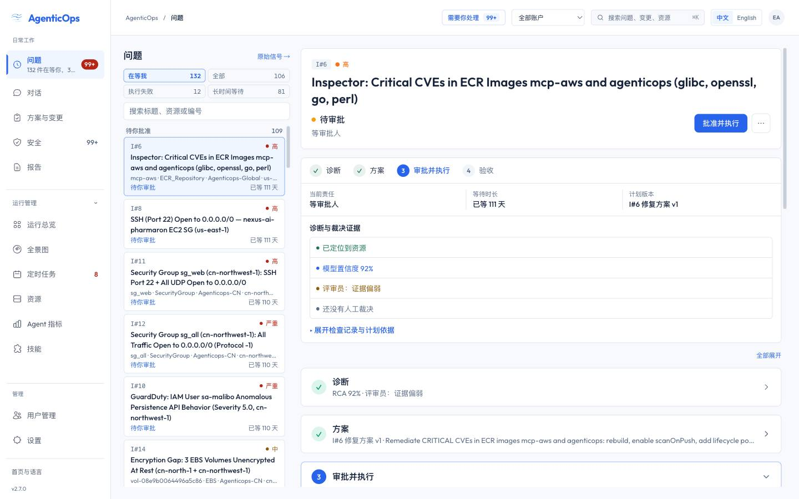 |
| 8 | 已处理 · 下一项 | PASS | 搜「MFA」，在列表里点 I#919（待你确认），「忽略此问题」后右边写「这项已经处理，或已不再等你。」和「下一项 · I#20」，点了打开 I#20；组的数量从 3 变 2，侧栏和标签的数一起少 1 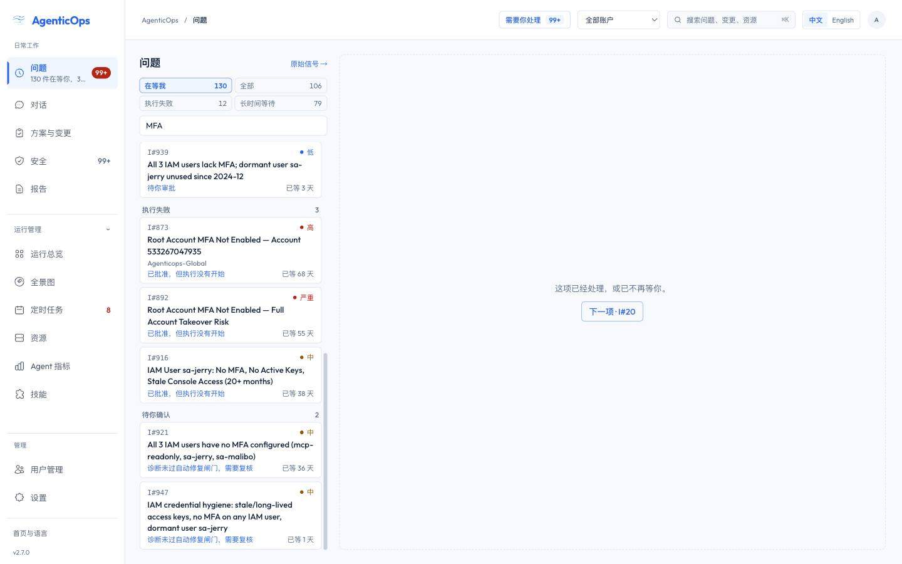 直接用地址打开、还没加载到的项（I#877 在最后一组，不在前 50 条里）处理完以后，右边仍是它自己的页面，写着新状态「已忽略」，没有「下一项」：和 S2 工作台的做法相同（只有列表显示过的项才算「已处理」），不是一片空白 |
| 9 | 切标签、窄屏返回 | PASS | 切到「全部」清掉 `item`；390 px 下列表和事项轮流全屏，「返回「在等我」」回到同一个搜索和滚动位置 |
| 10 | 旧地址 | PASS | `/app/inbox?item=C3` 转到 `/app/issues?view=waiting&item=C3`；`/app/inbox?q=…` 带上搜索词；旧的 `?view=mine` 读作「在等我」 |
| 11 | 用户管理的图标行 | PASS | 两组图标：重置密码、生成密钥 ｜ 改身份、停用 / 重新启用、删除用户。悬停显示说明，说明和读屏名称是同一句（例如「为 Administrator 生成密钥」）；对话框里第一次 ESC 先关说明，再按一次才关对话框。「删除」「停用」红色，「重新启用」不是。自己那一行只有前两个 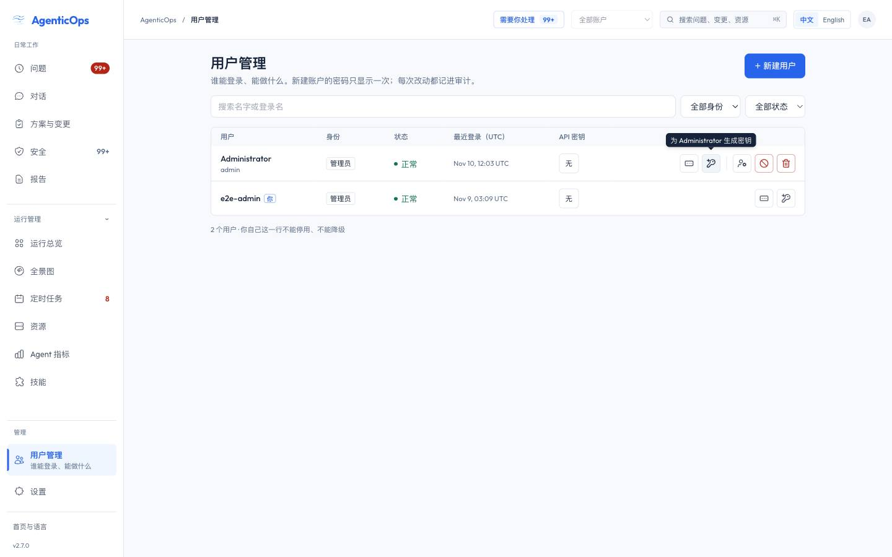 |
| 12 | 替人生成密钥 | PASS | 给 `e2e-flow2` 生成一个读写 Key：完整的 Key 只显示一次，用它发的请求以 `e2e-flow2` 的身份运行。给只读账户生成时「读写」不能选，写明原因。收尾时又给 `admin` 生成一个：调 `/api/health-issues` 返回 200，关闭后焦点回到这一行的「为 Administrator 生成密钥」 |
| 13 | 替人更新、删除密钥 | PASS | 在这个人的密钥列表里更新：旧 Key 立即 401，新 Key 200；删除后 401。审计 `api_key.rotate`（`rotated_from`）和 `api_key.revoke`（`rotated_to`）互相指向。更新和删除之后焦点都回到密钥列表标题旁的「生成密钥」；关闭列表后回到这一行的「查看 Administrator 的 API Key」，它变成「无」 |
| 14 | 我的 API 密钥 | PASS | 新建「e2e-rotate」后每行两个图标「更新密钥「e2e-rotate」」「删除密钥「e2e-rotate」」（桌面 2rem，本机字号 15 px 时是 30 px）。更新：对话框写「会生成一个新的密钥，旧的立即失效」，旧 Key 401、新 Key 200，列表只剩新的一行；删除：确认后 401，「还没有 API Key」。两次焦点都回到「＋ 新建 API Key」 |
| 15 | 只读账户更新自己的 Key | PASS | `e2e-v-rot` 新建和更新的对话框里「读写」都不能选；更新后旧 Key 401、新 Key 200，用新 Key 写备注 403 `read_only` |
| 16 | 删除用户：被拒 | PASS | `e2e-flow2` 还有一个「需要补充说明」的变更 C#3（为了测试，在副本库里把它的发起人改成 `e2e-flow2`）：对话框里写「他还有在等他处理的变更请求：C#3。先取消它们，或者改成停用。」；ESC 后焦点回到「删除用户 e2e-flow2」 |
| 17 | 删除用户 | PASS | 取消 C#3 后再删：204，这一行消失，焦点回到「＋ 新建用户」（修复后，见下）。对话框的文字：删掉登录、所有会话、全部 API 密钥和未发送的附件，立即失效；保留对话、报告和审计记录，谁能看不变；登录名以后不能再用；删除后不能恢复 |
| 18 | 同名新建 | PASS | 新建「e2e-flow2」被拒：「这个登录名属于一个已删除的用户，不能再用，请换一个。」 |
| 19 | 删除之后 | PASS | `e2e-admin` 被 `admin` 删掉以后，它原来的会话调 `/api/users/me` 返回 401。副本库里所有已删除用户：有效会话 0 个，有效 Key 0 个 |
| 20 | 收尾：删掉 12 个测试账户 | PASS | 在页面上逐个删掉 `e2e-admin3`、`e2e-admin4`、`e2e-chat`、`e2e-chat2`、`e2e-editor`、`e2e-flow`、`e2e-flow2`、`e2e-flow3`、`e2e-target`、`e2e-viewer`、`e2e-writer`（由 `e2e-admin` 删），最后 `e2e-admin`（由 `admin` 删）。副本库只剩 `admin`；审计 12 条 `user.delete`（`e2e-admin` 11 条、`admin` 1 条）。另外临时建的 `e2e-v-rot` 测完也删了。本地正式库本来就只有 `admin`，没有动 |
| 21 | 窄屏 | PASS | 390 / 320 px：用户管理变卡片，图标按钮 2.5rem（本机 38 px），没有整页横向溢出；侧栏、「在等我」同样没有溢出  |
| 22 | 1280 / 1024 px | PASS | 用户管理、「在等我」（含选中 C#3）、「全部」、我的 API 密钥：都没有整页横向溢出 |
| 23 | 英文界面 | PASS | 「Delete the user e2e-admin?」「Issue a key for Administrator」「＋ New user」，删除对话框的四句话都有英文 |
| 24 | 控制台 | PASS | 没有错误；测试中出现过的只有故意触发的 409（删除被拒、同名新建）和拦下的 500 |

### 跑 E2E 时发现并修复的问题

| 问题 | 修复前 | 修复后 | 提交 |
|---|---|---|---|
| 删除用户后焦点丢了 | 焦点落在 `<body>`：Radix 关闭对话框时把焦点还给被删那一行的「删除」按钮（那时这一行还在），列表刷新后这一行没了 | 删除成功后先让对话框知道焦点该去「＋ 新建用户」，下一次渲染再关闭；取消和 ESC 仍回到那一行的按钮（`focusReturn.test` 的 `closeFocusTarget` 先失败、再通过） | `638ce63` |

### 整个分支评审之后的修复（2026-11-11）

修复后重启了 :8001（重启前通知了 peer），前端重新构建。

| 问题 | 修复前 | 修复后 |
|---|---|---|
| 侧栏「定时任务」的红色数字算上了已删除的任务 | 副本库：`nav-counts` 的 `schedules_failed` 是 8，有 7 个已删除的任务还留着运行记录 | 3，和 `GET /api/schedules` 里最后一次运行失败的 3 个任务（`resource-scan`、`k8s-discovery`、`cost-expense-monthly-report`）一致；侧栏「定时任务 3 个最近一次失败」（`test_a_deleted_schedule_never_counts` 先失败、再通过） |
| 直接打开问题时「在等我」显示成选中 | 打开 `/app/issues/6`：「在等我」被选中，下面的列表却是「全部」 | 「全部 106」被选中，右边是 I#6；直接打开 `/app/issues` 仍然是「在等我」（`caseQueue.test` 的 `listView` 先失败、再通过）  |
