# AgenticOps — Business Workflow & Quick Start Guide

## How It Works (30-Second Overview)

AgenticOps is an AI operations assistant that **scans** your AWS infrastructure, **detects** health issues, performs **root cause analysis**, generates **fix plans**, and optionally **executes** them — all through natural language chat.

```
You: "check health of my prod services"
 └──► Main Agent (router) ──► Detect Agent ──► CloudWatch + metrics + logs
                                                      │
                                            HealthIssue created
                                                      │
You: "analyze I#42"                                   ▼
 └──► Main Agent ──► RCA Agent ──► Skills + CloudTrail + metrics + KB
                                          │
                              Root cause identified (confidence: 0.85)
                                          │
You: "fix I#42"                           ▼
 └──► Main Agent ──► SRE Agent ──► Fix plan generated (L2: resize instance)
                                          │
You: "approve fix plan 7"                 ▼
 └──► Approval gate ──► Plan status: approved
                                          │
You: "execute plan 7"                     ▼
 └──► Main Agent ──► Executor Agent ──► Pre-check → Execute → Post-check
                                          │
                                    Issue resolved ──► KB case study saved
```

---

## Architecture Overview

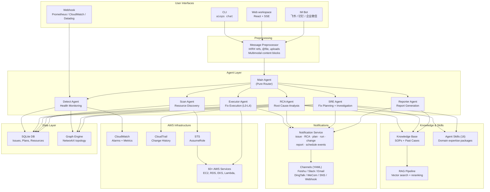

---

## Credential Safety: Authentication & Authorization

AgenticOps operates across **multiple AWS accounts**. There is no global "current account" — every operation must explicitly resolve the **target account's** credentials. The two concerns are separate:

- **Authentication (AuthN)** — *which account am I, and are these credentials valid?* Resolved through the **provider layer** (`get_provider → resolve_credentials`), never by bare `boto3`.
- **Authorization (AuthZ)** — *is this command allowed to run?* A 3-tier classifier (read-only / write / blocked) gates every AWS CLI + host command before execution.

The iron rules live in `CLAUDE.md` → **凭证安全铁律**. The flows below are the enforced implementation.

### Authentication Flow (multi-account, fail-closed)

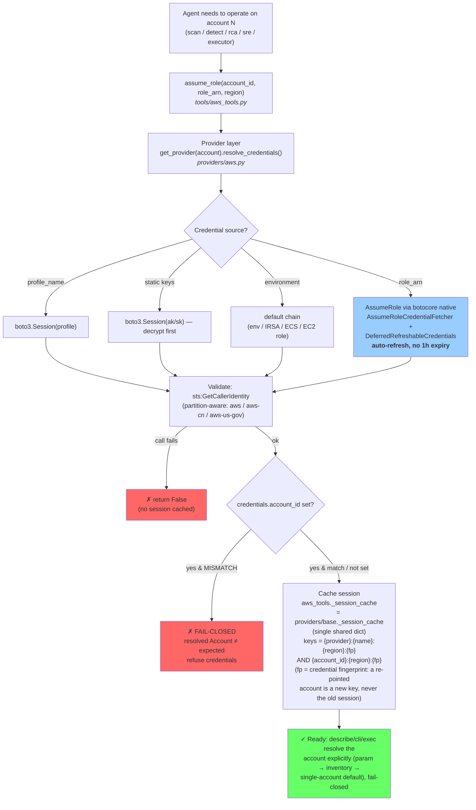

**Why account-addressed, not a ContextVar:** Strands runs sync tools under `asyncio.to_thread` + `contextvars.copy_context()`, so a ContextVar written inside a tool never reaches the next tool — a silent fallback to ambient credentials is how a command once ran in the wrong account. The account is an explicit property of the *target*: `credentials/resolver` resolves it from the tool's `account` param → inventory lookup by host/cluster id → the single enabled account. No registered account → fail-closed (never ambient).

### Authorization Flow (3-tier command gate + scoped exec)

Every AWS CLI / host command passes a classifier **before** it runs, then executes in an env scoped to the active account:

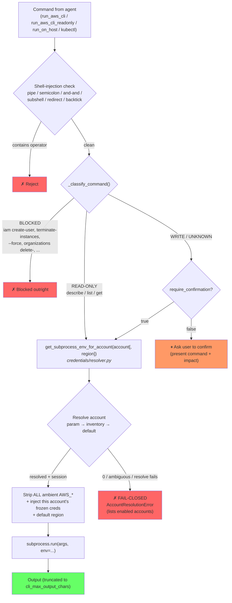

**Unified exec entry:** the AWS CLI tools, `run_on_host(ssm)` and `aws eks update-kubeconfig` take their env from `credentials/resolver.get_subprocess_env_for_account()`; kubectl (`run_kubectl`, the K8s connector) from `credentials/kube.kubectl_env_for_cluster(account, cluster, region)` — that env plus a private kubeconfig, never `~/.kube/config` or `KUBECONFIG`. No ambient branch: a missing, ambiguous or failed account is fail-closed. `run_on_host(method="auto")` climbs SSM → SSH on transport failure.

> **AuthN vs AuthZ separation:** AuthN decides *whose* credentials (provider layer, fail-closed); AuthZ decides *what's permitted* (3-tier classifier + L0–L4 approval gate in the fix pipeline). A read-only command on the right account still runs; a write command on the right account still needs confirmation / approval.

**What the classifier knows, and auto-approval (MVP-2.7.1):** an AWS operation the prefix tables do not list is classified by its verb (`create-` / `delete-` / `update-` / `put-` / `modify-` / `start-` / `stop-` / `tag-` / `invoke` / …; global options skipped) — this only ever raises a tier, and blocked patterns are checked first. `kubectl rollout status|history` are reads. A command is classified as its tool will run it (split as the tool splits it); a line that cannot be split is `unknown`. **Auto-approval never covers a step the code cannot classify**: an L0/L1 fix plan or standard change holding an `unknown` command, or a step with no command, waits for a human (`policy_decision`, rule `unclassified_command`).

**Where a run may only read (MVP-2.9.0 N30, N31).** A diagnosis, a fix-plan run and a detection only read — in code: the gate has no «confirm» branch there, a command that is not `READ-ONLY` is refused (ledger `refused` / `read_only_run`). A host line is split as a shell would split it and every command must be one that cannot change anything (`ls`, `cat`, `grep`, `ps`, `df`, `journalctl`, `systemctl status`, `ss` …); `awk`, `sed`, `find`, `curl`, `sudo`, a redirect to a file, `$(…)` and `$VAR` are refused. Skills register only read tools; the plan run has no enhanced backend. Chat and the executor keep the gate as drawn.

---

## Core Workflow: Issue Lifecycle

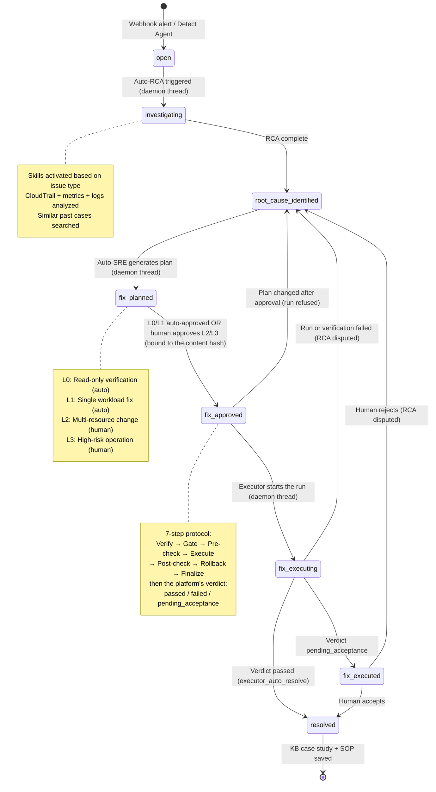

Every status write goes through one function, `services/issue_state.transition_issue` (see *Issue & Change Logic* below). `dismissed` (a false positive) is left out of the diagram: any unresolved state can move to it, it keeps suppressing repeats of its fingerprint, and `dismissed → open` reopens it.

---

## Agent Routing Logic

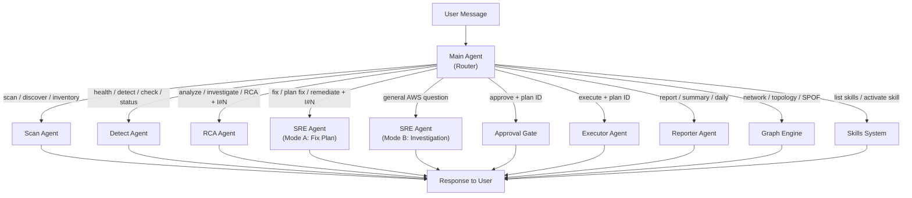

---

## Detection & Analysis Flow (Detail)

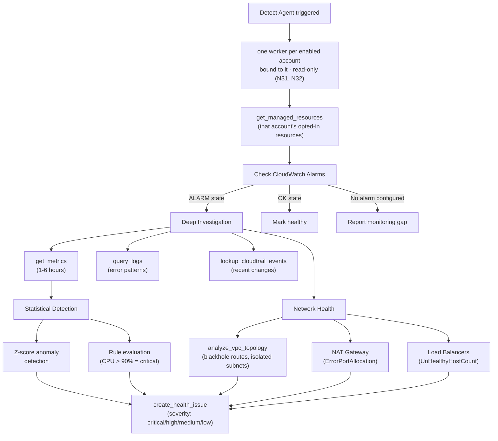

---

## Fix Execution Pipeline (Detail)

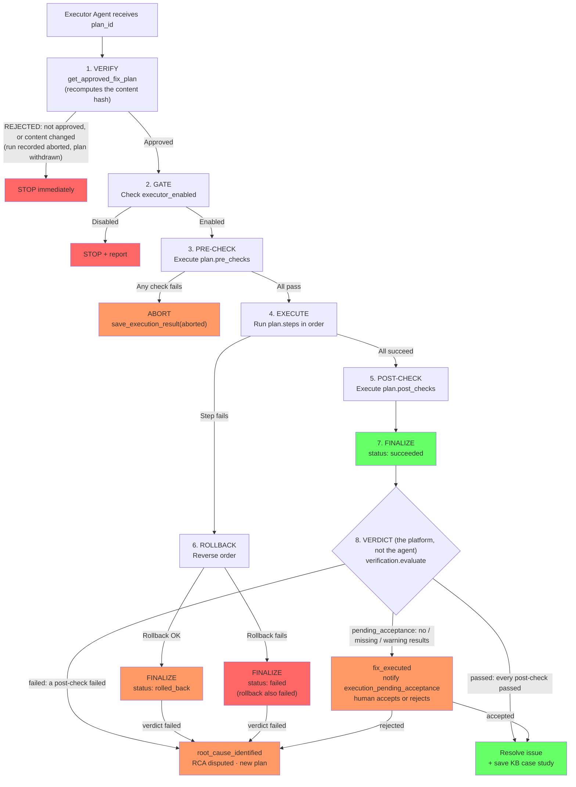

---

## Auto-Fix Pipeline (Closed-Loop Remediation)

When alerts arrive via webhook, the pipeline runs on its own — no person for L0/L1 fixes whose every step the classifier can read. A fix plan only restores the affected resource (improvements go to its summary as follow-ups for a change request), and `save_fix_plan` refuses a rollback that would take the service down (MVP-2.7.1):

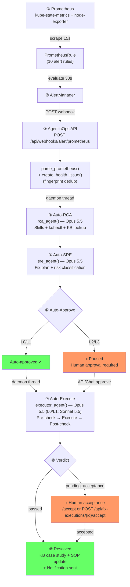

**Code path**: `app.py:_process_webhook_alert()` → `rca_service.trigger_auto_rca()` → `pipeline_service.trigger_auto_sre()` → `trigger_auto_approve()` → `trigger_auto_execute()` → `save_execution_result()` → `verification.evaluate()` → resolved (passed) / fix_executed (pending acceptance) / root_cause_identified (failed).

**Prevention hooks (graph engine, zero LLM)**:

- **Patrol graph risks** — the scheduled HealthPatrol runs an `AnalyzeGraphRisksStep` after detect: SPOF detection (articulation points/bridges) + capacity-risk analysis (subnet IP exhaustion, EKS pod limits) on the persisted infra graph. Findings become HealthIssues (`source=graph_patrol`) **without** auto-RCA — structural risks need design review, not CloudTrail forensics. Gate: `patrol_graph_checks_enabled`.
- **RCA topology evidence** — RCA pulls the published relation graph on demand through the `get_topology_evidence` tool (see *RCA Topology Evidence* below); `GET /api/graph/focus` returns an issue's local graph with a structural / potential / observed blast radius. Gate: `rca_topology_context_enabled` — the tool and its prompt section come and go together.
- **Pre-execution simulation gate** — `trigger_auto_approve()` runs `simulate_fix_impact()` (graph `impact_analysis`, account-scoped) before policy evaluation; the `impact-severity-escalation` rule in `policies.yaml` escalates plans whose target outage would isolate subnets or break critical paths. Fail-soft: no graph data → rule doesn't match → behavior unchanged.

**Key settings**:

| Setting | Default | What it controls |
|---------|---------|-----------------|
| `AIOPS_AUTO_RCA_ENABLED` | `true` | Auto-trigger RCA on new HealthIssue |
| `AIOPS_AUTO_FIX_ENABLED` | `true` | Master switch for auto-fix pipeline |
| `AIOPS_EXECUTOR_AUTO_APPROVE_L0_L1` | `true` | Auto-approve low-risk plans |
| `AIOPS_EXECUTOR_ENABLED` | `true` | Enable fix execution |
| `AIOPS_NOTIFICATIONS_ENABLED` | `true` | Auto-notify on pipeline events |
| `AIOPS_PATROL_GRAPH_CHECKS_ENABLED` | `true` | SPOF/capacity prevention step in patrol |
| `AIOPS_RCA_TOPOLOGY_CONTEXT_ENABLED` | `true` | Gates the RCA `get_topology_evidence` tool and its prompt section together |

The executor, auto-fix and L0 / L1 switches in force are what an administrator saved in Settings → Automation and execution (stored, kept across restarts); these variables are defaults, and one set to `false` holds its switch off whatever is stored.

> **See also**: [EKS Lab Auto-Fix Pipeline (Use Case 6)](use-cases/use-case-6-eks-lab-auto-fix-pipeline.md) for validated end-to-end test results.

---

## Change Management Flow (ITSM — no HealthIssue)

A routine change (tag edit, scaling, config) does **not** go through the incident pipeline. It flows
Main → SRE legitimacy review → approval → Executor, with an audit ledger and an identity-bound approver.
The change plan is a `FixPlan` with `plan_kind="change"` (never a HealthIssue).

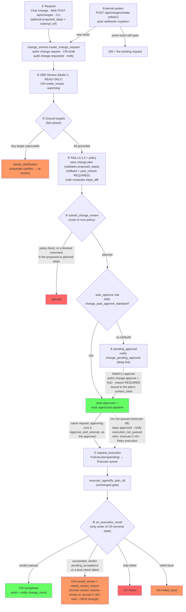

**Two ledgers, one gate:**

- **Decisions** → `audit_logs` (with an `actor` column): every requested/reviewed/approved/rejected/
  executed decision, written in the **same transaction** as the state change. Authorization runs through a
  single `authz.check(actor, permission, subject=)` against `config/rbac.yaml`; with `rbac_enforce=false`
  (default **shadow mode**) a denial is audited as `authz.denied_shadow` and the request is allowed.
- **Commands** → `command_audits`: every write-tier tool command (`run_aws_cli` / `run_on_host` /
  `run_kubectl`), fail-soft. A command matching `policies.yaml` `change_required` with no approved-plan
  context is **refused** and the user is pointed at `/change`.

**Invariants:** the CR terminal state is written only by `on_execution_result`; an unprovable target
yields no plan; auto-approval needs both the yaml rule and the `change_auto_approve_standard` flag, and no step
the command classifier cannot read (MVP-2.7.1: otherwise rule `unclassified_command` → a normal change).
A `webhook:*` requester (change intake) never approves or executes, even in shadow mode.

---

## Skills & Knowledge Base Flow

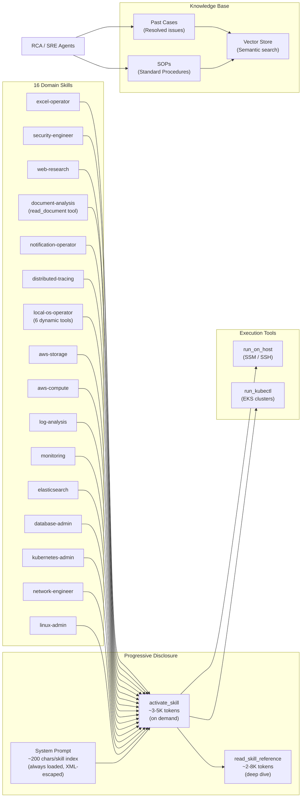

### Auto-Create Skills

When no existing skill matches the problem domain:

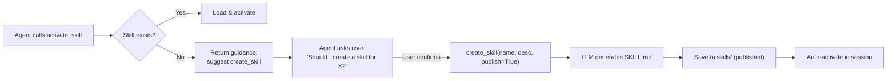

- Agent detects missing skill via `activate_skill` (not found) or by inspecting `<available_skills>`
- Always asks user for confirmation before creating
- `publish=True` saves directly to production `skills/` directory — no draft/promote workflow needed
- Skill is immediately activated and usable in the current session and all future sessions

### Self-Improving Skills

After resolving HealthIssues, the system analyzes whether existing skills had gaps:

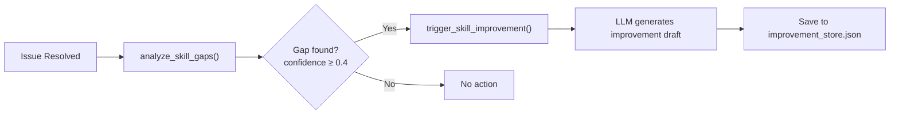

**Three trigger sources:**
- **Post-resolution** — automatic gap analysis after issue resolved (`skills_post_resolution_review`)
- **Agent-detected** — any agent flags a skill gap during its work
- **Manual** — user requests improvement via Chat or Web Portal

**Settings** (Web → Settings page):
- `skills_auto_improve_enabled` — master switch
- `skills_post_resolution_review` — enable post-resolution trigger
- `skills_improvement_notify` — send notifications on improvement

### 技能广域加载 + 脚本沙箱 (MVP-2.5.0)

技能不再只能手写在 `skills/` 里：可以从 URL / git 仓库 / zip 归档 / 本地目录导入，且技能包可以自带 `*.py` / `*.sh`，
由受限沙箱执行。

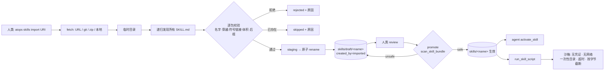

**要点：**
- **导入只落 draft，不执行包内任何代码**（没有 `install.sh` 钩子）。导入是人类动作，agent 没有导入工具。
- 一个仓库/归档可装多个技能：递归找出所有含 `SKILL.md` 的目录；命中后不再下钻，所以技能自己的
  `references/SKILL.md` 不会被当成第二个包。`--name` 可按名过滤。
- **promote 是唯一的生效门**，且会扫整包（SKILL.md 正文 + 所有 `.sh`/`.py`）。两半是同一道门的两种精度：`.py` 走
  `ast` 解析绑定（不再误杀 `model.eval()`／`df.eval()`），`.sh` 仍逐行匹配。这是人工审批前的确定性预过滤器，
  **不是对刻意混淆的抵抗**。
- 沙箱是与 `run_on_host` / `run_kubectl` 正交的新通道，**默认关闭**（`skills_sandbox_enabled: false`），
  关着时 executor 工具表里不出现 `run_skill_script`；拿不到隔离器（`unshare -n` / `sandbox-exec`）就**拒跑**，
  绝不假装无网络。沙箱**不限制文件系统写入**——所以整包扫描里的破坏性文件操作规则是真实边界。

**入口（三个面）：**
- CLI：`aiops skills import <uri> [--name N] [--json]`
- API：`POST /api/skills/import-source`（旧 `POST /api/skills/import` 仍是 multipart 上传那条路）
- **Web UI**：Skills → Import → 「URL / Git 仓库」标签页：粘贴地址后实时提示服务端会把它当成什么（Git 仓库 / 压缩包 / 单个 SKILL.md / 服务器路径，仅作提示，后端是唯一裁判）；可选「只导入指定技能」（= `--name`）。完成后是一张结果清单：一行总计 + 每个包一行（状态、名称、后端原因），已安装的行可「查看并发布」。「上传文件」标签页保留拖拽上传。导入来的技能带 **Imported** 徽标，详情页写明来源（`GET /api/skills` 的 `created_by` / `source_uri`，`GET /api/skills/{name}` 另有 `source_ref` / `imported_at`）。

### Schedule & Task Management via Chat

Agents can create and manage schedules/tasks through natural language:

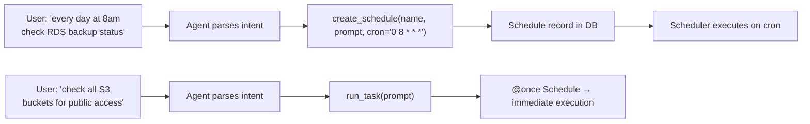

**Tools:** `run_task` (one-shot) | `create_schedule` (recurring) | `list_schedules` | `manage_schedule` | `get_schedule_history`

**CLI shortcuts:**
- `/run <description>` — executes one-shot task immediately (forwards to Agent as `run_task`)

**Chat management:** Natural language delete/pause/resume via `manage_schedule(id, action)` — Agent understands "delete task 42", "pause schedule daily-rds-check", etc.

**Report template:** Tasks append report instructions to the prompt. Users can provide custom Markdown templates or use the default format (summary → findings → recommendations).

**Execution config:**
- `timeout_seconds: 0` — unlimited by default (tasks run until completion)
- `max_retries: 0-5` — auto-retry on failure, notification sent only on final attempt
- `schedule_type: recurring | one_time` — explicitly distinguishes recurring schedules from one-time tasks

**Frontend (Schedules page):** a Recurring / One-time toggle in the creation dialog, All / Recurring / One-shot tabs with search, one-time tasks disable themselves after running.

### MCP Server Management

External tool providers via Model Context Protocol (Claude Desktop-compatible `mcp-servers.json`).

**Manage via Chat:**
```
User: "list mcp servers"         → list_mcp_servers
User: "add mcp server awslabs.aws-api-mcp-server command uvx args awslabs.aws-api-mcp-server@latest"
User: "validate mcp"             → validate_mcp_servers
User: "reload mcp"               → reload_mcp_servers (hot-reload, no restart needed)
User: "disable awslabs.aws-api-mcp-server" → toggle_mcp_server
```

**Also available:** Web Settings (MCP Servers card), API (`/api/settings/mcp-servers/*`)

**Lifecycle:** Lazy-start — MCP servers start on first chat message, not at app startup. Hot-reload validates config before applying.

**Security:** Tool names sanitized for Bedrock (`[a-zA-Z0-9_-]+`), subprocess env isolated (no VIRTUAL_ENV leak), `config/aws-mcp.cfg` auto-injected to avoid `~/.aws/config` plugin conflicts.

---

## Chat Preprocessing Pipeline

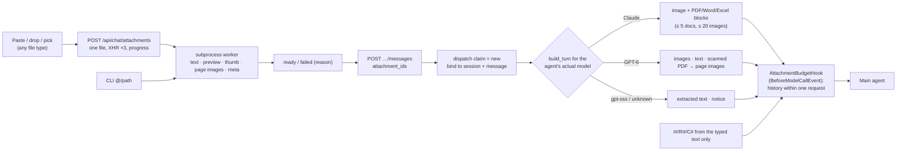

**Chat attachments (2026-11-07):** any common file — text, pdf (scanned too), Word, Excel, PowerPoint, csv / json / logs / code, images incl. HEIC — pasted, dropped or picked with ＋; each uploads at once and is processed in an isolated subprocess, and send waits for them. The message says how each reached the model («read natively», «text extracted», «page images», «not readable by this model»): Claude reads images and documents natively, GPT-6 images, gpt-oss text only; one request carries ≤ 5 documents and ≤ 20 images, so older documents become text. Limits: Settings → General → **Chat attachments**.

**The conversation list** (MVP-2.9.0 N22): tabs *All* / *Starred* / *Archived*, each from the server, pinned first then by last activity, grouped by UTC day; search covers the name, the linked issue / change and the account. Each row says what it is about and what is going on (replying · waits for you · last send did not finish · a step failed · draft kept); a **⋯** menu per row; *Undo* after archiving; a list that cannot be fetched says so.

**Messaging settings**: Settings → **Messaging** = Bot Apps (inbound credentials), Channels (outbound routing, `role: alert|chat`) and Delivery Logs, over `config/channels.yaml` + `config/im-apps.yaml` (`/api/messaging/*`); a blank secret keeps the stored one. `/api/notifications/*` and `/api/settings/{channels,im-apps}` are deprecated.

---

## Reading a Chat Answer (ChatGPT-style chat, 2.7.1)

Every Web chat answer has three parts: the **work log** (what the agent did), the **answer**, and what you can do next.

```mermaid
flowchart LR
    SSE["SSE frames<br/>text · tool_start (text_offset)<br/>tool_input (summary) · tool_end (duration, result, text_end)"] --> STORE["chatStream store<br/>+ chat_messages.tool_calls"]
    STORE --> SPLIT["splitWork<br/>cut the reply at each step's offsets"]
    SPLIT --> LOG["Work log<br/>steps + narration between them<br/>«Worked through N steps · T»"]
    SPLIT --> ANS["Answer<br/>the text after the last step's result"]
    ANS --> RICH["splitRichBlocks"]
    RICH --> MD["markdown<br/>tables, code (copy), I#/R#/C# links"]
    RICH --> CH["```chart → recharts<br/>bar · line · area · pie"]
    RICH --> MM["```mermaid → flowchart<br/>(loaded on demand, strict)"]
    ANS --> ACT["copy · regenerate · ⋯ save as report<br/>«Next steps» chips (click = send)"]
```

How to read it:

1. **The work log.**
   - While the agent works, it is open: each step appears as it starts, with what it ran (credentials masked) and how long it took. Click a step to see the start of its result.
   - When the answer is done it folds to one line: «Worked through N steps · T». Click it to open the log again; it reads the same after a reload.
   - The model's own remarks between steps («let me check …») are in the log, not in the answer.
2. **The answer.**
   - Statistics come as one sentence and a table (fewer tokens). Ask for a chart («画个柱状图», "plot it") and you get one: hover for values; ⤢ enlarges it and shows its data as a table.
   - Flows come as flowcharts. Click to enlarge and zoom; ESC closes.
   - Code blocks have a copy button.
3. **Next.**
   - Copy takes the answer as markdown; ⋯ copies it as plain text or saves the chat as a report.
   - Regenerate (last answer only) asks the same question again and the new answer comes below. It is off when the question carried attachments, because attachments go with one message; attach them again instead.
   - «Next steps» are what you would likely ask next; a click sends one.
4. **Attaching.**
   - Drop files anywhere on the chat, paste a screenshot, or use ＋.
   - Files sit inside the input box: images as thumbnails with an upload ring, documents as coloured cards, refused files in red with the reason.
   - Send waits until every upload is processed.
5. **On a phone.**
   - The chat list is a drawer (☰), and the input box stays at the bottom.
   - Enter makes a new line; the arrow sends.
   - Swipe left or right in the image viewer.

Only the Web chat draws charts and flowcharts. The CLI, IM bots and scheduled runs keep plain text answers.

## Concurrent Chat Sessions & Fast Session Open

The Web chat supports **multiple simultaneously-streaming conversations** in one browser tab and opens any session **instantly**, regardless of history size.

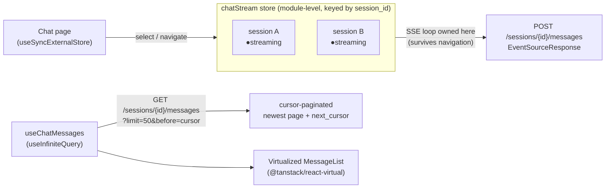

**Concurrency.** The SSE read-loop lives in a module-level `chatStream` store keyed by `session_id`, not in the page: switching conversations does **not** stop generation, several stream at once (a live ● dot marks each), and the input is disabled only in the one that streams. One turn per conversation at a time (the Strands agent lock).

**Fast open.** History is cursor-paginated (`GET /api/chat/sessions/{id}/messages?limit=50&before=<msg_id>` → the newest page + `next_cursor`), `GET /api/chat/sessions/{id}` is metadata only, and the list is virtualized (`@tanstack/react-virtual`), loading older pages as you scroll up without a jump.

**Caching.** No server-side cache: the TanStack Query page cache (a finished stream appends in place), the Bedrock prompt cache, and a per-message markdown memo so re-mounted rows are not re-parsed.

**Persistence.** Sessions and messages live in SQLite (`data/agenticops.db`): `chat_sessions`, `chat_messages` (indexed on `(session_id, id)` for cursor scans), `session_summaries`.

**Reload caveat.** An in-flight stream is **not** resumed after a hard page reload (by design); the backend persists the partial reply, so it appears in the loaded history.

---

## Enhanced Backend (ACP) — optional task delegation

Selected agents (**main** and **sre**) can delegate a hard task — create-skill, deep research, brainstorming, complex multi-step operations — to an external coding agent for a higher-quality result. This is an **optional enhancement / escalation path**, not a replacement: the Strands 7-agent orchestration is unchanged, and the feature is **off by default**.

```
main / sre agent
   │ LLM decides a task is complex → calls a @tool (like a sub-agent)
   ▼
@tool enhanced_task(task, context, backend?)        ← registered only when acp_enhanced_enabled=true
   ▼
EnhancedBackend abstraction + registry  (protocol-agnostic core)
   ▼ get_backend(acp_enhanced_backend) — provider chosen in Settings → Enhanced Backend
   ├─ ClaudeCodeBackend → AcpClient → npx claude-agent-acp   (Bedrock; Node ≥ 22)
   ├─ KiroCliBackend    → AcpClient → kiro-cli acp           (IAM Identity Center login)
   └─ CodexBackend      → AcpClient → npx codex-acp          (needs OPENAI_API_KEY)
   ▼ stdio subprocess (self-implemented JSON-RPC 2.0)
   ▲ EnhancedEvent → existing SSE (text / tool_start / tool_end / done) → chat UI + "✦ Enhanced" chip
```

- **Self-implemented protocol** (`src/agenticops/acp/`): newline-delimited JSON-RPC 2.0 over stdio — no third-party ACP dependency; launched with `npx -y`, `protocolVersion: 1`, nested `session/update` payloads, terminal `usage` tokens.
- **End-to-end streaming, no buffering.** `session/update` notifications → `AcpClient` (async generator) → `backend.run()` yields `EnhancedEvent`s → `enhanced_task` is an **async-generator `@tool`** (each yield a Strands `ToolStreamEvent`) → the web stream maps them to SSE (`tool_stream_to_sse`). Claude Code's own tool calls show as live steps, so a long task shows its progress; no chunk is held back.
- **Three providers, pluggable**: `claude-code` (Bedrock), `kiro-cli` (`kiro-cli acp`, kiro's own login) and `codex` (`@zed-industries/codex-acp`, needs `OPENAI_API_KEY`) share the one `AcpClient` (`protocol_version` per provider). Another provider = one class + `register_backend()`.
- **Choose in the UI**: **Settings → General → Enhanced Backend** — a toggle (`acp_enhanced_enabled`) and a provider; both persist to `settings.yaml` and rebuild the chat agents on the next message.
- **Graceful**: if the backend is unavailable (no `npx`, not logged in, no key, launch fails, disabled), `enhanced_task` returns a clear message and the calling agent continues with normal handling — the turn never crashes. With Bedrock turned off, Claude Code on Bedrock is not offered and a call naming it is refused; Settings says why.
- **Enable**: toggle it in Settings, or set `acp_enhanced_enabled: true` in `config/settings.yaml` (config keys: `acp_enhanced_backend`, `acp_use_bedrock`, `acp_timeout_seconds`, `acp_auto_approve_permissions`, `acp_kiro_command`/`acp_kiro_args`, `acp_codex_command`/`acp_codex_args`).

---

## Model Providers — Beyond Bedrock (MVP-2.9.0 N35)

Every model call can go to a provider other than Amazon Bedrock, and the whole system can run with Bedrock turned off.
A model setting holds either a Bedrock model id (as before — every existing setting stays valid) or a **reference**
`<provider>::<model id>` (split at the first `::`; Ollama's `qwen3:32b` and OpenRouter's `vendor/model` ids are fine).

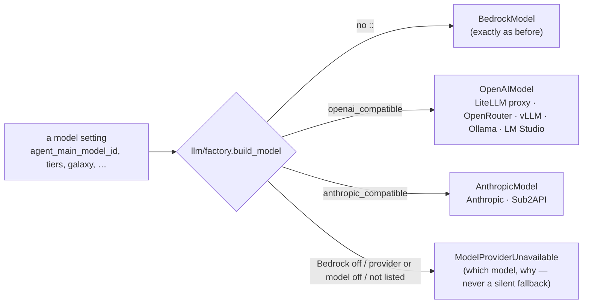

**Add a provider** (Settings → Model providers, an administrator): «Add provider» → pick the platform (its usual
address and protocol are filled in) → name (lowercase, it is how settings refer to it: `name::model`), key, optional
extra headers → «Test connection»: the form is tested as it stands — list, one chat, one tool call — and nothing is
stored. After a pass «Save» stores it, reads its model list and runs the stored test; after a failure it can only be
saved switched off. An edit that changes the protocol, address, key or headers is tested the same way first (an edit
of the name or timeout is not). Then give the models to the settings: Settings → General → «Agent models» and «Other
places that use a model» (the three tiers, the executor's model for L0 / L1 plans, the security advisor, report
translation, the Signal Gate's merge judge, the RCA critic, Galaxy). Every picker is the same: grouped by provider,
searchable, arrow keys and Enter work, each model with what it can do.

| Platform | Address | Key | Notes |
|---|---|---|---|
| LiteLLM proxy | `http://localhost:4000/v1` | the proxy's key | model ids are the proxy's model names |
| OpenRouter | `https://openrouter.ai/api/v1` | yes | its list carries prices, context lengths, tool support |
| vLLM | `http://localhost:8000/v1` | only with `--api-key` | tool calls need `--enable-auto-tool-choice` and a parser |
| Ollama | `http://localhost:11434/v1` | no | only models with tool support can run agents |
| LM Studio | `http://localhost:1234/v1` | no | |
| Sub2API / any Anthropic-compatible gateway | the gateway's base (no `/v1`) | yes | Anthropic Messages API |
| Anthropic | `https://api.anthropic.com` | yes | |

**Run without Bedrock**: point every agent, the three tiers and (optionally) the knowledge base's vector model at
providers, then turn the «Amazon Bedrock» switch off. With it off no Bedrock model is listed or called, `/api/health`
skips the Bedrock identity, and any setting still naming a Bedrock model is shown in red with the reason
(`model_issues` of `GET /api/settings`) — and fails explicitly when used.

**Models**: the «Models» dialog searches, filters, refreshes, adds a model by id, turns one on / off and sets window, max output, tools, images, documents, reasoning, takes temperature (not known = not sent), prompt cache (Anthropic-compatible; by default on for Anthropic and Sub2API), prices; a hand-set field survives a refresh. Nothing is read off a model's name: a new model is chat until marked as embedding. Nothing Bedrock-only is sent there.

**Where the data goes**: everything an agent sends to a model — conversation, tool results, resource names, configuration — goes to that model's provider; a third-party platform sees it all, and the page says so. The enabled providers' model lists are read again at startup, in the background.

**Keys**: stored encrypted when `AIOPS_MASTER_KEY` or a KMS key is configured (the page warns when they would be
stored in plain text), never returned, logged or audited; editing keeps the stored key unless a new one is typed,
«Remove the saved key» clears it. Header values are stored the same way.

**Knowledge base vectors** (Settings → Knowledge base → «Vector model»): a provider's embedding model (OpenAI-compatible), else Titan while Bedrock is on, else keyword search only. After a change, «Rebuild the vectors» re-embeds every case and SOP and replaces all vectors at once — if one fails the old ones stay (SQLite vector store only).

```bash
aiops providers list                              # name, protocol, address, models, last test — never a key
aiops providers test local-llm --model qwen3:32b  # list / chat / tool call; exit 1 when a step fails
```

API: `GET/POST /api/model-providers`, `PATCH/DELETE /api/model-providers/{name}` (409 `in_use` names the settings that
use it), `PUT /api/model-providers/bedrock {enabled}`, `POST /api/model-providers/test-draft` (the form, before it is saved), `POST …/{name}/test`, `POST …/{name}/refresh-models`,
`GET/POST …/{name}/models`, `PATCH …/{name}/models/{model_id}`, `GET/PUT /api/kb/embedding`, `POST /api/kb/reembed`;
`PATCH /api/settings` takes `model_settings`. With sign-in on, changing any model or provider needs an administrator.

---

## Cloud Security Review (MVP-2.5.0)

A dedicated posture engine (`security/`) that runs on **two independent cadences** and turns raw cloud config into scored, reachability-annotated, deduplicated, and (optionally) LLM-advised findings. Everything is deterministic where it counts and fail-safe where it can't be.

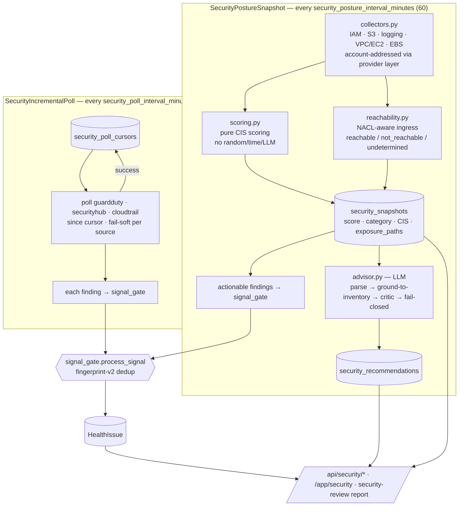

**Principles enforced end-to-end** (validated live in `docs/MVP-2.5.0-E2E-REPORT.md`):
- **Reproducible scoring** — `scoring.py` is pure; reachability and recommendations never feed back into scores.
- **Conservative reachability** — missing route/NACL data yields `undetermined`, never a false `not_reachable`.
- **Fail-closed advisor** — a recommendation not grounded in inventory, refuted by the critic, or that raises, is dropped (0 rows); the advisor never blocks a snapshot.
- **Fail-soft collectors / pollers** — a failed source is skipped with a WARNING and recorded; an account none of whose sources could be read is not scored (never 100), and a poll cursor advances only on success.
- **One issue per fingerprint** — every finding (posture + poll) flows through the Signal Gate; duplicates merge instead of storming.

**Using it:**
- **Web**: **`/app/security`** shows per-account scores, a score trend, CIS radar, findings, recommendations, and exposure paths; the Runtime overview's security card lists each account (score and tier, or «cannot be scored»).
- **API**: `GET /api/security/{summary,trend,findings,recommendations,attack-paths}`.
- **Report**: `POST /api/reports/generate {"report_type":"security-review"}` (or ask the reporter agent for a "security review report").
- **Schedules**: `SecurityPostureSnapshot` (slow) and `SecurityIncrementalPoll` (fast) are registered pipelines; cadence via `security_posture_interval_minutes` / `security_poll_interval_minutes`.
- **Config**: `security_review_enabled`, `security_advisor_enabled`, `security_advisor_critic_enabled`, `security_reachability_nacl_enabled`, `security_snapshot_retention_days`, `security_model_id` (empty = `bedrock_model_id_cheap`).

---

## Quick Tutorials

### Tutorial 1: First Scan — Discover Your AWS Resources

```bash
# 1. Start interactive chat
aiops chat

# 2. Pick the account to work in (/account list shows the registered ones)
/context account prod

# 3. Scan all resources in all regions
scan all resources in all regions

# 4. Or scan specific services/regions
scan EC2 and RDS in us-east-1 and us-west-2

# 5. View results
/resource list
```

**What happens behind the scenes:**

Main Agent → routes to **Scan Agent** → calls `assume_role` → loops through services (`describe_ec2`, `describe_rds`, ...) → saves to SQLite → returns summary.

**Resources that disappear.** A scan never deletes a row: a type listed completely in a region (no error, not truncated, no page token) marks the AWS rows it did not see `absent_since`, and a row seen again returns. Counts and lists show present rows only (**Show absent** on Resources); lookups by id and the graph still see them. The `resource-scan` schedule runs this scan every `resource_scan_interval_minutes`.

---

### Tutorial 2: Health Check — Detect Issues

```bash
# Quick health check (alarm-based, fast)
check health of all services

# Deep health check (adds z-score anomaly detection, slower)
run a deep health check on all services in us-east-1

# Check specific resource type
check health of EC2 instances
```

**What happens:**

Main Agent → **Detect Agent** → checks CloudWatch alarms → pulls metrics/logs for alarming resources → runs statistical detection → creates `HealthIssue` records.

**Output:** A severity-sorted table of issues found, with IDs you can reference as `I#N`.

---

### Tutorial 3: Root Cause Analysis

```bash
# Analyze a specific issue (use the I# from detect results)
analyze I#42

# Or describe the problem naturally
investigate the high CPU on i-0abc123def in us-east-1
```

**What happens:**

Main Agent → **RCA Agent** → activates domain skills (e.g., `linux-admin` for EC2) → searches KB for similar cases → checks CloudTrail for recent changes → gathers metrics/logs → synthesizes root cause with confidence score → generates fix recommendations.

**Output:** Root cause summary, confidence score (0.0–1.0), contributing factors, recommended fix.

---

### Tutorial 4: Generate & Execute a Fix Plan

```bash
# Generate a fix plan
generate a fix plan for I#42

# Review it
/fix show 7

# Approve the plan (required before execution)
approve fix plan 7

# Execute
execute plan 7
```

**Risk levels determine approval requirements:**

| Level | Risk | Example | Approval |
|-------|------|---------|----------|
| L0 | Read-only | Verify metric recovered | Auto |
| L1 | Single workload | kubectl rollout undo, set resources, delete networkpolicy, scale | Auto |
| L2 | Multi-resource | Resize instance, modify SG rules, multi-namespace changes | **Manual** |
| L3 | High-risk | Service restart, failover, data migration, node drain | **Manual** |

**Execution flow:** Pre-checks → Execute steps → Post-checks → Auto-rollback on failure.

---

### Tutorial 5: Using the Web Dashboard

```bash
# Start the web server
aiops web
# or
uvicorn agenticops.web.app:app --reload --port 8000
```

Open `http://localhost:8000/app/` and sign in.

- **Where `/app` lands**: your pinned home (Chat / Issues / Reports — **Home & language** in the avatar menu or at the foot of the sidebar), else the last page you had open (one that is gone or no longer visible falls back to its list with a notice), else Chat; under the new interface, **Decide**. An administrator with no enabled account lands on `/app/setup`. A full URL always opens exactly that page; signed out, any page goes through `/app/login?next=…` and back (same-origin `/app` pages only).
- **Top bar**: breadcrumb, **Needs your attention** (what waits on *you* — the sidebar's Issues count; opens *Issues · Waiting on me*), the **account scope** (one account or All; lists, Resources, Security and the count follow it, a detail page shows its own), search (⌘K / Ctrl K), 中文 | English and the avatar menu (account, API keys, theme, font size, Home & language, the new interface, sign out). Home, language and the last page follow your account to other browsers; theme and font size stay per browser.
- **Sidebar**: *Daily work* (Issues, Chat, Plans & changes, Security, Reports), *Operations* (Runtime overview, Galaxy, Schedules, Resources, Agent metrics, Skills), *Administration* at the foot (Users — admins only —, Settings); drag to reorder inside a group. One number per entry at most — Issues: what waits on you (red with a critical one), Security: open high / critical findings, Schedules: latest run failed, Skills: drafts; never a guessed 0. A read-only account sees no numbers and no Administration.
- **Approvals say what they do**: «Approve & run» only when approving really queues the run (auto-fix and the executor on), otherwise «Approve» and someone presses **Execute** later; every approval asks you to tick «I have reviewed this version, the target scope, the risks and the recovery checks».
- **Every dialog and side panel closes on Escape**; a delete confirmation closed with Escape deletes nothing.

| Page | What You Can Do |
|------|----------------|
| **Runtime overview** (`/app/overview`) | Counts, *Recent issues* (who each waits on and for how long, the resource's short id with a copy button), a security card per account (score and tier, or «cannot be scored») |
| **Chat** | The CLI's chat with streaming, attachments and many conversations at once (*Reading a Chat Answer* and *Concurrent Chat Sessions* above). A new chat takes its context: **Ask Agent** on an issue binds it to the issue's account, otherwise the top bar's account (or none: all accounts); the line above the composer says which, and a bound chat's tools refuse every other account. Sending is safe to repeat (one message, one run); a reply cut off by a reload is labelled *interrupted*; **Stop** ends the reply only — queued or running work keeps going. Drafts survive navigation, a language switch and a reload |
| **Issues** (`/app/issues`) | **Waiting on me** first: every issue and change that waits on *you*, grouped by the decision (approve, accept, failed, confirm), longest wait first; then *All*, *Failed*, *Waiting long*. Filters (ops / security / all, status, severity, sort, search — a title, a resource or `I#12`) are the server's and in the URL. At ≥ 1280 px the list sits beside the item's page; narrower, they take turns and back returns to the same list. Old `/app/inbox` links open here |
| **Issue Detail** / **Change Detail** | The work-item template (*Issue & Change UI* below): one status line with the one next step, phase cards (issue ① Diagnose ② Plan ③ Approve & run ④ Accept; change ① Request ② Review ③ Plan ④ Approve & run ⑤ Accept) and a rail of facts and activity. **Add a note** (append-only, under your name; needs write); **⋯ → Ask Agent** opens a chat about the issue, nothing sent until you send |
| **Plans & changes** (`/app/plans`) / **Plan Detail** | Tabs **Fix plans**, **Changes** (with **New change request**: optional steps and an external ticket) and **Audit** (admins only with sign-in on), each with how many of its items need you; filters in the URL. `/app/plans/:id` reads like an approval: origin issue, target, version and hash, what changes, checks, rollback, then the approval and the runs. Old `/app/changes` and `/app/audit` links land on their tab |
| **Resources** / **Resource Detail** | A table of name + id, type, account, region, lifecycle (**Show absent**), health — open issues anchored to it; *Unknown* always says why: no open issue, stale data, gone, never observed — and last observed; the head says when the last resource scan ran; cards on a phone. One resource: overview, its issues and fix plans, network, tags and a **Local graph** |
| **Signals** (`/app/signals`) | Every signal the Signal Gate judged; reached from the issue list's **Raw signals →** and an issue's rail, not from the sidebar |
| **Galaxy** (`/app/galaxy`) | The resource starfield; `?focus=<resource id>` centres one resource |
| **Security** (`/app/security`) | Per account (follows the account scope): score / 100 and tier (≥ 80 good, 50–80 needs attention, < 50 look first), reachable paths, this account's open findings, a 7 / 30 / 90-day trend, CIS radar, recommendations, exposure paths. An account none of whose sources could be read says **Cannot be scored** with each reason — never 0, never 100; a control whose source failed is *undetermined*, never a pass. Findings are filtered and counted by the server («1–20 of 821»); each links to its issue |
| **Reports** / **Report Detail** | Generate and read reports; search covers title, summary and body of every report you may see (`R#145` opens it). Each report has a version and an owner and reads in Chinese or English, one at a time — a language not ready says so; **Export**, **Print**, **Publish** (shows the destination, sends exactly the shown version once). The reporter agent's reports carry a **Coverage** card recorded by the system |
| **Schedules** / **Schedule Detail** | Cron-based scans and checks. «Configuration» (enabled or not) and «Latest run» are separate facts — an enabled schedule that never ran says «not run yet», never «running»; times are UTC; after **Run now** the page says «submitted» until the run appears |
| **Sign-in** / **Setup overview** (`/app/setup`) | Sign-in tells a wrong password from an unavailable service and keeps what you typed. Setup says where cloud accounts, the model, execution and approval, and notifications stand, with the facts and a button to each; «verified» only for credentials or a model actually tested (*Verify the model*, administrators: one real call) |
| **Skills** / **Skill Detail** | The 16 domain skills; import from a URL / git repo / zip (a result manifest, an *Imported* badge); review, promote and roll back drafts |
| **Agent Metrics** | Tokens, latency, cost and RCA root-cause location — one time range (7 / 30 / 90 days, in the URL) for every module; accuracy reads «1 / 1 judged correct · small sample · 1 of 56 RCAs judged», never a bare 100 % |
| **Users** (`/app/users`) / **API keys** (`/app/account/api-keys`) | See *User Accounts & Read-only Roles* below |
| **Settings** | Tabs (`?tab=`): General, Accounts, Model providers, Messaging, Audit Log, Knowledge Base, Skills, MCP Servers, Agent memory. *General* = **Basics**, **Automation and execution**, **Models** (+ Pull connectors, Chat attachments, Model connection, Enhanced Backend). The six high-impact switches are staged and saved together after **Preview and save changes**; each says the value in force and where it comes from (stored, the file, or held by the environment — then disabled). Only an administrator changes them; every change is audited |

Web chat takes any common file — paste, drop or the composer's ＋ menu (see *Chat attachments* above).

#### The new interface — NewUI (MVP-2.9.0, `/app/new`)

Built around one question: *what needs a decision from me now?* Open it from **New interface (NewUI)** under the sidebar logo, the avatar menu or the phone menu; **Classic view** (top right; below 960 px in the account menu) goes back. The choice is yours, per browser: in the new interface **every page opens in it** — the classic pages at their own addresses under its top bar and command bar, in its day / night colours — and notification links open there too. The classic interface stays the default. Release note: [`MVP-2.9.0-RELEASE.md`](MVP-2.9.0-RELEASE.md).

| Lens | Address | What you do there |
|------|---------|-------------------|
| **Decide** (`1`) | `/app/new/decide/I12` | Your queue (the items of *Issues · Waiting on me*, most severe first; filters All / Approve / Accept / Trouble / Confirm) and **one brief per item**: one decision and what it rests on — the diagnosis and its evidence, every plan step with the tier the code gave its command (read-only / changes something / cannot be classified / blocked), what it touches, how success is checked. A brief per reason the server reports (20 today); an unknown one gets a generic page with a link to the classic one |
| **Story** | `/app/new/story/I12`, `…/C3` | One item's whole record — found, diagnosed, planned, approved, run, accepted — with every timeline event, notes (issues) and *Reopen* for a dismissed issue. `Enter` on a brief opens it; `Esc` returns |
| **Live** (`2`) | `/app/new/live` | What agents are doing **now** (flagged past its limit), what **stalled** (back with a person as «diagnose again»), what is **due next**, what **ended in the last day**. A lane lists its steps as the code recorded them (◆ a fact, ▸ an action, ◇ the model's words; refused ones struck through). `E` sends a word to a diagnosis, plan or change review at work (read before its next model call, kept in the record). **Hold `A` to stop a run**: only the plan's own rollback lines and read-only checks may run after it; a run stopped after its last step waits for acceptance. A read-only account sees no command lines or output |
| **All items** | `/app/new/items` | Every issue or every change, closed ones included; kind, status, severity, search and sort in the URL, counts from the server, 50 at a time; a row opens the story, *back* returns to the table |
| **World** (`3`) | `/app/new/world` | Every resource of the latest graph build on one map, flat or 3D (`V`): find (`F`), filter, only what is around one (`G`), a path between two (`L`), back to the whole (`H`). A ring = open issues; no ring = *unknown*, not healthy; a dashed outline = gone. Relations are the build's (its time is on the card); health is read again every 30 s. A path prefers rule relations and says when a step is only inferred. The **data check** card compares what was drawn with the data every second and turns red when the counts differ |

**Keys** (`?` lists them; off while you type): `J` / `K` next / previous · **hold** `A` for the main action when it changes infrastructure or is final — it goes to exactly the version you were shown; any other key cancels · `R` request changes (the plan goes back **and** the agent redoes it with your sentence; the new brief shows what changed) / not accepted · `D` dismiss · `S` later (an hour) · `X` tick the next check · `Y` / `P` / `N` / `F` the diagnosis is right / partly / wrong / a false alarm · `M` diagnose again · `Space` evidence · `Enter` story · `Q` ask an agent · `1` `2` `3` lenses · `T` day / night · `Esc` one layer · **`Z` undo** — a decision is sent five seconds after you make it; until then undo means it was never sent.

**Command bar** (`/` or ⌘K / Ctrl K, at the foot of every lens): `/` lists commands and pages, `@` lists things — what waits on you first, then the global search (`12`, `I12`, `C3` find that item first). It goes to places; plain text ends with «ask an agent: …», which opens a **new** conversation with the sentence in the composer, not sent.

**What the server decides, not the page**: «Hold to approve **and run**» only when approving starts the run; an approved plan runs only while its issue still waits for it; *read-only* only for one command a shell would not split (a command holding `[REDACTED-SECRET]` is *cannot be classified*); a plan redone after a person's «no» always comes back to a person; an item an agent is working on leaves everyone's queue and a second request is 409.

**The last 24 hours**: the top bar's band marks each issue found, agent start / end, person's decision and change step of the last day; on **World** the slider (`[` / `]` previous / next event, `P` play, `0` now) shows which resources had an open issue then — severity, anchors and relations are today's, and the page says so.

**The other pages** are the classic ones inside the new frame (**Pages** in the top bar, or the command bar); there only ⌘K / Ctrl K and `Esc` are the frame's. Issue and change addresses open the story, the issue list opens **All items** or **Decide**, Galaxy opens **World**; «open the classic page» stays classic for that section. Not in NewUI yet: pausing an agent.

---

### Tutorial 6: Headless Mode (Scripting & Automation)

```bash
# Single-shot query (prints response and exits)
aiops chat "check health of prod"

# Pipe mode (machine-readable output)
echo "list all critical issues" | aiops chat

# With file attachment
aiops chat "analyze this error log @/tmp/error.log"

# With image analysis
aiops chat "what's wrong in this screenshot @/tmp/dashboard.png"

# Chain commands in CI/CD
aiops chat "scan EC2 in us-east-1" && \
aiops chat "check health of EC2" && \
aiops chat "generate daily report"
```

**TTY detection:** Rich formatting when running in terminal, plain text when piped.

---

### Tutorial 7: Network Topology & SRE Analysis

```bash
# View VPC topology
show me the network topology for vpc-0abc123

# Find single points of failure
detect single points of failure in vpc-0abc123

# Check capacity risks
analyze capacity risk in vpc-0abc123

# Simulate removing a network link
what happens if I remove the connection between subnet-aaa and nat-gw-bbb?

# Dependency chain (blast radius)
what depends on i-0abc123def?
```

**Note:** Topology is exposed through the agent (SRE/RCA call the graph engine tools) and chat, not a dedicated web page — the standalone Network page was removed. Ask in chat (CLI or Web) as shown above; the graph engine (NetworkX: SPOF, capacity risk, dependency chain, change simulation) runs server-side as agent tools.

---

### Tutorial 8: Using Agent Skills

```bash
# List available skills
list available skills

# Skills are auto-activated during RCA/SRE — but you can also ask directly
activate the kubernetes-admin skill and help me debug pod CrashLoopBackOff

# The agent will:
# 1. activate_skill("kubernetes-admin") — loads decision trees
# 2. Follow the decision tree for CrashLoopBackOff
# 3. Use run_kubectl to inspect the pod
# 4. Read references for deep-dive material if needed
```

**Adding your own skill:** See `skills/ADDING_SKILLS.md` — just create a directory with a `SKILL.md` file, no code changes needed.

---

### Tutorial 9: Reference Shortcuts in Chat

```bash
# Reference a health issue by ID
what is the status of I#42?

# Reference an AWS resource by ID
show me details of R#17

# Combine references
compare I#42 with the config of R#17

# Attach a file for context
analyze this error log @/var/log/app/error.log alongside I#42
```

The preprocessor resolves `I#N` and `R#N` references by querying the database and injecting context blocks into the message before the agent sees it.

---

### Tutorial 10: Reports & Scheduled Operations

```bash
# Generate reports
generate a daily report
generate an incident report for critical issues
generate an inventory report for EC2

# View reports
/report list
/report 3

# Schedules: list them, run one now (create one in chat — «every day at 8am check RDS backups» — or on the
# Schedules page)
/schedule list
/schedule run resource-scan

# Example schedules:
# - Daily health check at 8:00 AM
# - Weekly inventory scan on Mondays
# - Hourly critical-issue detection
```

**Reading any data module.** Every module says one of four things: loading, failed (with Retry), empty (only when the request succeeded and returned nothing), or its data. When a refresh fails, the last data stays on screen under «refresh failed — as of HH:MM UTC». A failed request is never shown as «no findings».

---

### Tutorial 11: Notification Channels & /send_to

```bash
# List configured channels (reads from config/channels.yaml)
/channel list

# Show channel details
/channel show feishu-ops

# Test a channel (sends a test message)
/channel test feishu-ops

# Update channel config (writes to YAML)
/channel set feishu-ops severity_filter critical,high
/channel set slack-incidents enabled true

# Send report to a channel
/send_to feishu-ops #R5

# Send local doc to a channel
/send_to slack-incidents #D3

# Send free text to an IM alias
/send_to ops-team "Production incident resolved"
```

**How it works:**

- `/channel` manages channels defined in `config/channels.yaml` (the sole source of truth)
- `/send_to` resolves target as: NotificationChannel name -> IMAlias name
- Content can be: `#R<id>` (Report), `#D<id>` (LocalDoc), or free text
- Available in CLI, Web chat, and IM bot

**Supported channel types:** Feishu, DingTalk, WeCom, Slack, Email (SES), SNS, Webhook.

**Auto-notifications:** When `AIOPS_NOTIFICATIONS_ENABLED=true`, the pipeline sends notifications on key events (report saved, schedule result, execution result).

**Consolidated mode (default):** `AIOPS_NOTIFICATIONS_CONSOLIDATED=true` suppresses per-issue notifications during Scan/Detect/RCA operations — only the final report is sent. Set to `false` for dev/debug to see every notification individually.

**Pre-signed download URLs:** When S3 storage is configured (`AIOPS_REPORT_STORAGE=s3`), report and schedule notifications automatically include a time-limited download link (default 7 days, configurable via `AIOPS_REPORT_PRESIGNED_URL_EXPIRY`). Works across all channels — Email, Slack, Feishu.

**IM WebSocket auto-detect:** Feishu/Slack WS connections start automatically when an enabled channel of that type exists in `config/channels.yaml`. No need to set `AIOPS_FEISHU_WS_ENABLED` manually.

---

### Tutorial 12: IM Bot (Feishu / DingTalk / WeCom)

```bash
# Start with embedded Feishu bot (default)
uvicorn agenticops.web.app:app --port 8000

# Or run Feishu bot standalone (no web)
python -m agenticops.im.feishu_ws
```

In any IM conversation with the bot, you can use the same natural language as CLI:

```
User: check health of EC2 in us-east-1
Bot:  Found 3 health issues: ...

User: analyze I#42
Bot:  Root cause: memory leak in container...

User: /send_to slack-incidents #R5
Bot:  Report sent to slack-incidents channel
```

**Setup:** Configure IM app credentials in `config/im-apps.yaml` and notification channels in `config/channels.yaml`.

---

### Tutorial 13: Raise & Approve a Change (no incident)

```bash
# 1. Open a change request from chat (SRE reviews it immediately)
aiops chat "/change add tag ChangeTest=2026-09 to i-0abc123 --account prod"
#    → returns C#N, the SRE verdict, risk (e.g. L1), and a plan with a
#      describe-tags post-check and a delete-tags rollback

# 2. List change requests
aiops chat "/changes"
aiops chat "/changes pending_approval"

# 3. Approve it — the approver must differ from the requester; a reason is required.
#    Approving a change runs it (as approving a fix plan does): the run is queued to the Executor
#    as the approver, and the CR moves to executing
aiops chat "/approve C7 approved for the tagging rollout"
#    → Executor applies create-tags, the post-check runs aws ec2 describe-tags,
#      and the CR moves to completed (needs_review if the post-check result is missing)

# 4. Only if the run could not be queued (e.g. the executor was disabled): the CR waits at
#    approved, a change_result "execution_not_queued" notification goes out, and you retry with
aiops chat "/execute C7"
```

On the web: **Plans & changes → Changes** (`/app/plans?tab=changes`) → **New change request** (optionally your own steps and an external ticket); `/app/changes/:id` reviews, approves and runs it («Approve & run» shows the content hash and needs a reason; «Retry execution» only when the run could not be queued) and accepts it. The hub's **Audit** tab has the ledgers and `GET /api/plans/stats`. Old `/app/changes` and `/app/audit` links land on their tab.
external ticket), then open `/app/changes/:id` to review, approve and run («Approve & run» — the dialog shows the plan's
content hash; reason required; «Retry execution» appears only when the run could not be queued), accept, and
read the activity. The status line's one primary button is always the next step (Start review, Answer the reviewer,
Approve & run, Retry execution, Mark completed, Copy as new); reject, cancel and restart review sit in its **⋯** menu. **Audit** (`/app/audit`) shows the
decision/command ledgers and `GET /api/plans/stats` KPIs. `C#N` in chat opens the change in the side
panel. The old `/app/plans` redirects to `/app/changes`.

**When a direct write is refused:** if you ask an agent to run a high-risk command
(e.g. `aws ec2 modify-security-group-rules …`) with no approved plan behind it, the tool layer refuses
it (`change_required`) and suggests opening a change request — that is the system steering you onto the
audited path, not a bug.

---

## User Accounts & Read-only Roles

With `AIOPS_API_AUTH_ENABLED=true` everyone signs in, and there is **no self-registration**: an operator creates accounts on
the server (the random password is printed once).

```bash
aiops users create alice                         # writer (read + write)
aiops users create bob --admin                   # administrator
aiops users create demo --viewer                 # read-only: browse and chat, change nothing
aiops users create auditor --viewer --settings   # read-only, and may open Settings with every control disabled
aiops users list                                 # name, role (admin / writer / viewer / viewer+settings), last sign-in
aiops users disable demo                         # its sessions and API keys stop at once
```

| | Writer / admin | Viewer | Viewer + `--settings` |
|---|---|---|---|
| Browse pages, chat | yes | yes — in its own chats, with a query-only main agent | yes |
| Own password, UI preferences | yes | yes | yes |
| Any other write (approve, change, run, settings, …) | yes (RBAC rules apply) | 403 `read_only` | 403 `read_only` |
| Settings page | yes | hidden | read-only |

**On the web** (admins, **Administration → Users**, `/app/users`): every account with its role, state and last sign-in. **New user** generates a password shown once. Per row: **reset password** (generated and shown once, or typed — N34, never shown back; the user's browsers sign out), **issue a key**, **change role**, **disable** (sessions end, keys revoked) and **delete** (soft: sign-in, sessions, keys and unsent uploads end; chats, reports and audit records stay; the name is never reused; refused while a change request waits on them). Nobody disables, demotes or deletes themselves; the last active admin stays; every change is audited. **Password rule** (typed reset and `PUT /api/users/me/password`): 8–128 characters, not only spaces, no control characters, else 422 `weak_password`.

**API keys** (avatar menu → **API keys**, `/app/account/api-keys`; an admin issues them for someone from their row — **API keys: N**): a name, *Read only* or *Read & write* (never above the person's role), an expiry (30 / 90 days, 1 year, never; 90 by default). The key is shown **once**, with an example:

```bash
curl -H "Authorization: Bearer aiops_…" https://<your-site>/api/health-issues?limit=5
```

**Update** issues a new key under the same name and stops the old one; **Delete** works at once. A key never approves, rejects, runs, deletes or accepts a plan or change — not even through a chat it started (403 `human_session_required`) — nor manages keys, passwords or users. *Still open (owner's decision): a read-write key's chat can reach the writer tools that touch the host — `enhanced_task`, MCP settings, local file writes, schedules.*
«Generate a random password» shows a new one once (as before); «Set a password» (MVP-2.9.0 N34) takes the one the admin
types twice and never shows it back (`{"password": null, "generated": false}`). Either way the user's signed-in
browsers sign out (yours stays when you reset yourself) and one `user.reset_password` audit row records the method —
never the password. **The password rule** — for a typed reset and for a user's own change (`PUT /api/users/me/password`):
8–128 characters, not only spaces, no control characters; otherwise 422 `weak_password` and nothing changes. Stored
passwords are never re-checked. New users still get a generated one-time password.

A viewer's chat has no sub-agents, approvals, changes or configuration; CLI tools refuse write commands and Kubernetes secret
reads. It still reads everything a reader sees, and its turns spend tokens on the main agent's model.

## Token & Cost Observability

Every agent call is logged with token counts and cost (computed from `config.token_cost_table` at write time). Attribution tracks who triggered the spend: `user`, `cli`, `system`, or `schedule`.

- **Per-message footer** (Web chat): each assistant message shows `↑in ↓out Σtotal · $cost`, click to expand sub-agent breakdown via trace timeline.
- **Cost dashboard** (Web → Agent Metrics): KPI scorecards + stacked-bar/line chart + donut, filterable by day/month/year × agent/actor/model.
- **CLI**: `aiops cost --period month --by agent` renders a Rich table with totals and breakdown.
- **API**: `GET /api/cost/summary?period=30d&group_by=agent` returns `{totals, series, breakdown}`.

---

## Galaxy — Resource Relationship Graph (LLM-Hybrid)

`/app/galaxy` is a draggable, drill-down whole-inventory relationship graph. Its innovation is a **three-layer hybrid build** with a strict trust model: mechanical relationships are derived by code (never wrong), semantic relationships are proposed by an LLM but must pass fail-closed machine verification before entering the graph — and every edge is tagged with its `provenance` so LLM output can never be mistaken for fact.

### Trust model (production-grade reliability)

| Edge kind | Source | `provenance` | Rendered | May drive autonomous action? |
|---|---|---|---|---|
| Containment, ID reference, tag grouping | Code rules (L1) | `rule` | solid line | Yes (future) |
| Inferred grouping / semantic links | LLM + verification (L3) | `llm` | dashed line | **Never** — advisory only |

An LLM edge is **dropped** unless: (1) both endpoint node ids exist in the code-derived inventory (the LLM cannot invent a resource), and (2) its `evidence` string is grounded in a real resource's `raw_data`/`tags`. Drop rate above `galaxy_drop_rate_alert` (5%) logs a WARNING — a prompt/model-drift smoke detector.

### Build pipeline

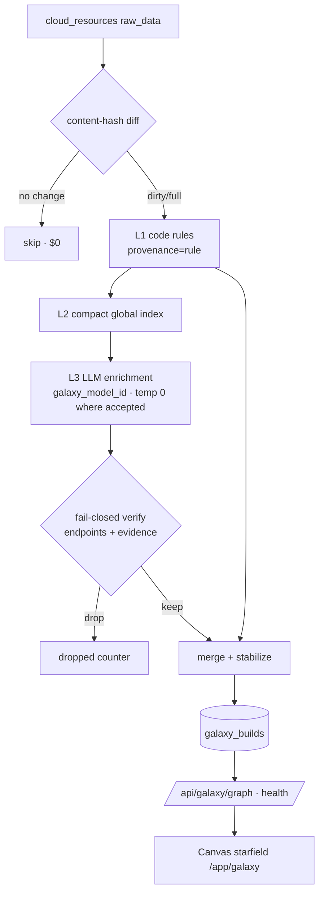

- **Content-hash incremental**: an hourly job hashes each resource (volatile fields stripped) and diffs against the last build. No change → exits in <1s at **$0** (no LLM call). Only changed resources are re-analyzed; unchanged resources carry forward their prior LLM edges. Steady-state cost ~$1–3/month vs $1,100+/month for naive hourly full rebuilds.
- **Triggers**: hourly `galaxy-auto-build` schedule · manual "Rebuild" button (`?full=true`) · post-scan hook (fault-isolated, best-effort).
- **Bounded storage**: only the newest `galaxy_builds_keep` (default 24) build rows are retained; each stores the full rule+llm graph blobs, so older rows are pruned after each successful build.

### Endpoints

| Endpoint | Purpose |
|---|---|
| `POST /api/galaxy/rebuild?full=` | Trigger a build (409 if one is running); runs off the event loop via `asyncio.to_thread` |
| `GET /api/galaxy/status` | Latest build: status, node/edge/dropped counts, cost, next auto-check |
| `GET /api/galaxy/overview` | (no page uses it since 2.6.1) Top layer: account + group nodes with resource counts, type distribution, health rollup |
| `GET /api/galaxy/expand?group=&types=&health=` | (no page uses it since 2.6.1) Drill into a group: member resource nodes + rule/llm edges (with provenance), health-colored, capped at `galaxy_expand_node_cap` |
| `GET /api/galaxy/graph` | Full slim payload (all nodes + rule/llm edges, health overlay) — feeds the client-side starfield layout; `built_at` says which build |
| `GET /api/galaxy/health[?at=]` | Health and «gone» of every resource, read apart from the build (NewUI polls it every 30 s); `at` = a moment of the last 24 hours (422 otherwise) |

Frontend (`pages/Galaxy.tsx`, **Experimental**): a **Canvas starfield** (d3-force, ~1300 nodes); a node's colour is the worst open issue anchored on it — `unknown` (*no alert ≠ healthy*) / `notice` / `warning` / `critical` —, an absent resource is greyed, llm edges are dashed. Click a node → a side panel; an issue → a dialog; «view raw_data» → a `JsonTree` panel. **Deep link**: `/app/galaxy?focus=<resource id>` (`12`, `R12`, `res:12`) centres one node — the local graph's «Open in Galaxy» lands here.

---

## Pull Connectors (K8s) & Webhook Intake Auth (MVP-2.6.1)

K8s objects are first-class inventory: a read-only pull connector writes them into `cloud_resources` (`provider=kubernetes`), and the Galaxy rule layer derives Deployment → Pod → Node edges from them. Nothing on this path calls an LLM.

```mermaid
flowchart LR
    SCH["k8s-discovery schedule<br/>(every 10 min)"] --> RUN["connectors/runner.run_connector"]
    CLI["aiops connectors run k8s"] --> RUN
    API["POST /api/connectors/k8s/run"] --> RUN
    RUN --> TGT["targets: EKS rows of enabled aws accounts<br/>+ kubernetes accounts"]
    TGT --> ENV["credentials/kube.kubectl_env_for_cluster<br/>target-account env + private kubeconfig"]
    ENV --> GET["kubectl get KIND -o json<br/>one call per kind, byte-capped"]
    GET --> ING["connectors/ingest.ingest<br/>upsert + absent_since + connector_runs"]
    ING -->|structure changed| GB["build_graph(k8s-discovery)<br/>rule-only, no LLM"]
```

- **What is collected**: Namespace, Deployment, StatefulSet, DaemonSet, Service, Ingress, Node, ConfigMap, Secret, PersistentVolumeClaim, PodDisruptionBudget, NetworkPolicy — plus owner-less (bare) pods as `K8s_Pod`. A pod that has an owner is only summarized into its workload's `pod_summary`.
- **Partial never deletes**: a kind whose `kubectl get` fails, times out, exceeds `k8s_connector_max_output_bytes` or returns no item list is *partial*; only a completely listed kind marks vanished objects `absent_since`. A cluster the AWS scan proved gone has its K8s rows marked absent by a tombstone target that runs no kubectl.
- **No secrets stored**: a Secret row keeps only its `type`, a ConfigMap only its key names and a hash, and no object keeps its annotations.
- **Credentials**: see *Unified exec entry* above. The in-cluster chaos-lab account registers its service-account kubeconfig; that RBAC grants no read on secrets, so its Secret kind stays partial by design.
- **See it**: `aiops connectors list` (switch, schedule, recent runs) · `aiops connectors run k8s [--account NAME]` (exits 1 unless the result is complete or partial) · `GET /api/connectors` · Settings → General → **Pull connectors** (switch, schedule, Running badge, **Run now**, the newest runs with their counts and error). With `k8s_connector_enabled: false` no schedule is seeded and a run answers `disabled`.

### Webhook intake auth

With `AIOPS_WEBHOOK_SECRET` set, `POST /api/webhooks/alert[/{source}]` takes the shared token as `Authorization: Bearer <token>`, `X-AIOps-Token: <token>` or `?token=<token>` — or an HMAC: `X-AIOps-Timestamp: <unix seconds>` + `X-AIOps-Signature: sha256=<hex HMAC-SHA256 of timestamp + "." + body>`, within `intake_signature_window_seconds` (300); anything else is 401. With sign-in on, only those two POSTs pass the middleware to this check (decided on the routed path, never the `Host` header). Unset, intake is unchecked and a startup WARNING says so.

```yaml
# Alertmanager
receivers:
  - name: agenticops
    webhook_configs:
      - url: http://<agenticops>:8000/api/webhooks/alert/prometheus
        http_config:
          authorization:
            credentials: <AIOPS_WEBHOOK_SECRET>
```

SNS (CloudWatch alarms) cannot set headers: put `?token=<AIOPS_WEBHOOK_SECRET>` in the subscription URL. It will show up in access logs, so use a header wherever the sender allows one.

**Identity hints**: parsers fill only what the source itself carries — `hints` (account / region / cluster / namespace / workload / pod / service), `observed_at` (the source's fault time, UTC) and `alarm_name` — and `alert_processor` hands them to the Signal Gate unchanged. Prometheus' `service` label is not a hint (it is usually the scrape target's Service); CloudWatch K8s hints come only from `ContainerInsights` dimensions, and its region only from `AlarmArn`.


---

## Clearing Every Issue — `aiops delete issues --all` (MVP-2.9.0)

For starting the issue list over (the owner's reset of 2026-11-23). It deletes every issue **and everything keyed by an
issue number**, because SQLite reuses ids: once the table is empty the next issue is I#1 again, and any diagnosis, fix
plan, run, timeline event, signal, recorded step, «later», chat binding, ITSM link or case record left behind would
quietly belong to the new I#1.

```bash
aiops service stop                                    # it refuses while another AgenticOps process holds the lock
aiops delete issues --all --dry-run                   # rows per table, nothing changed
aiops delete issues --all --yes --reset-poll-cursors --move-knowledge
```

| | |
|---|---|
| Refused (nothing done) | without `--yes` (a dry run needs none); a database that is not SQLite; another process holding `<data_dir>/.scheduler.lock` — and no migration runs before these checks and the backup |
| Backup first | an online backup (SQLite backup API — the database runs in WAL mode, the `.db` file alone is not a full copy) to `<data_dir>/backups/pre-delete-issues-<UTC>.db`, checked (integrity, same issue count) before anything is deleted |
| Deleted, in ONE transaction | every row keyed by an issue number: `agent_steps` / `attention_snoozes` of `I…`, the issues' and fix plans' `itsm_links`, fix plans (`plan_kind='fix'`) and their runs, every RCA result, the issues' timeline (notes included), every signal (old ones would make re-detected signals noise), case and SOP records made from an issue, the issues; the vectors of the cases / SOPs from issues (their files move into `<backup>-knowledge/` with `MANIFEST.tsv`) |
| Kept | change requests with their plans, runs and timeline; `audit_logs` and the command ledger; inventory, graph, security snapshots, reports, accounts, users, schedules, settings. A chat bound to an issue stays, unbound from it — its account binding stays |
| `--reset-poll-cursors` | the security poll's cursors go: its next run backfills 24 hours (older GuardDuty / CloudTrail findings do not come back) |
| `--move-knowledge` | moves everything learned into `<backup>-knowledge/` (with `MANIFEST.tsv`), never deletes it: every KB case and SOP file (re-embed after putting them back) and the agent memories from an issue (`related_issue_id`, `detect/auto_*`); `--memory-dir DIR` adds another checkout's `agent-memory` |

There is no Web API, Web UI or agent tool for it — an administrator runs it in a terminal. To re-scan, hold the automatic steps off (`AIOPS_AUTO_RCA_ENABLED`, `AIOPS_AUTO_FIX_ENABLED`, `AIOPS_EXECUTOR_AUTO_APPROVE_L0_L1`, `AIOPS_EXECUTOR_ENABLED`, `AIOPS_NOTIFICATIONS_ENABLED` = `false`) and run in order `aiops run schedule resource-scan`, `aiops run schedule galaxy-auto-build` (with the model — not cheap after a fresh scan), `aiops run schedule security-posture-snapshot`, `aiops run detect`, `aiops run schedule security-incremental-poll`. Numbers from the real runs: [E2E report](MVP-2.9.0-E2E-REPORT.md) «问题清零».
the automatic steps off while it runs (`AIOPS_AUTO_RCA_ENABLED`, `AIOPS_AUTO_FIX_ENABLED`,
`AIOPS_EXECUTOR_AUTO_APPROVE_L0_L1`, `AIOPS_EXECUTOR_ENABLED`, `AIOPS_NOTIFICATIONS_ENABLED` = `false`) and run, in
order: `aiops run schedule resource-scan`, `aiops run schedule galaxy-auto-build` (an incremental build WITH the model —
after a fresh scan most content hashes change, so it is not cheap: $10.15 on the preview with Fable 5.2; the reset itself
used a rule-only refresh, `galaxy.builder.build_graph("k8s-discovery", llm=False)`, which has no CLI),
`aiops run schedule security-posture-snapshot`,
`aiops run detect`, `aiops run schedule security-incremental-poll`. The poll queries CloudTrail once per high-risk event name (N33,
2026-11-24 — before, it paged every management event of the window, and CloudTrail's one-hour pagination tokens made a
busy region fail and start over); after a cursor reset its time goes into feeding the signals through the Signal Gate
(about an hour for ~3,600–5,400 signals). Detection runs read-only in code (N31, as diagnosis and planning since N30), each account's worker bound to that account
(N32: it lists only its account's resources, and the issues it opens carry the account).

---

## CLI Slash Command Quick Reference

| Command | Purpose |
|---------|---------|
| `/help [topic]` | Show all commands |
| `/account list\|show <name>` | Registered accounts; `/account activate\|deactivate <name>` enables / disables one |
| `/context account <name>` · `/context reset` | Work in one account · back to the defaults (`/context` shows it) |
| `/scan [--services SVC]` | Trigger resource scan |
| `/detect [SCOPE]` | Trigger health detection |
| `/issue list\|show <id>` | Health issues |
| `/analyze <ID>` | Show the issue's details |
| `/fix list` · `/fix show <plan_id>` | Fix plans |
| `/approve <plan_id\|C<id>> [reason]` | Approve a fix plan or a change, as `cli:<user>` |
| `/execute <plan_id\|C<id>>` | Run an approved fix plan, or retry a change whose run was not queued |
| `/accept <I<id>\|C<id>> yes\|no <reason>` | Accept or reject a run pending acceptance |
| `/change <description> [--account NAME]` · `/changes [STATUS]` · `/reject C<id> <reason>` | Open, list, reject change requests |
| `/run <description>` | Run a one-shot task now |
| `/schedule list\|run <name>` | Schedules |
| `/skill …` | Skills |
| `/session list\|resume\|rename\|pin\|star\|archive` | Conversations (DB-backed) |
| `/report list` | List reports |
| `/channel list\|show\|test\|set` | Manage notification channels (YAML-backed) |
| `/send_to <target> <content>` | Send content to channel or IM alias |
| `/model [agent] [alias]` | Switch an agent's model (`/model reset`) |
| `/output json` | Switch to JSON output |
| `/pager auto` | Auto-paginate long output |
| `/exit` | Exit chat |
| `/account list` | List AWS accounts |
| `/account set <name>` | Switch active account |
| `/scan [region\|all]` | Trigger resource scan |
| `/detect [region\|all]` | Trigger health detection |
| `/issues` | List all health issues |
| `/issue <ID>` | Show issue details |
| `/analyze <ID>` | Trigger RCA |
| `/fix list` | List fix plans |
| `/approve <ID>` | Approve fix plan |
| `/execute <ID>` | Execute fix plan |
| `/accept <I<id>\|C<id>> yes\|no <reason>` | Accept or reject a run pending acceptance |
| `/report list` | List reports |
| `/context set <key> <val>` | Set chat context |
| `/channel list\|show\|test\|set` | Manage notification channels (YAML-backed) |
| `/send_to <target> <content>` | Send content to channel or IM alias |
| `/output json` | Switch to JSON output |
| `/pager auto` | Auto-paginate long output |
| `/exit` | Exit chat |

---

## API Quick Reference (curl)

```bash
BASE=http://localhost:8000/api

# Health check
curl $BASE/health

# Overview stats
curl $BASE/stats

# List resources
curl "$BASE/resources?type=ec2&region=us-east-1&limit=20"

# List issues
curl "$BASE/health-issues?severity=critical&status=open,investigating&limit=10"

# Create chat session (with auth on it is private to you — MVP-2.7.0; others get 404)
curl -X POST $BASE/chat/sessions -H 'Content-Type: application/json' \
  -d '{"title": "My Session"}'

# Share it with the workspace (only its owner or an admin may change visibility)
curl -X PATCH $BASE/chat/sessions/{id} -H 'Content-Type: application/json' \
  -d '{"visibility": "workspace"}'

# Send message (SSE stream)
curl -N -X POST $BASE/chat/sessions/{id}/messages \
  -H 'Content-Type: application/json' \
  -d '{"content": "check health of EC2", "client_message_id": "<uuid>"}'   # a repeat with the same id replays

# Switch this session's model (per-session; "" = Auto, follow global)
curl -X PATCH $BASE/chat/sessions/{id} \
  -H 'Content-Type: application/json' \
  -d '{"model_id": "global.anthropic.claude-opus-5"}'

# Attach files (2026-11-07): upload each, wait until processed, send their ids with the message
curl -X POST $BASE/chat/attachments -F "file=@/tmp/dashboard.png"     # → 201 {"id": "…", "status": "processing"}
curl $BASE/chat/attachments/{attachment_id}                            # → "status": "ready" | "failed" (+ reason)
curl -X POST $BASE/chat/sessions/{id}/messages \
  -H 'Content-Type: application/json' \
  -d '{"content": "what changed on this dashboard?", "client_message_id": "<uuid>", "attachment_ids": ["…"]}'
curl "$BASE/chat/attachments/{attachment_id}/content?variant=thumb"    # original | preview | thumb | page-N

# One-request form (still works): the files are staged and processed inside the request
curl -X POST $BASE/chat/sessions/{id}/messages \
  -F "content=analyze this screenshot" -F "client_message_id=<uuid>" \
  -F "file=@/tmp/dashboard.png"

# Chat upload limits (admin when auth is on; every change audited)
curl $BASE/settings/chat-upload
curl -X PATCH $BASE/settings/chat-upload -H 'Content-Type: application/json' \
  -d '{"max_files": 10, "allowed_extensions": [".pdf", ".png", ".xlsx"]}'
curl -X DELETE $BASE/settings/chat-upload                              # back to settings.yaml defaults

# Approve fix plan — quote the content_hash you reviewed (GET /fix-plans/{id}); 409 if it changed since
curl -X PUT $BASE/fix-plans/{id}/approve -H 'Content-Type: application/json' \
  -d '{"content_hash": "<content_hash>", "reason": "reviewed the steps and the rollback"}'

# Get network topology
curl "$BASE/graph/vpc/{vpc_id}/enriched?region=us-east-1"

# Detect single points of failure
curl "$BASE/graph/vpc/{vpc_id}/spof?region=us-east-1"

# List messaging channels (alert/chat routing)
curl $BASE/messaging/channels

# Test a messaging channel
curl -X POST $BASE/messaging/channels/feishu-ops/test

# List IM aliases
curl $BASE/im-aliases

# Submit webhook alert (Prometheus format)
curl -X POST $BASE/webhooks/alert/prometheus -H 'Content-Type: application/json' \
  -H "X-AIOps-Token: $AIOPS_WEBHOOK_SECRET" \
  -d '{"alerts":[{"status":"firing","labels":{"alertname":"KubePodOOMKilled"}}]}'

# Pull connectors: recent runs, run K8s discovery now
curl "$BASE/connectors?limit=5"
curl -X POST $BASE/connectors/k8s/run

# RCA root-cause location: judge it; quality over the last 30 days
curl -X POST $BASE/health-issues/{id}/rca-feedback -H 'Content-Type: application/json' \
  -d '{"location_verdict": "correct"}'
curl "$BASE/rca/location-stats?days=30"

# Import skills from a URL / git repo / archive — everything lands as a draft
curl -X POST $BASE/skills/import-source -H 'Content-Type: application/json' \
  -d '{"uri": "git+https://github.com/org/skills.git@main#skills", "names": ["log-triage"]}'

# Cloud Security Review summary (per-account scores, reachable paths, open findings)
curl $BASE/security/summary
```

---

## RCA Topology Evidence & Root-Cause Location (MVP-2.6.1)

RCA reads the published relation graph on demand and names *where* the root cause is, not only *what* it is. The graph side is deterministic (no LLM); the location is checked against the database before it is stored, and nothing downstream acts on it.

```mermaid
flowchart LR
    RCA["RCA agent"] -->|get_topology_evidence| EV["graph/evidence.build_evidence"]
    EV -->|K8s anchor, cluster collected too long ago| RC["one bounded K8s connector run<br/>(trigger rca) + rule-only refresh"]
    EV --> PACK["edges + direction · neighbors' issues / signals / changes<br/>· ranked candidates + reasons · evidence refs"]
    PACK --> RCA
    RCA -->|save_rca_result location| VAL["services/rca_location.validate_location<br/>fail-closed"]
    VAL --> ST["location_status<br/>valid / partial / invalid / absent"]
    HUMAN["human"] -->|rca-feedback location_verdict| ST
    ST --> STATS["GET /api/rca/location-stats"]
```

- **The evidence pack** (`get_topology_evidence(issue_id)`): the anchor, the rule / observed edges around it with direction labels, each neighbour's open issues, signals and changes inside the RCA window, and deterministic root-cause candidates with reasons (a container anchor — cluster, namespace, network — ranks last). Every edge and node has an evidence ref (`graph:edge:<src>><dst>:<type>`, `graph:node:<ref>`) the RCA cites as type `graph`. `freshness: stale` = the graph may lag; `truncated: true` = a missing neighbour proves nothing; `available: false` says why, never «no problem».
- **Recollect before reading**: a K8s anchor whose cluster was collected more than `rca_k8s_recollect_min_age_seconds` (120) ago, or before the issue's onset, gets one bounded K8s connector run (trigger `rca`) and, if the structure changed, a rule-only graph refresh; failure marks the evidence `stale`.
- **The location** (`save_rca_result(..., location=…)`): up to three ranked candidates plus a causal path. A candidate that is not an inventory row of the issue's account, or an evidence label not of this RCA, is dropped; one path edge that is not a relation of the cited build drops the path. Result: `valid` / `partial` / `invalid` (the RCA is still saved) / `absent`. **Observed only**: the critic, the gate and auto-fix never read it.
- **Self-grounding**: the evidence check never counts `save_rca_result`'s own input as tool output.
- **Human verdict + stats**: `POST /api/health-issues/{id}/rca-feedback` takes `verdict` and / or `location_verdict` (`correct` / `partial` / `incorrect`; the judge is the session actor; 409 when there is no location to judge). `GET /api/rca/location-stats?days=30`: status counts, `top1` = correct / judged, the anchoring rate. On the web: *Your verdict* on Issue Detail ① and the **RCA root-cause location** card in Agent Metrics.
- **Policy blast radius (shadow)**: `estimate_blast_radius` = how many resources depend on the target in the published graph (downstream, rule relations, ≤ 3 hops). With `policy_graph_impact_enforce: false` (default) it is only recorded as `shadow_blast_radius`; `true` feeds `blast-radius-escalation`.
- **Gate**: `rca_topology_context_enabled` — off means RCA sees neither the tool nor its prompt section.
- **Eval**: 13 chaos cases with declared ground truth, run once with the gate off and once with it on (AC@1 / AC@3 / MRR, `located`, graph recall). See *Chaos E2E Runbook* below and the [report](MVP-2.6.1-LOCATION-EVAL-REPORT.md).

---

## Issue & Change Logic (MVP-2.6.1)

What a plan is, who may move an issue, and when a run counts as done. All of it is code — no LLM decides a status or a verdict.

- **One status write path**: `services/issue_state.transition_issue(session, issue_id, new, actor=, reason=, expected=)` is the only writer of `HealthIssue.status` — edge check, `UPDATE … WHERE status=:expected` (0 rows → 409) and a `status_changed` event in the caller's transaction (`tests/test_issue_status_writes.py`). A failed fix goes back to `root_cause_identified`. The agent tool `update_health_issue_status` never moves an issue into or out of the three fix statuses — the approval, the run and the acceptance do.
- **Dismissed**: a repeat of a dismissed fingerprint still merges into it (that is how a false positive stays quiet — `SUPPRESSING_ISSUE_STATUSES`), but dismissed is not open (`OPEN_ISSUE_STATUSES`: gray-zone candidates, open counts, node colours, re-anchoring).
- **Plan version + content hash**: `content_hash` = sha256 over what a run would do — steps, rollback, pre / post checks, target account, risk level — on the content as stored; a changed hash bumps `plan_version` (`I#<n> fix plan v<N>`, `C#<n> implementation plan v<N>`). Approval quotes the hash the approver saw (422 without, 409 «reload» when it changed) and records `approved_hash` / `approved_version`. No path approves the plan of a closed issue or runs one whose issue does not wait for it; a plan changed after approval is aborted and withdrawn.
- **A change request's own steps**: `proposed_steps` (`[{action, command}]`, ≤ 50) and `external_ref` (`{system, ticket_id, url?, requested_by?}`) ride on `POST /api/changes`, the `request_change` tool and intake. The SRE review validates the steps instead of writing its own; code stores `steps_diff` (added / removed / modified / unchanged, by command). A blocked-tier command in the proposed or the planned steps rejects the request (`policy_rule=blocked_command`).
- **External intake** (`POST /api/changes/intake`): 404 until `AIOPS_CHANGE_INTAKE_SECRET` is set. The raw body is signed like the alert webhook — `X-AIOps-Timestamp` + `X-AIOps-Signature: sha256=<hex HMAC-SHA256 of timestamp + "." + body>`, within `intake_signature_window_seconds` — else 401. The requester is `webhook:<external_ref.system>`, which never approves or executes (rbac `no-webhook-approve-or-execute`, even in shadow mode). A redelivery while the same ticket is open returns that request with 200. No UI: external systems call it; the request shows on the change pages.

```bash
BODY='{"title":"Tag web-1 Env=prod","description":"CHG0031: add the Env tag","account":"dev",
"target_hints":["i-0abc"],"proposed_steps":[{"action":"tag","command":"aws ec2 create-tags --resources i-0abc --tags Key=Env,Value=prod"}],
"external_ref":{"system":"servicenow","ticket_id":"CHG0031","url":"https://sn.example.com/CHG0031"},"requested_by":"carol"}'
TS=$(date +%s)
SIG=$(printf '%s.%s' "$TS" "$BODY" | openssl dgst -sha256 -hmac "$AIOPS_CHANGE_INTAKE_SECRET" | sed 's/^.* //')
curl -X POST http://localhost:8000/api/changes/intake -H "Content-Type: application/json" \
  -H "X-AIOps-Timestamp: $TS" -H "X-AIOps-Signature: sha256=$SIG" --data-binary "$BODY"
```

- **Intake limits** (known, not fixed): no nonce — a request can be replayed inside the window (dedup returns the open request; after it closed a replay opens a new one); the secret authenticates the caller, not the `system` it names; with `change_auto_approve_standard=true` a standard intake change runs with no human; use different `webhook_secret` and `change_intake_secret` values.
- **One verdict per run** (`services/verification.evaluate`, pure; `fix_executions.verification_status`). Business status, execution status and verdict are three facts; `failed` is not «rolled back», and a missing result is never a pass. A result counts only for the declared check its `check_id` names (`pc-1 … pc-n`, by position); `save_execution_result` refuses once a succeeded result that does not cover the checks one to one, then records `pending_acceptance`. Every run carries `post_check_binding`, shown as `pc-n` lines. A stale run never moves an issue that has moved off its fix.

| Verdict | When | Fix issue | Change request |
|---------|------|-----------|----------------|
| `passed` | the run succeeded and every declared post-check passed | `resolved` (`fix_executed` with `executor_auto_resolve=false`) | `completed` |
| `pending_acceptance` | succeeded, but no post-checks, a declared check with no result or more than one, a result for an undeclared check or without a `check_id`, the plan changed after approval, a warning, a step that did not report success, or a stop after the last step | `fix_executed` + `execution_pending_acceptance` notification | `needs_review` + `needs_review_reason` + the same notification |
| `failed` | the run did not succeed, or a post-check failed | `root_cause_identified`, the RCA disputed (not for a run that tried nothing, nor a stopped one) | `failed` / `rolled_back`; a succeeded run with a failed post-check → `needs_review` |

- **Human acceptance**: only a `pending_acceptance` run, with a reason, as the session actor, authorized as the plan kind's approval (`webhook:*` 403). «Accept this run» asks you to tick each check still to verify and the overall confirmation (the ticked `pc-n` go into the audit row). Accepting resolves the issue; rejecting sends it to `root_cause_identified` and disputes the RCA; a change goes through `resolve_review`. Only the latest run can be accepted (409 names it). Routes check 404 → 403 → state 409 → hash 409.

```bash
curl -X POST http://localhost:8000/api/fix-executions/42/accept -H "Authorization: Bearer $TOKEN" \
  -H "Content-Type: application/json" -d '{"decision":"accepted","reason":"checked the tag by hand"}'
# in aiops chat
/accept I17 yes checked the tag by hand        # the issue's latest run pending acceptance
/accept C5 no the tag went on the wrong instance   # a change's needs_review verdict
```

- **Main's read tools**: `get_plan(plan_id)` (either origin, any status: full text, version, hash, approval, rejection) and `get_execution_result(execution_id=, plan_id=)` (a run's step / check / rollback results, verdict and acceptance; `plan_id` = that plan's latest run); `get_change_request` returns the whole current plan, `proposed_steps`, `steps_diff`, `needs_review_reason` and the latest verdict. Main can explain why a run is pending; accepting it stays a human action.

### Issue & Change UI (MVP-2.6.1)

- **Navigation**: Issues, Plans & changes (fix plans, changes and audit as tabs), Resources; Signals at `/app/signals` (no sidebar entry). `/app/issues?view=resources|signals`, `/app/changes` and `/app/audit` redirect to their page or tab with `replace`, other parameters kept.
- **Work-item template** (Issue Detail and Change Detail):
  - **Status line** — the page's only status indicator: ref, title, status, the one reason (said here and nowhere else; while a run is `pending_acceptance` both pages show its `verification_reason`), who it waits on, and **one primary button**. Every other action is in the **⋯** menu, offered only when the server would accept it; a 409 / 403 appears under the line in the server's words.
  - **Primary button by state** (`lib/issuePhases` / `lib/changePhases`, the same function as the lists' «waits on»). Issue: RCA below the gate → **Review root cause**; no RCA or judged wrong → **Rerun RCA**; a gated RCA or a failed run → **Generate fix plan**; a plan waiting → **Approve & run**; run under way → none; approved but never queued → **Retry execution** (once the timeline shows the run did not start); pending acceptance → **Accept result**; passed but held, or closed without a verdict → **Mark resolved**. Change: draft → **Start review**; needs clarification → **Answer the reviewer**; planned → **Approve & run**; approved → **Retry execution**; needs review → **Mark completed**; ended badly → **Copy as new**.
  - **First screen** (above the cards): where the item stands, who it waits on and for how long (only while a person is waited on), the plan version; then the latest run against *its own* plan («Plan #id · vN · hash», whether it still matches the approval, one line per declared check — failed and to-check first) or, before any run, the diagnosis evidence: location, the model's own confidence, the critic and the human verdict as four lines. A fix plan's page has the same block and, while its issue waits for acceptance, a «Go accept this run» link.
  - **Phase cards** — a finished card folds to one sentence, the current one is open, a future one says who moves it; a failed one is red and open; a change that ended early ends its list at that card. **Expand all** opens every reached card. ① shows the confidence against `rca_min_confidence_for_autofix` (raw → evidence check ×0.6 → final; a refuted critic ×0.5), read from `GET /api/settings`.
  - **Your verdict** — four choices, one submit: root cause and location right / partly right / root cause wrong / not an issue; sent to `rca-feedback` then `feedback`; a choice that needs a valid location is greyed with the reason, and the last two need a note.
  - **Links** — the URL hash opens a card: `#diagnose` / `#plan` / `#run` / `#accept` / `#activity` (a change: `#request` / `#review` / `#plan` / `#run` / `#accept` / `#activity`); an old `?tab=` link is mapped once with `replace`.
- **Local graph** (`components/graph/LocalGraph.tsx`: Issue ① compact — one hop and the causal path, ≤ 15 nodes —, Resource Detail, Change ②) reads `GET /api/graph/focus`: rule relations solid, inferred ones dashed and hidden until asked, the RCA causal chain, merged signals, related issues; the blast-radius numbers are the API's; a keyboard list under the canvas.
- **Chat**: a bare `I#N` or `C#N` opens the context side panel (ESC closes); a change's plan is read-only there — approve and accept it on Change Detail.

---

## Configuration Quick Reference

All settings use env vars with `AIOPS_` prefix. Set via `.env` file or shell:

```bash
# Core — models live in config/settings.yaml (agent_*_model_id + the tier fallbacks) or Settings → Agent models;
# never pin one here: an AIOPS_* variable beats settings.yaml.
export AIOPS_BEDROCK_REGION="us-east-1"
export AIOPS_BEDROCK_MAX_TOKENS=16384
export AIOPS_BEDROCK_WINDOW_SIZE=40    # Sliding window conversation manager

# Auto-fix pipeline — defaults only: what an administrator saves in Settings → Automation and execution is
# stored and survives a restart. The environment can only make a process stricter: false here (true for
# EXECUTOR_HITL_ENABLED) holds the switch there whatever is stored; Settings shows it disabled.
export AIOPS_EXECUTOR_ENABLED=true              # Enable fix execution (default: true)
export AIOPS_AUTO_RCA_ENABLED=true              # Auto-trigger RCA on new issue (default: true)
export AIOPS_AUTO_FIX_ENABLED=true              # Auto-fix pipeline master switch (default: true)
export AIOPS_EXECUTOR_AUTO_APPROVE_L0_L1=true   # Auto-approve low-risk plans (default: true)
export AIOPS_NOTIFICATIONS_ENABLED=true         # Auto-notify on pipeline events (default: true)

# Agent runtime (Strands 1.64)
export AIOPS_STRANDS_CONTEXT_MANAGER_AUTO=true      # Offload oversized tool results, keep a preview (default: true)
export AIOPS_CONTEXT_OFFLOAD_MAX_RESULT_TOKENS=1500 # Results above this are offloaded (retrieve_offloaded_content)
export AIOPS_CONTEXT_OFFLOAD_PREVIEW_TOKENS=750     # Head of the result kept in context

# Features
export AIOPS_SKILLS_ENABLED=true       # Enable agent skills (default: true)
export AIOPS_EMBEDDING_ENABLED=true    # Enable vector embeddings (default: true)
export AIOPS_K8S_CONNECTOR_ENABLED=true # K8s pull connector + k8s-discovery schedule (default: true)

# Web & Auth
export AIOPS_CORS_ORIGINS="http://localhost:3000,https://myapp.example.com"
export AIOPS_API_AUTH_ENABLED=false     # API key auth middleware (default: false)
export AIOPS_WEBHOOK_SECRET=YOUR_SECRET # Alert-webhook token (Bearer / X-AIOps-Token / ?token= / HMAC); unset = unchecked
export AIOPS_DATABASE_URL="sqlite:///path/to/agenticops.db"

# IM Bot
export AIOPS_FEISHU_WS_ENABLED=true    # Feishu WebSocket long connection (default: false; an enabled Feishu channel starts it anyway)
```

---

## Closed-Loop Validation

### Running Validation

```bash
# Run all 10 cases sequentially on EKS Lab
cd infra/eks-lab/scenarios
AGENTICOPS_URL=http://localhost:8000 bash run-all-scenarios.sh

# Run individual case
bash case-1-oom/inject.sh && bash case-1-oom/verify.sh

# Run Phase 1 only (Cases 1-3)
AGENTICOPS_URL=http://localhost:8000 bash run-phase1.sh

# Run Phase 2 only (Cases 4-10)
AGENTICOPS_URL=http://localhost:8000 bash run-phase2.sh
```

### Validation Results (2026-03-06)

All 10 cases passed 5/5 on EKS Lab (`agenticops-lab`, ap-southeast-1):

| Case | Scenario | Score | MTTR |
|------|----------|-------|------|
| 1 | OOM Kill (adservice) | 5/5 | 5m 34s |
| 2 | Bad Image (productcatalog) | 5/5 | 6m 38s |
| 3 | Redis Crash (redis-cart) | 5/5 | 7m 3s |
| 4 | Node DiskPressure | 5/5 | 8m 41s |
| 5 | Pod Pending (CPU exhaustion) | 5/5 | 7m 30s |
| 6 | Unhealthy Targets (readiness) | 5/5 | 5m 24s |
| 7 | CoreDNS Down | 5/5 | 4m 42s |
| 8 | PVC Pending (wrong SC) | 5/5 | 6m 38s |
| 9 | HPA Maxed Out | 5/5 | 4m 7s |
| 10 | Service Crash (cartservice) | 5/5 | 6m 24s |

**Acceptance criteria**: auto-fix ≥7/10 ✅, detect ≤3min ✅, resolve ≤10min ✅, cost ≤$3/cycle ✅

### Case Documentation

Each case is documented in `docs/cases/case-N-*.md` with:
- Fault description (type, severity, target)
- Injection script and key commands
- Expected alert flow and pipeline flow
- Expected fix (command, risk level)
- Actual metrics (detection latency, MTTR, cost)

---

## Chaos E2E Runbook

The **EKS Chaos E2E Harness** validates the AgenticOps 感知→分析→解决→记录 loop end-to-end by injecting faults on the `agenticops-chaos-lab` EKS cluster (us-east-1) and asserting that the system perceives, analyzes, resolves, and records each scenario without human intervention.

### Prerequisites
- `kubectl` context set to `agenticops-chaos-lab`
- AWS CLI configured for the lab account
- Python with `requests`, `pyyaml`, `pytest`

### Deploy the App In-Cluster
```bash
cd infra/eks-chaos-lab/agenticops
bash deploy-app.sh --admin-password YOUR_PASSWORD --webhook-secret YOUR_SECRET
```
The app runs as a ClusterIP Service — never exposed publicly.

### Run the E2E Suite
From the remote server (with network access to the cluster):
```bash
cd infra/eks-chaos-lab/e2e
export AIOPS_ADMIN_PASSWORD=YOUR_PASSWORD
export AIOPS_WEBHOOK_SECRET=YOUR_SECRET     # same value as deploy-app.sh --webhook-secret

# All scenarios (6 assert + 2 evidence)
bash run-e2e.sh

# Deterministic pass/fail only
bash run-e2e.sh --assert-only

# Chat + report capture only
bash run-e2e.sh --evidence-only

# Root-cause location eval, one batch per run (off, then on; ~1¾ h each)
LOCATION_BATCH=off bash run-e2e.sh --location-only
LOCATION_BATCH=on  bash run-e2e.sh --location-only
```

### Interpret Results
- **JUnit XML**: `results/junit.xml` — standard CI artifact
- **Evidence**: per-scenario snapshots (chat transcripts, cluster state, report PDFs) under `results/`
- **Four phases asserted** (assert mode):
  - **感知 (Perceive)**: HealthIssue matching the scenario appears
  - **分析 (Analyze)**: RCAResult attached
  - **解决 (Resolve)**: issue → `resolved`, FixPlan executed, cluster end-state fixed
  - **记录 (Record)**: pipeline timeline contains fix/resolve events
- **Location eval**: `results/location-<utc>.json` per batch; `python location_eval.py <off>.json <on>.json` prints the tables for the [report](MVP-2.6.1-LOCATION-EVAL-REPORT.md)

### Safety Guarantees
- App is ClusterIP-only; sole ingress is the `kubectl port-forward` tunnel opened by `run-e2e.sh`.
- Every scenario restores on teardown; `restore-all.sh` runs unconditionally (trap EXIT).

**Full harness docs**: [infra/eks-chaos-lab/e2e/README.md](../infra/eks-chaos-lab/e2e/README.md)

---

## Deployment

### Docker (推荐)

AgenticOps 以单一 Docker Image 交付，包含全部运行时依赖。

```mermaid
flowchart LR
    BUILD["docker build<br/>-f docker/Dockerfile"] --> IMAGE["agenticops:tag"]
    IMAGE --> ECR["AWS ECR"]
    ECR --> EC2["EC2<br/>docker run"]
    ECR --> ECS["ECS Fargate<br/>Task Definition"]
    ECR --> EKS["EKS<br/>K8s Deployment"]
```

**Quick Start (本地测试)**:
```bash
docker build -f docker/Dockerfile -t agenticops:latest .
docker run --rm -p 8000:8000 \
  -e AIOPS_ADMIN_PASSWORD=test123 \
  -e AIOPS_BEDROCK_REGION=us-east-1 \
  agenticops:latest
# → http://localhost:8000
```

### Terraform IaC

三种部署模式，每种独立一个 Terraform root module：

| 模式 | 路径 | 适用场景 |
|------|------|----------|
| **EC2** | `iac/ec2/` | 单实例，最简单，开发/小团队 |
| **ECS** | `iac/ecs/` | Fargate 无服务器，自动伸缩 |
| **EKS** | `iac/eks/` | 已有 K8s 集群，大规模 |

**共享模块** (`iac/modules/`): ecr, vpc, alb, rds, iam, dns

**部署流程 (EC2 为例)**:
```bash
cd iac/ec2
cp terraform.tfvars.example terraform.tfvars
# 编辑: region, admin_password, acm_cert_arn

terraform init
terraform apply -target=module.ecr -auto-approve   # 1. 创建 ECR
# docker build + push                              # 2. 推送镜像
terraform apply -auto-approve                      # 3. 部署全部基础设施
```

**Bring Your Own**:
- `vpc_id` — 使用已有 VPC（空=创建新的）
- `acm_cert_arn` — 使用已有 ACM 证书（空=自动申请）
- `eks_cluster_name` — 部署到已有 EKS 集群
- `alb_internal = true` — 仅 VPC 内网访问

详细说明见各模块 README: `iac/ec2/README.md`, `iac/ecs/README.md`, `iac/eks/README.md`
